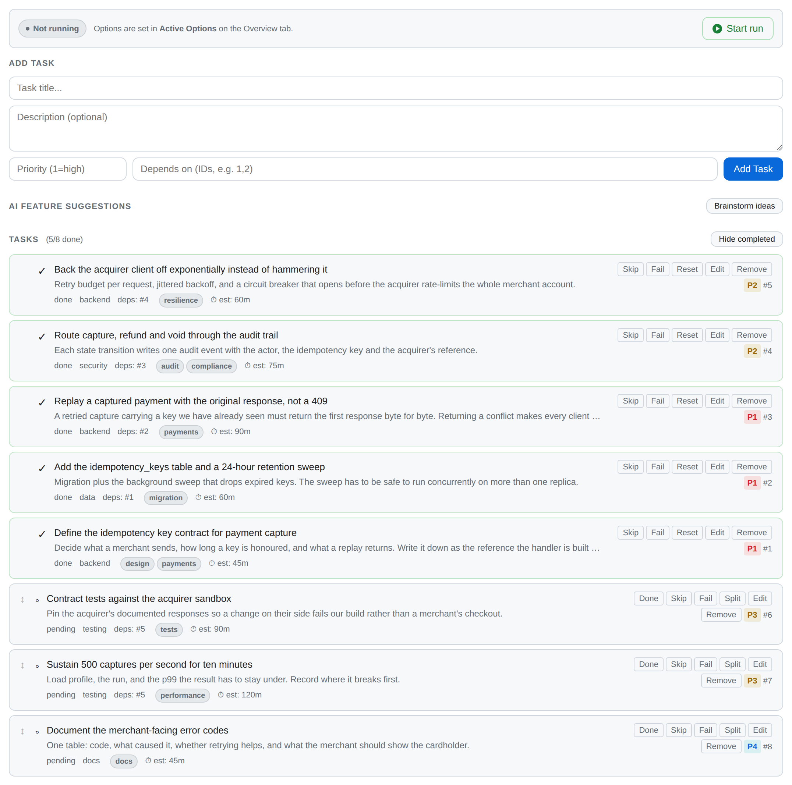

# cloop

[](https://github.com/blechschmidt/cloop/actions/workflows/ci.yml)
[](https://blechschmidt.github.io/cloop/)

cloop builds software for you with AI coding agents. You tell it what you want:
a one-line goal, a list of tasks, or a written specification. cloop splits the
work into tasks and hands them, one after another, to a coding agent such as
Claude Code, which writes the code in your repository and runs your tests.
cloop keeps track of every task and its outcome, retries what fails, and keeps
going until the job is done.

You can read the task list before anything runs, change it while cloop is
working, and look up afterwards what was done for each task.

📖 **[Documentation](https://blechschmidt.github.io/cloop/)** ·
[Getting started](https://blechschmidt.github.io/cloop/docs/getting-started/installation/) ·
[How it works](https://blechschmidt.github.io/cloop/docs/getting-started/concepts/)

## Quick start

```bash
go install github.com/blechschmidt/cloop@latest

cd ~/src/my-project
cloop init "Add a health check endpoint to the HTTP server"
cloop run
```

If you don't have Go installed, download a static binary for Linux or macOS
from the [latest release](https://github.com/blechschmidt/cloop/releases/latest).
[Installation](https://blechschmidt.github.io/cloop/docs/getting-started/installation/)
has a one-line installer that checks the download for you.

`cloop init` saves the goal. `cloop run` first asks the model to turn it into a
plan:

```
Task Plan (3 tasks):
  1. [P1] Add a /healthz handler returning 200 and a JSON body
  2. [P2] Write a table-driven test for the /healthz handler
  3. [P3] Document the endpoint in the README
```

Then it works through the tasks in priority order. For each one it starts the
agent with the goal, the task and a summary of what has been done so far. The
agent changes the code and runs the tests, and cloop records the result before
it starts the next task.

While it runs, these commands show you where things stand:

```bash
cloop status     # the goal and how far the plan has got
cloop task list  # every task and its status
cloop log        # what the agent did, step by step
cloop ui         # the same in a web dashboard, updated live
```

[Your first project](docs/getting-started/first-project.md) goes through a
first run in more detail, including what to do when a task fails.
[The dashboard walkthrough](docs/getting-started/walkthrough.md) shows the same
in the browser, with screenshots.

### Starting from a specification

If you already have a specification, cloop can turn it into requirements and
plan the work from those instead of from a one-line goal:

```bash
cloop init "Build the order service described in spec.md"
cloop requirements draft --from-file spec.md   # the model proposes testable requirements
cloop requirements approve --all-drafts        # once you have reviewed and edited them
cloop requirements plan                        # plan the tasks that meet them
cloop requirements gate linked                 # count a task as done only when its requirements pass
cloop run
```

Each planned task is linked to the requirements it is meant to meet, and the
agent gets those requirements as its acceptance criteria.
[Requirements](docs/guides/requirements.md) explains the details, including how
to keep requirements in the repository as `.cloop/requirements.yaml`.

### Requirements

- **Go 1.26 or later** to build it (`go.mod` pins the toolchain).
- **A model provider.** The default is the
  [Claude Code](https://claude.com/claude-code) CLI: `claude` must be on your
  `PATH` and signed in. The Anthropic and OpenAI providers only need an API
  key, and Ollama needs nothing.

To build from source:

```bash
git clone https://github.com/blechschmidt/cloop.git
cd cloop && go build -o cloop .
```

## What cloop does

**It plans.** A goal becomes a list of 5 to 15 concrete tasks, each with a
priority and the tasks it depends on. You can also write the tasks yourself
(`cloop task add`), start from a template (`cloop init --template`), or import
them from a Jira, Linear or GitHub Issues export (`cloop import`).

**It builds.** Each task goes to a coding agent that works directly in your
repository and reports at the end whether the task is done, failed or not
applicable. Tasks that don't depend on each other can run in parallel, each in
its own git worktree.

**It handles failures.** When a task fails, cloop works out what went wrong and
retries it with an adjusted prompt. After three failures in a row it stops the
run, so that a broken plan doesn't burn through your budget.

**It checks the work against your specification.** You can write requirements
for the project, each with an optional test command, or let cloop draft them
from a specification document. Tasks can be linked to the requirements they
implement, and with the requirements gate switched on, a task only counts as
done once those requirements pass their tests.

**It keeps going.** With `--auto-evolve`, cloop suggests new tasks once the plan
is finished and works on them as well. They are added to the plan like any
other task, so you can review or delete them.

**It picks up where it left off.** The plan and every task's result are stored
in `.cloop/state.db`. If you stop a run with Ctrl+C, the next `cloop run`
continues from the task it was working on.



## Providers

Choose one with `--provider`, or set a default with
`cloop config set provider <name>`.

| Provider | What it is | Sign-in |
| --- | --- | --- |
| `claudecode` | the Claude Code CLI (default) | an existing `claude` login |
| `copilot` | the GitHub Copilot CLI | an existing `copilot` login, or `COPILOT_GITHUB_TOKEN` |
| `anthropic` | the Anthropic API | `ANTHROPIC_API_KEY` |
| `openai` | Chat Completions, including OpenAI-compatible endpoints | `OPENAI_API_KEY` |
| `ollama` | a local Ollama server, free to use | none |

`cloop providers --test` shows which providers are configured and whether they
respond. For tests and CI there is also a `mock` provider that never touches
the network.

[Choosing and configuring a provider](docs/getting-started/providers.md)
explains how cloop decides which provider and model to use, and which
environment variables override what.

## Documentation

The documentation is published at
**[blechschmidt.github.io/cloop](https://blechschmidt.github.io/cloop/)**. Its
source is in [`docs/`](docs/README.md).

| | |
| --- | --- |
| **[Getting started](docs/getting-started/README.md)** | installing cloop, a first project, how the task loop works, providers, and the web dashboard |
| **[Component and security architecture](docs/architecture/README.md)** | an overview of the whole system: the processes, what each package does, how a run travels from **Start** to a commit, and how the security pieces fit together |
| **[Executor architecture](docs/architecture/executors.md)** | how a task gets from the hub to a sandbox and back: the four backends, how a machine is chosen, health checks, failover, and enrolling remote machines |
| **[Security model](docs/security/model.md)** | the trust boundaries, why the hub never runs agents on its own host, sign-in and roles, and which test checks each guarantee |
| **[Threat model](docs/security/threat-model.md)** | the threats at each boundary, what stops them, and the risks that remain |
| **[Secrets and egress](docs/guides/secrets.md)** | giving a task access to a GitHub repository, a token, a kubeconfig, a registry login or the Internet, for a limited time |
| **[Git interception proxy](docs/git-interception-proxy.md)** | letting a sandbox push to some branches but not others, without giving it the token |
| **[Kata Containers](docs/guides/kata.md)** | running each sandbox in its own lightweight VM |
| **[Operator runbook](docs/operations/runbook.md)** | backups, restores, audit checks, key rotation, upgrades, rollbacks and what to do in an incident |
| **[Command reference](docs/reference/commands.md)** | every command and flag |
| **[Configuration reference](docs/reference/configuration.md)** | every `.cloop/config.yaml` key |
| **[Per-project sandbox](docs/reference/sandbox.md)** | `.cloop/sandbox.yaml`: the image, setup steps, resource limits and mounts for a project's tasks |
| **[Deployment](deploy/README.md)** | the container image, a docker-compose stack for trying cloop out, and the Helm chart |

`cloop <command> --help` covers everything else.

## Running cloop for a team

So far everything runs as one process on your machine. cloop can also run as a
shared server, the hub, that a team signs in to with single sign-on. The hub
doesn't run agents on its own machine. Tasks run in containers, on other
machines you enroll as executors (an edge device or a build server, say), or as
Kubernetes Pods. Agents only get the access you grant to their project, such as
push access to particular branches of a GitHub repository, read access to one
Kubernetes namespace, or a connection to the Internet, and every grant can
expire. For GitHub and Kubernetes the hub can keep the real credential to
itself and put a proxy in front of it, so the agent never holds the token. A hub
can also connect to your Confluence and Jira so that agents can look up what
your team has written down.

To set up a hub:

```bash
cloop hub bootstrap --external-url https://cloop.example.com \
  --oidc-issuer https://idp.example.com --oidc-client-id cloop-hub
```

The configuration this writes has `executors.allow_host_process: false`, so no
task can run on the hub's host, and `default_role: none`, so a new user can do
nothing until you give them a role. Then read the
[component and security architecture](docs/architecture/README.md), the
[security model](docs/security/model.md) and the
[operator runbook](docs/operations/runbook.md).

Developers can use a hub from their terminal. `cloop login https://cloop.example.com`
prints a code that they approve in the browser they are already signed in
with. After that, `cloop remote` works with the hub's projects, tasks, runs and
live logs, and `cloop task attach` opens a shell inside a running task's
sandbox. See [working from a terminal](docs/getting-started/terminal.md).

### Security tests

[`tests/security/`](tests/security/) checks the promises made in the threat
model, for example that no HTTP handler can start a process on the hub's host,
and that a stored secret never shows up in an API response, an error message or
the audit log. If one of these broke, cloop would still appear to work
normally, which is why they have tests of their own.

```bash
go test -race ./tests/security/
```

The suite is a required CI job. The
[security model](docs/security/model.md#the-guarantee--test-table) lists which
test checks which guarantee.

## Development

```bash
make build          # compile ./cloop
make test           # unit tests (race + coverage) and the e2e suite
make lint           # staticcheck (SA), unused and ineffassign, as CI's Lint job runs them
make docs-serve     # preview the documentation site locally
```

See [CONTRIBUTING.md](CONTRIBUTING.md) for the full workflow, and the
[Makefile](Makefile) for fuzzing and the docker-compose evaluation stack.

## License

MIT
