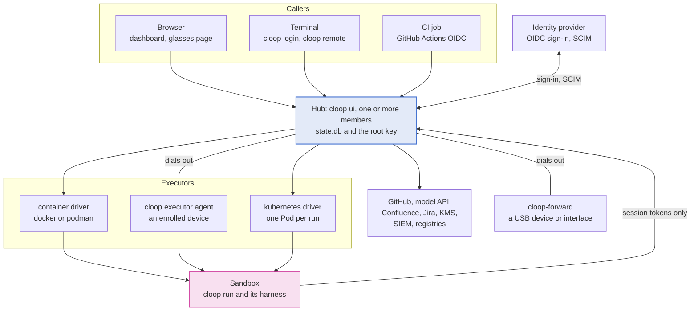
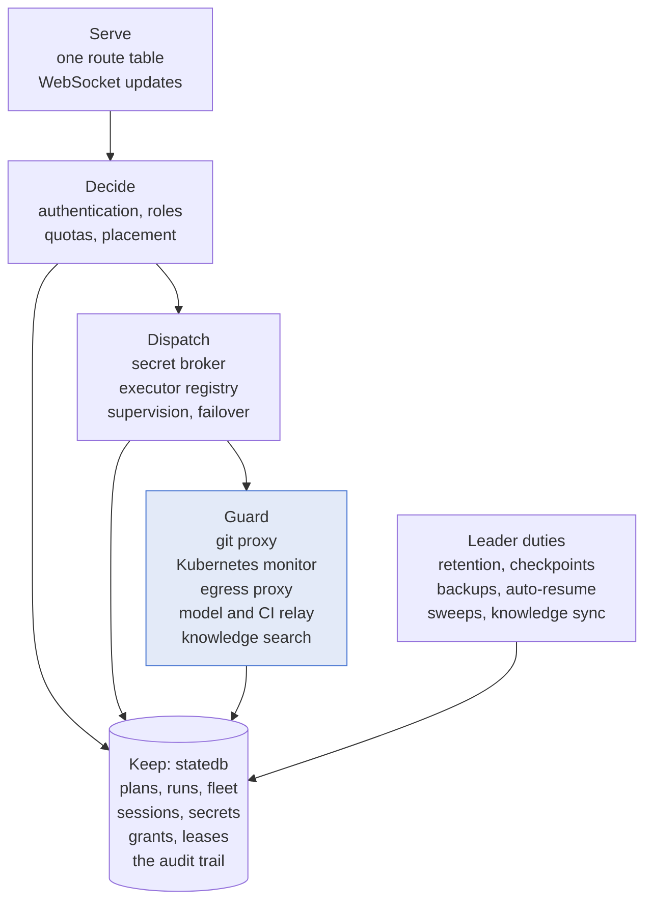
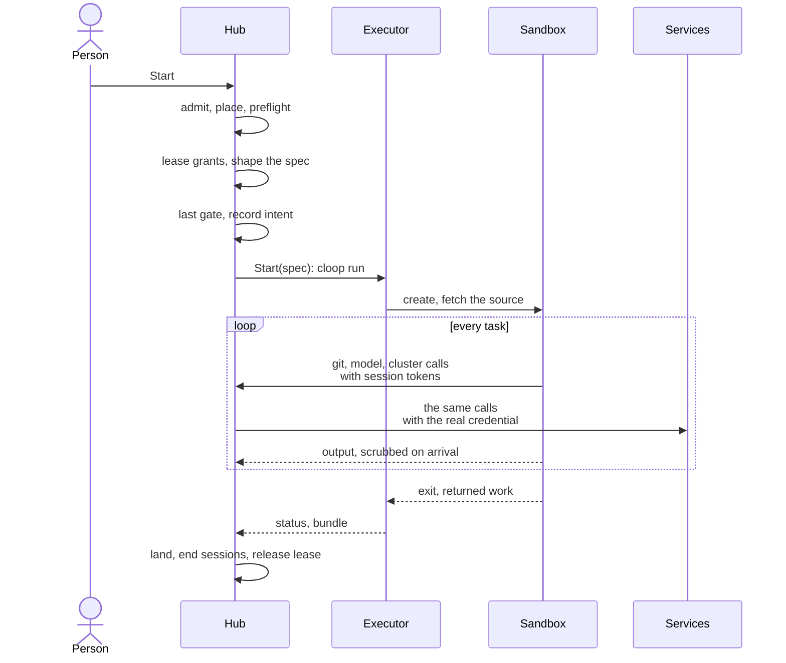
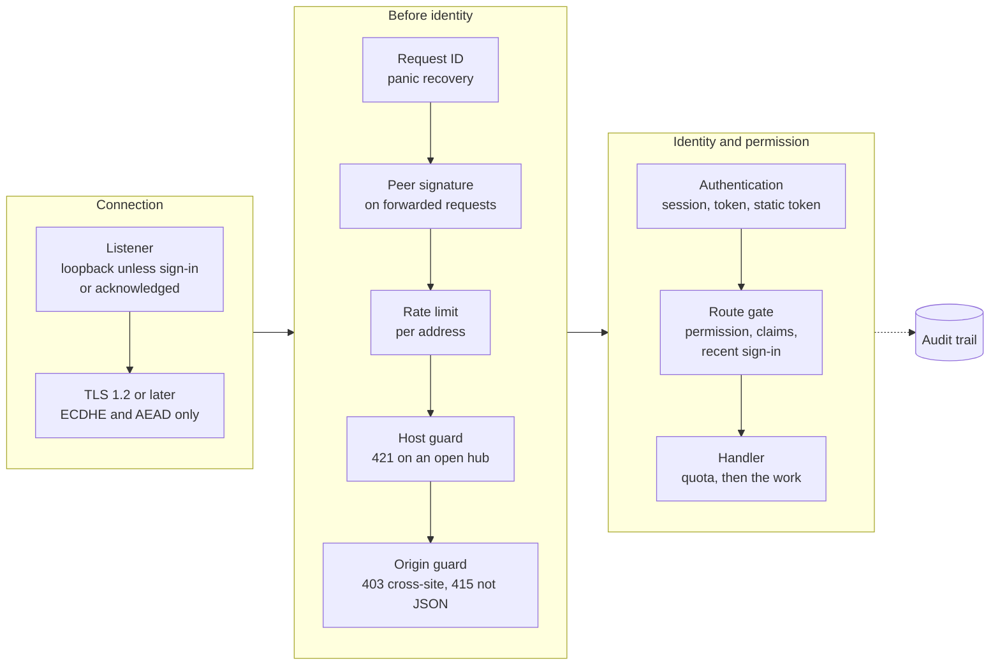
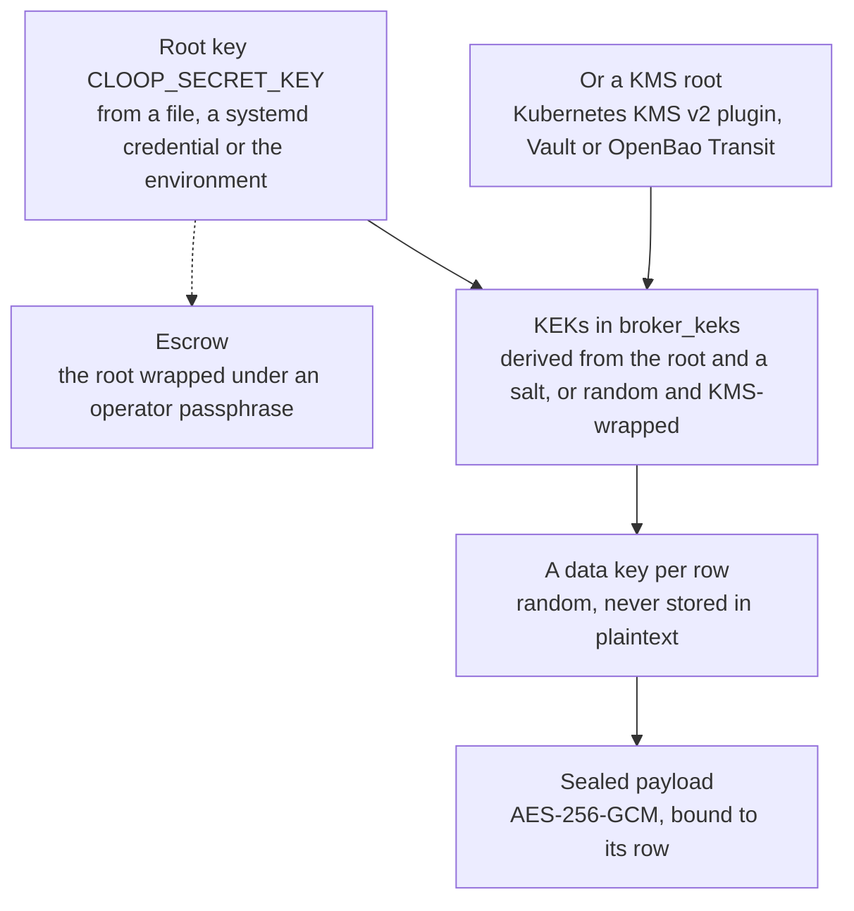
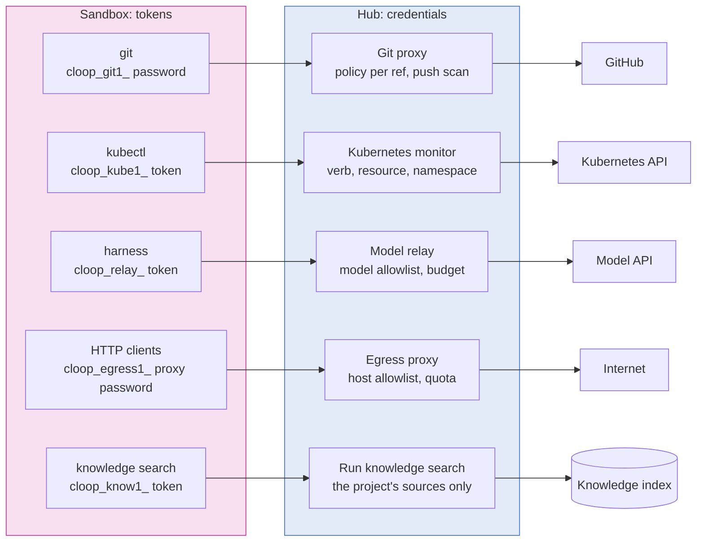

# Component and security architecture

This page describes all of cloop in one place: the processes it runs as, the
components inside each process, the data they keep, and the path a task takes
from a click to a commit. Wherever one part talks to another, it also says what
is trusted, how each side proves who it is, and what stops a compromised part
from doing more damage.

The other pages under Architecture and Security each cover one piece in depth.
This page shows how the pieces fit together and links to the page that covers
each one. The package paths named here are real, and a test keeps them that
way: `tests/docs/architecture_overview_test.go` fails if a path named here no
longer exists, or if a package is added under `pkg/` or a suite under `tests/`
without being named here (a package in the [component map](#component-map), a
suite in [how the architecture is kept true](#how-the-architecture-is-kept-true)).

- [Two ways to run cloop](#two-ways-to-run-cloop)
- [The system at a glance](#the-system-at-a-glance)
- [Processes](#processes)
- [Inside the hub](#inside-the-hub)
- [What is kept, and where](#what-is-kept-and-where)
- [A run, end to end](#a-run-end-to-end)
- [Security architecture](#security-architecture)
  - [Design rules](#design-rules)
  - [Trust boundaries](#trust-boundaries)
  - [Identity and access](#identity-and-access)
  - [Secrets and keys](#secrets-and-keys)
  - [Sandbox containment](#sandbox-containment)
  - [Credential guards](#credential-guards)
  - [Transport and the agent channel](#transport-and-the-agent-channel)
  - [Supply chain](#supply-chain)
  - [Audit and evidence](#audit-and-evidence)
  - [Availability as a security property](#availability-as-a-security-property)
- [Component map](#component-map)
- [How the architecture is kept true](#how-the-architecture-is-kept-true)
- [Reading on](#reading-on)

---

## Two ways to run cloop

cloop is a single Go binary (`main.go` hands over to `cmd`, a Cobra command
tree) that you can use in two quite different ways.

**On a checkout.** You run `cloop run` in a repository. The orchestrator
(`pkg/orchestrator`) turns a goal into a plan of tasks and runs a *harness* once
per task. The harness is Claude Code's `claude`, GitHub Copilot's `copilot`, or
a model API that cloop calls directly. After each task the orchestrator reads
the outcome and moves on to the next one. The plan, the history and the costs
are stored in the checkout's `.cloop/state.db`. The harness runs as you, with
your files and credentials, so the only trust boundary is the machine itself.
[Your first project](../getting-started/first-project.md) and
[how cloop works](../getting-started/concepts.md) describe this mode.

**As a hub.** `cloop ui` serves the dashboard, its JSON API and its WebSockets,
and hosts many projects for many people. In this mode the hub decides what runs
and records what happened, and *executors* do the running. The hub starts each
run as a `cloop run` workload on an executor: a container on a host, an
enrolled edge device, or a Kubernetes Pod. The run gets a lease on the
credentials its project was granted. Where cloop can arrange it, those
credentials never enter the sandbox: the sandbox holds a session token, and a
proxy on the hub uses the real credential on its behalf.

You can see the split in the import graph: only `cmd` imports
`pkg/orchestrator`. The hub doesn't contain the task loop; it starts one
somewhere else. The rest of this page is about the hub, because that is where
the trust boundaries are.

---

## The system at a glance

Three facts shape the rest of this page:

- **The hub is the only trusted component.** It holds the database, the root
  key and every credential. Every other part is assumed to be able to lie: a
  browser session can be a stolen cookie, an enrolled device can be
  compromised, and a workload is treated as hostile, because it runs code the
  hub didn't write, chosen by a model.
- **Devices and forwarders dial out.** The hub never opens a connection to an
  edge device. An agent behind NAT keeps one outbound WebSocket open and
  receives its work over it.
- **Where a guard is on, sandboxes talk to the hub instead of the services.**
  With the git proxy and the Kubernetes monitor on (`cloop hub bootstrap` turns
  on both), a sandbox's git and Kubernetes requests go to listeners on the hub.
  The hub decides each request and adds the real credential on the way out. The
  same goes for the sandbox's knowledge searches, for its Internet traffic when
  it has an egress lease, and for its model calls when the model relay is on.
  The relay is opt-in and serves Claude Code and Anthropic API runs.

---

## Processes

| Process | Started as | Runs on | Holds | Code |
| --- | --- | --- | --- | --- |
| Hub member | `cloop ui` | the control-plane host; several share one database as a [cluster](hub-cluster.md) | the database, the root key, sessions, the credential guards' listeners | `pkg/ui` |
| REST server | `cloop serve` | wherever it is run | one project's API, without the dashboard | `pkg/apiserver` |
| Run | `cloop run` | in a sandbox on an executor, or on a checkout | one project's plan, and the harness it starts | `pkg/orchestrator` |
| Harness | `claude`, `copilot` | as a child of the run | session tokens the hub minted for the run; where no guard is on, the credential itself (by default its Claude or Copilot sign-in) | `pkg/provider/claudecode`, `pkg/provider/copilot` |
| Device agent | `cloop executor agent` | an enrolled device, as a hardened service | its agent credential and, if it was enrolled with one, the hub's SPKI pin | `pkg/executor/agent` |
| Upgrade helper | `cloop-executor-upgrade.service` | the same device | no credential; it runs as root to verify and install the signed builds the agent asks for | `pkg/executor/install` |
| Device forwarder | `cloop-forward` | a machine wired to hardware | a forwarder credential and, if it was enrolled with one, the hub's pin | `cmd/cloop-forward`, `pkg/deviceforward` |
| Terminal client | `cloop login`, `cloop remote` | a developer's machine | a terminal session approved from the browser | `pkg/hubclient` |
| Cluster share | `cloop remote kube share` | a developer's machine | runs the kubeconfig's exec plugin locally and uploads a narrow ServiceAccount token | `pkg/kubeexec`, `pkg/kubeshare` |
| MCP server | `cloop mcp` | beside a harness | the plan, as Model Context Protocol tools; in a run of a project with knowledge sources, also the run's knowledge search | `pkg/mcp`, `pkg/knowledgerun` |

`cloop-forward` is a separate binary. Its `main` imports `pkg/deviceforward`
and links no orchestrator, dashboard or hub code, so the machine wired to the
hardware runs only a program that relays bytes and holds a credential
([device forwarders](../guides/device-forwarders.md)).

---

## Inside the hub

A hub member is a single process, and most of the code described here is in
`pkg/ui`. Its work falls into six areas:

**Serve.** Every route is declared in one route table, together with the
permission it requires, the scope that permission is checked against, and
whether it needs a recent sign-in. `gate()` wraps each route when it is
registered, and `require()` is the single place where permissions are enforced,
so a handler can't forget the check. A route that declares no permission and
isn't marked public stops the hub at startup. The
[HTTP API reference](../reference/http-api.md) is generated from that table,
and a test checks that the two match. Dashboards get live state as WebSocket
pushes, scoped per project, and members pass it to each other over the
cluster's event bus.

**Decide.** Authentication works out which identity a caller is. `pkg/authz`
gives that identity a role in each scope and decides *whether* it may do
something, `pkg/quota` decides *how much*, and placement (`pkg/executor`)
decides *where* a run may go. See [identity and access](#identity-and-access)
and [executors: placement](executors.md#placement).

**Keep.** Each control plane has one SQLite database (`pkg/statedb`, with the
schema in numbered migrations). It holds the fleet, sessions, grants and leases,
sealed secrets, proxy sessions, the knowledge index and the hub's own audit
chain. Each project keeps its plan and its own audit chain in its
`.cloop/state.db`. See [what is kept, and where](#what-is-kept-and-where).

**Dispatch.** The secret broker leases a project's grants to one run. The
executor registry turns the project's executor binding into a driver.
Supervision watches the running workload, moves the run to another executor if
its executor dies, and brings back what the run produced. See
[a run, end to end](#a-run-end-to-end).

**Guard.** The credential guards are listeners served by the hub process
itself, because the process that mints a session token has to be the one that
accepts it. There is no separate proxy daemon that could be compromised or fall
out of step with the hub. See [credential guards](#credential-guards).

**Leader duties.** Some work must happen once per control plane: retention and
the audit prune, audit head checkpoints, scheduled backups, auto-resume of
paused projects, the orphan sweep and knowledge syncs. It runs on the member
that holds the control-plane lease (`pkg/hublease`, `pkg/hubcluster`). A hub
running on its own is always the leader.

---

## What is kept, and where

| Store | What it holds | Protection |
| --- | --- | --- |
| `<hub>/.cloop/state.db` | executors and their sessions, dashboard sessions, API tokens, role bindings, project members, teams, quotas, provisioned users and groups, secrets, grants, leases, grant requests, proxy sessions, cluster membership and bus, knowledge sources and chunks, telemetry, the hub's audit chain | SQLite in WAL mode with a bounded log; credential payloads sealed under the [key hierarchy](#secrets-and-keys); credentials the hub issues kept only as hashes |
| `<project>/.cloop/state.db` | the plan and its tasks, run state, events, costs, requirements and verdicts, the project's audit chain | the same schema and rules: migrations only add to the schema; a binary refuses a newer database unless every migration it lacks is recorded as harmless to it; a save never erases a column that an older binary doesn't know about |
| `<project>/.cloop/` files | task artifacts, live output, checkpoints, attachments, the sandbox spec, config | crash-safe writes (`pkg/atomicfile`), size-limited reads (`pkg/boundedread`), and size kept in check by the janitor (`pkg/janitor`) |
| Root key | `CLOOP_SECRET_KEY`, from a file, a systemd credential or the environment; or KEKs held by a KMS | kept outside every `.cloop/` directory; can be escrowed under a passphrase (`pkg/keyescrow`) |
| Audit checkpoints | the head of each audit chain, every five minutes by default | written outside the database, so a truncated trail can be detected |
| Per-identity homes | each person's Claude Code and Copilot configuration on an SSO hub | one directory per identity, destroyed when the person is offboarded |
| Device side | the agent's credential, `agent.json` in its state directory (mode 0600), and the hub's pin if it was enrolled with one | the hub can revoke the credential, and then sends `bye` so the agent stops reconnecting |

No database holds the plaintext of a credential the hub *issues*: session
cookies, API tokens, enrollment tokens, agent credentials and proxy session
tokens. The hub stores a hash instead (SHA-256, or a salted HMAC-SHA256 for API
tokens, glasses links and SCIM credentials) and compares it in constant time. A
hash is enough to check a token that someone presents, and it can't be turned
back into the token.

A hub process that adopts a run another process started never saw that run's
tokens, but it still has to scrub them from the run's output. So every token
the hub mints for a run starts with a prefix that names its kind
(`cloop_git1_`, `cloop_kube1_`, `cloop_egress1_`, `cloop_relay_`,
`cloop_know1_`, and GitHub's `ghs_` for App installation tokens). The hub picks
out anything with one of these prefixes and confirms it against the recorded
hash (`pkg/redact`).

---

## A run, end to end

This is what happens between a click on **Start** and the task's commit
landing, in the order the hub does it (`startWorkloadAs` in
`pkg/ui/executor.go`):

1. **Admission.** The request goes through the
   [front door](#identity-and-access): a same-origin check, a JSON body, an
   authenticated identity, the route's permission at the project's scope, the
   identity's quota, and a free concurrency slot for the tenant.
2. **Where.** Before anything is chosen, the hub checks the project's directory
   again against the confinement rule (`pkg/projectconfine`). Then it resolves
   the project's executor binding, and the host-execution policy refuses a
   driver with no isolation. The run also has to pass a *harness preflight*: if
   the executor can't give the harness a Claude or Copilot sign-in, the run is
   refused before the hub mints anything for it.
3. **What it may hold.** The secret broker leases to this run, with a TTL,
   every grant whose subject matches the project and the executor. Repository
   grants become mounts, device grants become `--device` arguments, and
   interface grants are moved into the sandbox's network namespace. The rest
   become environment variables and files, except a credential that a guard
   will hold: that one is left out of the spec entirely.
4. **What it runs in.** The project's `.cloop/sandbox.yaml` narrows the spec
   (image, environment allowlist, ceilings, mounts). If the executor can't
   provide everything the file asks for, the run is refused; cloop never
   applies only part of it. The image is checked against the trust policy and
   pinned to a digest. Then the hub applies, in this order, the firewall
   levels, forwarded devices, the egress session, the workspace (for a feature,
   its branch bundle), trust in the hub CA, the model relay session, the
   knowledge session and the operator's resource ceilings.
5. **Last gate.** `executor.RequireRevocable` refuses an executor that couldn't
   take back a credential it is about to receive. This check comes after every
   step that can add a credential, because an earlier check would see an
   incomplete spec. The hub records its intent to dispatch before the workload
   exists. If a member dies at the wrong moment, the next member finds that
   record and acts on it, so no run is left unsupervised.
6. **Run.** The driver starts the workload. Every value the run was given is
   scrubbed from its output before the output reaches the hub's log bus, the
   database or a dashboard. The run's pushes go through the git proxy's policy
   and are [scanned](../git-interception-proxy.md#the-push-scan) for the same
   values. Connections that its firewall refuses are reported to the run.
7. **Return.** An executor that doesn't share the hub's filesystem sends back
   the run's commits as a write-back bundle, or a seeded project's outcome as a
   result frame. The hub lands them, ends the run's sessions, releases its
   lease and destroys credentials that were delivered as files. If the executor
   is lost instead, supervision dispatches the run again, up to a limit, and
   quarantines a task if two or more executors went down while running it.

[Executors: end to end](executors.md#end-to-end) follows the same path and shows
where each driver differs.

---

## Security architecture

### Design rules

The code follows these rules wherever it has a choice to make. Each rule says
where it is enforced.

1. **The hub never runs a harness itself.** No request can fork a process on
   the hub's host when the configuration has `executors.allow_host_process:
   false` — which `cloop hub bootstrap` writes for you. Once host execution is
   off, nothing in the running process can switch it back on. The policy is
   enforced at registration, resolution and placement, in the local driver and
   in every handler that touches the host. A call-graph test follows every
   route and background duty to prove that none of them reaches `os/exec`
   without going through the policy check
   ([the no-host-execution guarantee](../security/model.md#the-no-host-execution-guarantee)).
2. **Workloads are treated as hostile.** The hub checks everything a sandbox
   sends it. Its output is scrubbed and its pushes are scanned. The work it
   returns is capped in size and accepted only for the handle that asked for
   it. What it claims about its own runtime is checked by a probe that the
   image can't replace.
3. **Credentials stay on the hub's side of the boundary.** Guards on the hub
   can use a forge token, a cluster credential or a Claude token on a
   sandbox's behalf. The guards are the git proxy and the Kubernetes monitor,
   which `cloop hub bootstrap` turns on, and the opt-in model relay. A
   knowledge source's credential never leaves the hub at all. Behind a guard, a
   sandbox holds only a session token that is good for one run's traffic
   through that guard, and a revocation ends it at the next request. While a
   guard is off, a grant with a limit that only the guard can enforce is
   refused or narrowed to read-only, unless an administrator records on the
   grant why it may go out without that limit.
4. **Claimed capabilities are checked.** The
   [isolation probe](#sandbox-containment) checks a runtime's claimed
   isolation, and the hub refuses a claim that the evidence contradicts. Image
   tags are resolved to digests, and signatures are verified where the policy
   asks for them. Release artifacts are verified against the workflow that must
   have signed them. Devices report their build, and the hub refuses builds
   below a minimum.
5. **Refuse instead of degrading.** A driver that can't honour a spec field
   refuses the workload. A guard that is configured but not running refuses its
   traffic and never hands the credential over instead. A grant constraint that
   can't be parsed or satisfied, or a payload that minimises to nothing,
   produces a denial and an audit row, never a wider credential.
6. **Deny by default, and say so where the default is open.** With RBAC in
   force, an identity that matches no role binding gets role `none`.
   `cloop hub bootstrap` writes the `default_role: none` that puts RBAC in
   force. A route without a declared permission stops the hub at startup. A
   listener with no sign-in in front of it binds to loopback unless an operator
   explicitly configures otherwise. One configuration stays wide open: single
   sign-on without a role policy, which is allowed so that an upgrade doesn't
   lock anyone out. The startup banner, `cloop hub doctor`, Settings and
   `/api/me` all report it as open, next to a one-click fix.
7. **Every important decision is recorded.** Authorisation outcomes, grants,
   leases, guard decisions and fleet changes are written as rows of a
   hash-chained audit trail. The head of the chain is checkpointed outside the
   database, and the trail can be forwarded off the machine as it is written.
8. **Everything has a limit.** Request rates, WebSocket connections, request
   bodies, log replay, returned work, file reads, the write-ahead log, disk use
   and retention all have ceilings, because any unbounded resource would let a
   single tenant deny service to everyone else.

### Trust boundaries

The [security model](../security/model.md#trust-boundaries) numbers the four
boundaries between the hub and what it controls, and the
[threat model](../security/threat-model.md) goes through each one with STRIDE.
The table lists those four and the boundaries that cut across them:

| Boundary | Far side | How the far side proves who it is | The hub assumes it can | Detail |
| --- | --- | --- | --- | --- |
| ① Caller ↔ hub | browsers, terminals, CI jobs, SCIM clients | an SSO session, an API token, a terminal session, the static token, a federated CI token or a SCIM credential | replay a stolen cookie, forge cross-site requests, rebind DNS | [① Browser ↔ hub](../security/threat-model.md#①-browser--hub) |
| ② Hub ↔ device agent | enrolled devices | a single-use enrollment token, exchanged for an agent credential; a device enrolled with the hub's key pins it | be compromised, lie about its runtime or build, or send back more than it was asked for | [② Hub ↔ remote agent](../security/threat-model.md#②-hub--remote-agent) |
| ③ Hub ↔ container runtime | the local docker or podman socket | nothing: the socket is equivalent to root, and the hardening is in the argv the hub builds | run whatever the argv says | [③ Hub ↔ container runtime](../security/threat-model.md#③-hub--container-runtime) |
| ④ Hub ↔ Kubernetes | a cluster's API server | the brokered kubeconfig or projected ServiceAccount token | run other workloads beside the Pod, and let a workload reach other services in the cluster | [④ Hub ↔ Kubernetes cluster](../security/threat-model.md#④-hub--kubernetes-cluster) |
| Sandbox ↔ guards | every workload | session tokens minted per run and per guard | hold the token, misuse it within its scope, and try to exfiltrate data through it | [credential guards](#credential-guards) |
| Hub ↔ hub | other members of a cluster | an HMAC over each forwarded request, keyed by a secret in the shared database | nothing a member couldn't already do, since anyone who can read the key can also rewrite the database the hub trusts; the owning member still re-checks the original caller | [hub members](../security/threat-model.md#cross-cutting-hub-members) |
| Hub ↔ forwarder | on-prem machines wired to hardware | a forwarder enrollment token, exchanged for a credential; pins the hub like an agent does | be compromised | [device forwarder](../security/threat-model.md#cross-cutting-on-prem-hardware-through-a-device-forwarder) |
| Hub ↔ services | IdP, GitHub, model API, knowledge sources, KMS, SIEM | TLS to the service, and the service's own signing keys where it signs | answer slowly or not at all, or return text that tries to instruct an agent | [knowledge sources](../security/threat-model.md#cross-cutting-knowledge-sources), [SCIM](../security/threat-model.md#cross-cutting-scim-provisioning) |

### Identity and access

Every request to the hub goes through the same layers, outermost first
(`buildHandler` in `pkg/ui/server.go`):

The health probes skip every layer after panic recovery. An edge agent or a
forwarder that connects with its own credential, and a member's signed call to
the cluster's internal endpoints, skip session authentication and the route
gate, because each of them authenticates itself.

**Who a caller can be.**

| Credential | Shape | Issued by | Kept as | Ends |
| --- | --- | --- | --- | --- |
| Dashboard session | `cloop_session` cookie: `HttpOnly`; `Secure` and `SameSite=Strict` under TLS | OIDC sign-in, authorization code with PKCE (`pkg/oidcauth`) | a hash, with the IdP refresh token sealed (`pkg/sessionstore`) | idle timeout (8 h), absolute ceiling (24 h), sign-out, or revocation by an admin or the IdP, which also closes every stream the session opened |
| API token | `cloop_pat_<id>_<secret>` | a person or an admin, scoped and expiring (`pkg/apitoken`) | a salted HMAC | expiry or revocation |
| Terminal session | `cloop_cli_…` | `cloop login` (`pkg/hubclient`): a device code approved from a signed-in browser, issued by `pkg/oidcauth` | a hash | its own lifetime and idle timeout, sign-out or revocation |
| Static admin token | `CLOOP_UI_TOKEN` | the operator | never stored; identified by a fingerprint (`pkg/statictoken`) | retired at runtime on every member, which closes everything it opened |
| Glasses link | a `cloop_pat_` token named *Display glasses link*, carried in the URL | a person, for their own display glasses | a salted HMAC | 30 days, rotation, revocation or offboarding |
| CI session | `cloop_ci_…` | the hub, for a GitHub Actions OIDC token that matched an allowlist rule; checked by `pkg/ciauth` and `pkg/celmatch`, minted by `pkg/claudeproxy` | a hash | the session's lifetime, or revocation |
| SCIM credential | `cloop_scim_…` | an admin, for the IdP's provisioning client (`pkg/provision`) | a salted HMAC | revocation; rotated with an overlap |
| Agent enrollment, credential | `clet1.…`, then `clac1.…` | `cloop executor enroll`, then the first connection | hashes | single use; revocation |
| Forwarder enrollment, credential | `clft1…`, then `clfc1…` | `cloop forward enroll`, then the first connection | hashes | single use; revocation |

**What a caller may do.** The roles, from least to most privileged, are
`none`, `viewer`, `operator`, `maintainer` and `admin`. With RBAC in force, an
identity's role is decided per scope from three sources: role bindings in the
config, mapped from the IdP's claims; bindings written at runtime during an
incident (`pkg/rolestore`); and a project's own member list
(`pkg/projectmember`), whose members are people and teams (`pkg/hubteam`). A
project somebody creates is private: its owner is its administrator, and a role
held hub-wide reaches it only for the hub's administrators
([project members](../security/model.md#project-members)). RBAC is in force when single sign-on is on and an
operator has written a policy (a role mapping or a `default_role`). The request
gate and everything that reports on RBAC decide this with the same predicate,
`authz.Enforced`
([when RBAC is in force](../security/model.md#when-rbac-is-in-force)). Above
the operator role, two more conditions apply. The session's claims must have
been re-checked at the IdP within `ui.oidc.max_claim_age_minutes` (5 minutes by
default). A privileged route marked *sudo* also needs an interactive sign-in
within `ui.oidc.sudo_max_age_minutes` (2 hours); otherwise the hub answers
`401 REAUTH_REQUIRED` and the dashboard sends the person back to the IdP
([identity, roles and permissions](../security/model.md#identity-roles-and-permissions)).

**How much.** Quotas cap projects, concurrent tasks and reproductions,
executors and sessions, and set a daily token and cost budget per identity
(`pkg/quota`, `pkg/quotastore`). Spending counts against the identity that
started the run. With the model relay on, the relay counts it from the API's
own usage figures, so the figure doesn't depend on what the run reports.

**Joining and leaving.** A person gets an account by signing in or through SCIM
provisioning (`pkg/scim`, `pkg/provision`). They ask for access with grant
requests, which approvers see in the approvals inbox (`pkg/approvalnotify`).
They leave through offboarding (`pkg/offboard`), which ends their sessions,
tokens and glasses links, revokes their grants and leases, stops their tasks,
destroys their personal secrets and their Claude Code home, and writes a deny
binding. When a person is disabled at the identity provider, SCIM suspends them
in one request, without an administrator; once they are deleted there, they are
offboarded ([SCIM provisioning](../guides/scim-provisioning.md)).

**What a page cannot do.** The dashboard's content security policy is
`script-src 'self'`, without `'unsafe-inline'`. The markup contains no code,
only `data-action` names that a delegated dispatcher looks up. Requests that
change state need the hub's own origin or a bearer token, and a JSON body.
WebSocket connections need an exact origin match. Files a run produced are
served in a way that stops the browser from rendering any of them as a page of
the hub's origin ([① Browser ↔ hub](../security/model.md#①-browser--hub)).

### Secrets and keys

**The key hierarchy.** Each credential's payload is sealed (encrypted) with a
data key of its own. The data key is sealed with a key-encryption key (KEK),
and the KEK comes from a root key that the database never holds:

- `pkg/rootkey` is the only code that loads the root key. It tries, in this
  order, a file the process owns (mode 0400 or 0600, outside every `.cloop/`),
  a systemd credential (which is how a TPM-sealed `LoadCredentialEncrypted=`
  reaches the hub), and the environment.
- A KEK is derived from the root key with a per-key salt (200,000 rounds of
  SHA-256) and verified against a check value, so at load time the hub can tell
  a wrong root key from a corrupt row. With `secrets.kms`, each KEK is random
  and only the KMS's ciphertext of it is stored (`pkg/kms`). The KMS sees the
  32-byte KEK but never a secret, and the store can't be opened without the
  KMS.
- Both layers bind their ciphertext to its row with GCM associated data. A
  sealed payload copied onto another row fails to open, so it can't deliver
  someone else's credential under the wrong name.
- Rotation re-wraps the data keys and never touches the payloads, so it runs
  online while the hub is serving. Changing the root key runs online too.
  `pkg/keyescrow` keeps a copy of the root key under a passphrase, so losing
  the root key file doesn't mean losing every sealed credential
  ([key rotation](../operations/runbook.md#sealing-keys--online-resumable-no-credential-re-minting),
  [the root key](../operations/runbook.md#the-root-key)).

**From a secret to a run.** A *secret* belongs to the organisation or, on a
multi-user hub, to one person. A *grant* gives a secret to a subject (a
project, an executor, or every executor whose recorded labels match a
selector), with constraints that depend on the secret's kind and a TTL. When a
run is dispatched, the broker turns the matching grants into one *lease* for
that run. The lease is short-lived, and it holds each secret cut down to what
the grants allow. It is renewed while the run lasts, and every renewal
recomputes it from the current grants, so a revoked grant is never issued
again. Everything the workload receives comes from the lease, and revoking the
lease takes it back at once: the hub sends a device a `revoke` frame, wipes the
files a container reads, empties a Pod's lease Secret, and ends the guard
sessions that depend on the lease. Values that went into a process's
environment can't be taken back, so a container or Pod holding some is
stopped, and the revocation report says so
([the lease-revocation guarantee](../security/model.md#the-lease-revocation-guarantee)).

| Kind | What it is | How it reaches a run |
| --- | --- | --- |
| `github_pat` | a GitHub token | held by the git proxy when it runs; otherwise a file that a credential helper reads, answering only for the granted repositories on the grant's forge host |
| `github_app` | an App installation: app id, installation id, private key | the private key never leaves the hub; each lease gets an installation token scoped to the grant, renewed before its hour is up and held by the git proxy when the proxy runs |
| `kubeconfig` | a cluster credential | held by the Kubernetes monitor when it runs; otherwise rewritten to the allowed contexts and namespaces |
| `registry` | a registry login | a docker config filtered to the allowed registries, as `DOCKER_CONFIG` |
| `env` | opaque variables | the environment, filtered to the allowed keys and narrowed again by the sandbox spec's allowlist |
| `egress_proxy` | an outbound proxy, possibly with credentials | `HTTPS_PROXY` and `HTTP_PROXY`; the executor's network policy enforces its host allowlist |
| `local_repo` | a directory of repositories on the hub | a bind mount of the matching repositories, read-only unless granted otherwise |
| `host_device` | device nodes on the executor's host | `--device` |
| `host_interface` | network interfaces on the executor's host | moved into the sandbox's network namespace for the run |

Values a run was given are scrubbed from its output by exact match
(`pkg/redact`). Where the exact values aren't known, text that matches a
credential *shape* from a single pattern registry is scrubbed instead;
[credential patterns](../reference/credential-patterns.md) lists every pattern.
Credentials delivered as files are destroyed when the run ends, and a sweep at
startup destroys any that a crash left behind (`pkg/securewipe`).

### Sandbox containment

**Isolation.** Each driver declares the isolation it provides, and a probe
checks the claim.

| Driver | Isolation | Kernel of its own | Notes |
| --- | --- | --- | --- |
| `localprocess` | `none` | no | only where `allow_host_process` is true; never on a strict hub |
| `container` | `container`, or `vm` with Kata | with gVisor or Kata | docker or podman; `--cap-drop=ALL`, `no-new-privileges`, a read-only root filesystem, the uid of the project directory's owner, no network unless egress is arranged, and memory, CPU and process limits |
| `remote` | `remote` | depends on the device's runtime | an enrolled device that runs work directly, in a container runtime of its own, or in virtual executors, each with its own engine, runtime and firewall |
| `kubernetes` | `remote` | with a gVisor or Kata RuntimeClass | one Pod per run, running as non-root with a read-only root filesystem and no service account token; its own NetworkPolicy when egress is filtered |

A project can require a VM or a kernel of its own, and placement doesn't accept
a runtime's *name* as proof. From inside a sandbox, `cloop isolation-probe`
reads what only the kernel serving the sandbox can answer: its boot ID, uptime,
hypervisor flag, DMI data and gVisor's markers. A container or device executor
mounts the probe read-only from its own binary, so an image can't replace it.
Kubernetes can't bind a file into a Pod, so there the probe is the cloop that
ships in the executor's own configured image. A claim the evidence contradicts
is refused under the `isolation_evidence` constraint. An executor that was
never probed is admitted with a warning on the run, unless
`executors.isolation_evidence` is `required` (`pkg/isolationprobe`,
`pkg/isolationverify`).

**Images.** `sandbox.image_policy` lists the registries and repositories that
are allowed. It can require a digest and a cosign signature (by key or by
keyless identity), and it pins each image it admits to a digest
(`pkg/imagepolicy`). Before a sandbox runs one of cloop's own images, the hub
verifies it by digest against the workflow that publishes it. By default an
unverified image is flagged on the run; under
`executors.image_provenance: required` it is refused. An image signed by
anyone other than that workflow is refused in both modes. On Kubernetes, a tag
is resolved to a digest at the registry before the Pod is built, so the Pod
runs the image the policy evaluated. If the registry won't resolve a tag, the
image is refused under `require_digest` or `require_signature`, and otherwise
admitted with a warning.

**Network.** By default a container has no network at all. When it is given
egress, it gets one of two mechanisms, depending on the kind of authorisation.
Either it joins an `--internal` network with no route off the host, where the
hub's egress proxy is the only way out, or, if it must connect to named
addresses directly, it gets a host nftables ruleset scoped to its bridge,
installed *before* the workload starts. A Pod gets its own NetworkPolicy.
Firewall rules nest. A device's rule set covers everything any sandbox on it
may reach, a virtual executor's rules can only narrow the device's, and a
project's rules can only narrow those (`pkg/fwpolicy`). No allow list can
include a cloud metadata service by accident (`pkg/cloudmeta`). A refused
connection fails at once unless the rules say to drop it, and it is reported to
the run with the rule that refused it. There are two exceptions: Kubernetes,
where a NetworkPolicy keeps no log, and devices older than protocol v24
(`pkg/netfilter`, `pkg/denylog`; [firewall rules](../guides/firewall.md),
[sandbox network isolation](executors.md#sandbox-network-isolation)).

**Hardware.** A sandbox gets device nodes and network interfaces only through
a grant (`host_device`, `host_interface`), through a virtual executor that an
administrator gave them to, or through a forwarder binding. A path in the
sandbox spec can't give it hardware, because the spec is committed to the
repository and any pull request can change it. On-prem hardware reaches a cloud
sandbox through a [device forwarder](../guides/device-forwarders.md), attached
by the executor that runs the sandbox, with no listener anywhere.

**Resources and reuse.** CPU, memory, process count and disk are limited per
workload, within ceilings an operator sets per executor and per project. Disk
use is sampled and held to its limit (`pkg/executor/internal/diskwatch`). A
container or Kubernetes executor creates a new container or Pod for every
workload and removes it when the workload ends. There is no warm pool, because
a reused sandbox would carry whatever the previous tenant left in it.

**The agent's own privileges.** An agent that installs firewalls needs
`CAP_NET_ADMIN`. cloop clears ambient and inheritable capabilities at startup
and grants that capability only to `nft` (`pkg/caps`), so no workload inherits
it.

### Credential guards

The hub process serves every guard itself, and a sandbox reaches each one
through its firewall. The git proxy and the Kubernetes monitor have listeners
of their own, with TLS certified by the hub's own CA under `tls: auto`
(`pkg/hubca`, which can be rotated online). The model relay uses the git
proxy's listener by default, the egress proxy has its own, and the run
knowledge search uses the dashboard's. Each guard accepts a session token
minted for one run, checks the request against that run's policy, and only
then adds a credential that the sandbox never sees:

| Guard | Decides | Code | Detail |
| --- | --- | --- | --- |
| Git proxy | each pushed ref, against the branch allowlist, read-only access and the repository scope; refuses a push that contains a value the run was given | `pkg/gitproxy`, `pkg/executor/gitproxycreds`, `pkg/forgehost` | [git interception proxy](../git-interception-proxy.md), [git proxy architecture](git-proxy.md) |
| Kubernetes monitor | each API request, parsed into verb, group, resource, subresource, namespace and name before the cluster credential is added; shell-like subresources are refused for every verb | `pkg/kubeguard`, `pkg/kubeshare` | [Kubernetes access monitor](kubernetes-access.md) |
| Egress proxy | each connection against its egress grant's hosts, addresses, ports and methods, and its byte quotas | `pkg/egressbroker` | [scoped network egress](../reference/configuration.md#scoped-network-egress) |
| Model relay | each model call, against the project's model allowlist and the daily budget of the person who started the run; usage is counted from the API's own figures | `pkg/claudeproxy`, `pkg/ui/model_relay.go` | [the model relay](../guides/secrets.md#with-the-model-relay-on-the-claude-credential-stays-on-the-hub) |
| Run knowledge search | only the sources bound to the run's project are searched; retrieved text is fenced and cited | `pkg/knowledgerun`, `pkg/knowledge` | [knowledge sources](../security/model.md#knowledge-sources) |
| CI relay | a federated pipeline's model calls, against the rule that admitted it | `pkg/ciauth`, `pkg/claudeproxy` | [running an agent in CI](../guides/ci-pipelines.md) |

What the guards have in common:

- **A session lasts no longer than its run.** Git proxy, Kubernetes monitor and
  model relay sessions depend on the run's secret lease: they are extended with
  it and end with it. Egress and knowledge sessions are renewed while the run
  is alive and closed when it ends. If you revoke the grant behind a session,
  its next request is refused.
- **Sessions survive a hub restart.** They are recorded by hash in
  `proxy_sessions` (`pkg/sessionrecord`). The member that adopts a run after a
  restart restores its sessions along with its lease, and derives the
  credential again from the grant, never from anything recorded.
- **They fail closed.** A guard that is configured but not running refuses the
  traffic. It never falls back to giving the credential to the sandbox.
- **They are audited and metered.** Their audit actions include
  [`gitproxy.push_denied`](../reference/audit-events.md#gitproxy),
  [`gitproxy.push_secret_refused`](../reference/audit-events.md#gitproxy),
  [`kubeguard.request_denied`](../reference/audit-events.md#kubeguard),
  [`egress.connect`](../reference/audit-events.md#egress),
  [`model_relay.denied`](../reference/audit-events.md#model_relay) and
  [`knowledge.run.search`](../reference/audit-events.md#knowledge); see
  [metrics](../operations/metrics.md) for what they measure.

Where no guard runs, the credential itself is leased into the sandbox. It is
still scoped, minimised, revocable and scrubbed from output, but a grant whose
limits only a guard can enforce is not delivered as if those limits applied.
Without the git proxy, a GitHub branch allowlist turns a `github_app` grant
into a read-only token and refuses a `github_pat`, which can't be narrowed.
Without the Kubernetes monitor, a kubeconfig grant with namespace or verb
limits is refused unless an administrator records on the grant why it may go
out without them, which is audited as
[`secret.unguarded_ack`](../reference/audit-events.md#secret).

### Transport and the agent channel

- **TLS** settings come from one place (`pkg/tlsconf`) for the dashboard,
  `cloop serve` and the monitors' listeners: TLS 1.2 or later, with ECDHE key
  exchange and AEAD ciphers only.
- **Devices pin the hub where they can.** Whenever the hub serves TLS itself,
  enrollment carries the hub's SPKI fingerprint. An agent or forwarder enrolled
  with it checks the pin on top of the system certificate store, and several
  pins can be staged for a rotation. A device enrolled with no pin, behind a
  proxy that terminates TLS, verifies against the system store. Plaintext
  `ws://` to a host other than loopback is refused unless explicitly allowed.
- **The agent protocol is versioned.** The hub speaks versions 1 to 26 and
  stamps each frame with the version the session negotiated. The hub won't
  place a run on a device that is too old for what the run needs, such as a
  `revoke` frame for revocable material. The run is refused at placement with
  an error that names the device and the upgrade it needs, so it doesn't fail
  later on.
- **What a device sends back is limited.** A handle accepts only the bundle
  that its own dispatch asked for, up to that dispatch's cap, within a budget
  per executor and per hub process (256 MiB and 1 GiB by default), and nothing
  after its final status
  ([② Hub ↔ remote agent](../security/model.md#②-hub--remote-agent)).
- **Members sign what they forward** with an HMAC that covers the sender, the
  recipient, the time and a nonce. The member that owns the request
  authenticates the original caller again and doesn't rely on the forwarding
  member ([the peer channel](hub-cluster.md#the-peer-channel)).
- **The hub CA** issues short-lived certificates for the git proxy's and the
  Kubernetes monitor's listeners under `tls: auto`. It is rotated online in
  three stages (staged, activated, retired), and there is an emergency path
  ([rotating the hub CA](../operations/runbook.md#rotating-the-hub-ca)).

### Supply chain

- **Releases are verified by who built them.** `release.yml` signs the release
  archives keylessly when a tag is pushed. The installer, `cloop upgrade` and
  an agent's upgrade check that signing identity with cosign
  (`pkg/provenance`); they don't rely on a checksum published next to the
  archive. If cosign is missing, they refuse to install
  ([release provenance](../security/model.md#release-provenance-and-the-trust-root)).
- **The edge channel has its own pin.** `edge.yml` signs builds of `main`, and
  they are verified against that identity only. Each build carries its
  first-parent sequence number on `main`, and a device's root helper refuses a
  build older than the installed one, whatever the agent or the hub asks for
  ([edge channel](../guides/edge-channel.md)).
- **cloop's images are signed per digest** when they are published, and the
  hub verifies cloop's own images by digest before a sandbox runs one.
  `executors.image_provenance` decides whether an unverified image is flagged
  on the run or refused.
- **Each build records what it is.** `pkg/version` holds the commit, the
  sequence number and the table of published releases with the agent protocol
  each one speaks. The Upgrade dialog and the auto-update policy
  (`pkg/executor/autoupdate`) read it before they offer a build to a device.

### Audit and evidence

- **One chain per database.** The hub's `state.db` and every project's have an
  `audit_events` table whose rows are hash-chained. Each row's hash covers its
  own content and the previous row's hash, so editing or deleting a row breaks
  the chain from that point on (`pkg/statedb`). `cloop hub audit verify` checks
  the chains, and `pkg/auditmerge` reads them as one trail.
- **One list of action names.** Every action name the hub can write is
  registered in `pkg/auditaction`, and the
  [audit events reference](../reference/audit-events.md) is generated from that
  registry. A page that cites an action that doesn't exist fails the build.
- **Lost rows are recorded.** If an append fails, the hub counts it and, once
  the database accepts writes again, writes an
  [`audit.gap`](../reference/audit-events.md#audit) row into the chain.
- **Truncation can be detected.** Every five minutes by default, the leader
  writes each chain's head to a checkpoint outside the database
  (`pkg/auditcheckpoint`). Pruning seals what it removes
  (`pkg/auditretention`).
- **The trail can leave the machine as it is written.** Once `audit.forward`
  names a sink, the leader sends every row of every chain to syslog over TLS,
  to an HTTPS endpoint such as Splunk's, or to a file. Delivery is at least
  once, from a cursor per sink that a new leader resumes from. If a chain no
  longer lines up with a sink's cursor, that is recorded too, as
  [`audit.forward.discontinuity`](../reference/audit-events.md#auditforward)
  (`pkg/auditforward`, [forwarding the trail](../operations/runbook.md#forwarding-the-trail-off-the-box)).
- **Health is checked.** `/metrics` exports the hub's metric families
  (`pkg/hubmetrics`). `cloop hub doctor` and the dashboard's health panel check
  the deployment's configuration, and `cloop hub doctor --smoke` checks its
  dispatch path end to end (`pkg/hubdoctor`). Front-end telemetry is off by
  default and is scrubbed before it is stored (`pkg/telemetry`).

### Availability as a security property

- **One control plane, with one leader.** A second `cloop ui` on the same
  database joins the cluster instead of running as a separate hub, and one
  member at a time holds the control-plane lease (`pkg/hublease`,
  `pkg/hubcluster`).
- **Runs outlive the process that started them.** When a member dies, another
  member adopts its runs, agent connections, leases and guard sessions
  ([hub cluster](hub-cluster.md#runs-agents-and-failover)). If a member dies
  after starting a workload but before recording it, the dispatch intent it
  wrote first lets the next member find the workload and stop it, so it doesn't
  run unsupervised.
- **A workload can't take down the fleet one node at a time.** Failover is
  capped (`executors.failover.max_attempts`), and a task that more than one
  executor died under is quarantined until someone resets it
  ([the failover cap](executors.md#the-failover-cap-and-the-node-killer-quarantine-task-20391)).
- **A full disk pauses runs instead of corrupting data.** Runs pause when free
  space falls below a minimum and record their outcome using space held in
  reserve (`pkg/diskreserve`). The write-ahead log is trimmed and truncated,
  and the janitor and the leader's retention sweep prune what grows
  ([disk retention](../reference/configuration.md#disk-retention)).
- **Abuse is limited at the front door**: a token bucket per address, caps on
  WebSocket connections per address and in total, limits on request body size,
  and panic recovery around every handler.

---

## Component map

This section lists every package under `pkg/`, grouped by layer, with what
each one is for.

### Entry points

| Package | Role |
| --- | --- |
| `cmd` | the Cobra command tree behind `main.go`, grouped in `cloop --help`; most commands are thin wrappers over a package below |
| `cmd/cloop-forward` | the standalone device forwarder binary |

### Serving the hub

| Package | Role |
| --- | --- |
| `pkg/ui` | the hub: route table, handlers, dashboard assets, WebSockets, run dispatch, the guards' listeners, leader duties |
| `pkg/apiserver` | `cloop serve`, the REST API without the dashboard |
| `pkg/apidoc` | the HTTP API reference and `GET /api/openapi.json`, rendered from the route tables |
| `pkg/apierror` | the structured error both HTTP surfaces answer with |
| `pkg/jsonbody` | reading a JSON request body; every handler uses it |
| `pkg/sameorigin` | whether a request came from one of the hub's own pages, and which forwarded headers to trust |
| `pkg/exposure` | which address the hub listens on; refuses to put a hub without sign-in on the network |
| `pkg/reqid` | request correlation IDs through handlers, the orchestrator and providers |
| `pkg/clijson` | framing JSON output so it can still be read from a stream that also carries diagnostics |
| `pkg/multiui` | the registry of projects the dashboard serves |
| `pkg/telemetry` | the model for browser diagnostic events |
| `pkg/stt` | speech-to-text for dictation |

### Identity and access

| Package | Role |
| --- | --- |
| `pkg/oidcauth` | OIDC relying party: authorization code with PKCE, ID-token validation, session cookies, terminal sign-in, sudo |
| `pkg/sessionstore` | durable dashboard sessions; the only credential a session holds is stored sealed |
| `pkg/apitoken` | scoped, expiring, individually revocable API tokens |
| `pkg/statictoken` | the static admin token: identified without being stored, and retirable |
| `pkg/hubclient` | the terminal's side of `cloop login`, `cloop remote` and `cloop whoami` |
| `pkg/ciauth` | federating a CI pipeline's OIDC token into a hub session |
| `pkg/celmatch` | the strict CEL subset pipeline rules are written in |
| `pkg/scim` | the hub's implementation of SCIM 2.0 |
| `pkg/provision` | what the hub does when a user is provisioned, suspended or deleted |
| `pkg/offboard` | offboarding in one operation |
| `pkg/authz` | roles, permissions, scopes, bindings and the enforcement predicate |
| `pkg/rolestore` | role bindings written at runtime |
| `pkg/projectmember` | a project's members, people and teams, and the role each one holds |
| `pkg/hubteam` | the hub's teams: named groups of people, optionally following an IdP or SCIM group, that projects are shared with |
| `pkg/projectconfine` | which directories may be a hub project |
| `pkg/quota` | quotas and admission |
| `pkg/quotastore` | per-identity quotas and overrides in the hub database |
| `pkg/approvalnotify` | telling approvers that a request or a token is waiting for them |
| `pkg/claudecodeauth` | Claude Code sign-in per identity, driven from the browser |
| `pkg/copilotauth` | keeping each person's Copilot CLI separate from everyone else's |

### State and persistence

| Package | Role |
| --- | --- |
| `pkg/statedb` | the SQLite schema and its stores: migrations, audit chains, proxy sessions, WAL bounds |
| `pkg/state` | loading and saving a project's state, with external edits merged |
| `pkg/pm` | the plan and task model |
| `pkg/taskqueue` | the record of every unit of work |
| `pkg/config` | `.cloop/config.yaml`, its per-instance overlays, defaults and bounds |
| `pkg/configdiff` | drift between the YAML file and its database mirror |
| `pkg/configvalidate` | schema and semantic validation of config and state |
| `pkg/atomicfile` | crash-safe writes |
| `pkg/artifact` | per-task output artifacts |
| `pkg/attachments` | files attached to a task, accessed only through the attachment store's directory |
| `pkg/eventlog` | tailing, replaying and verifying the audit log |
| `pkg/dbbackup` | hot backups and restores |
| `pkg/dbmaintain` | VACUUM and ANALYZE |
| `pkg/dbverify` | SQLite integrity checks |
| `pkg/janitor` | automatic retention of `.cloop` |
| `pkg/diskusage` | what `.cloop` costs on disk, by producer |
| `pkg/diskreserve` | reserved disk space that lets a run record its outcome when the disk is full |
| `pkg/boundedread` | size-capped reads of files a run wrote |
| `pkg/logtail` | reading the last lines of a log without reading the whole file |
| `pkg/migrate` | upgrading and repairing a `.cloop` directory |
| `pkg/archive` | the task archive |
| `pkg/snapshot` | full `.cloop` backup and restore |

### Running the control plane

| Package | Role |
| --- | --- |
| `pkg/hublease` | the control-plane lease, which confines leader work to one member |
| `pkg/hubcluster` | membership, leadership, the event bus, ownership and the peer channel |
| `pkg/hubdoctor` | diagnosing a deployed control plane |
| `pkg/hubmetrics` | the hub's metrics registry |
| `pkg/version` | this build's identity and the published release table |
| `pkg/runprobe` | tells a process that isn't a hub whether a run is executing |
| `pkg/taskrecover` | repairing tasks a dead run left in progress |
| `pkg/pausereason` | why a run paused, in machine-readable form |
| `pkg/runbuild` | a long-lived run moving to a newer build at a task boundary |
| `pkg/outlive` | keeping a run going after the control plane that started it stops |
| `pkg/upgrade` | self-update from verified releases |
| `pkg/provenance` | verifying a release artifact's signer |

### The run

| Package | Role |
| --- | --- |
| `pkg/orchestrator` | the task loop: pick a task, run the harness, read the outcome, save it, and evolve the plan |
| `pkg/provider` | the provider interface, retries and circuit breaker; `anthropic`, `openai`, `ollama`, `claudecode`, `copilot`, `mock`, `cached`, `fallback` and `agentproc` beneath it |
| `pkg/router` | which provider a task role uses |
| `pkg/watchdog` | cancelling an in-flight task on demand |
| `pkg/procgroup` | process groups a harness leaves behind |
| `pkg/checkpoint` | mid-task checkpoints |
| `pkg/reviewgate` | the review gate: a second model checks a task's changes before they leave the working copy |
| `pkg/donecheck` | a task counts as done only once its work is committed |
| `pkg/requirements` | project requirements and their checks |
| `pkg/reqproof` | red-green proofs of requirement tests |
| `pkg/worktree` | a worktree per parallel task |
| `pkg/mergequeue` | serialising merges of task branches |
| `pkg/mergeresolve` | resolving merge conflicts with a model |
| `pkg/feature` | parallel features in one project |
| `pkg/featureops` | creating, removing and publishing a feature |
| `pkg/knowledgerun` | a run's access to its project's knowledge |
| `pkg/provideraudit` | the per-project log of provider calls |
| `pkg/cost` | pricing token usage |
| `pkg/budget` | a project's daily budget |
| `pkg/globalbudget` | the cross-project daily budget |
| `pkg/ratelimit` | Anthropic rate-limit headers and Claude Code subscription usage |
| `pkg/secret` | the project's own encrypted secrets file |
| `pkg/env` | per-project environment variables |
| `pkg/hooks` | shell hooks before and after tasks and plans |
| `pkg/condition` | conditions that decide whether a task runs |
| `pkg/approvalgate` | human approval before critical tasks |
| `pkg/multiagent` | specialist sub-agents per task |
| `pkg/consensus` | multi-model voting on critical tasks |
| `pkg/git` | git helpers for task branches and commits |
| `pkg/github` | a small GitHub REST client |
| `pkg/gitremote` | reading a remote as the GitHub repository it names |
| `pkg/notify` | desktop and chat notifications |
| `pkg/webhook` | event webhooks |
| `pkg/alert` | threshold alerts on a plan |
| `pkg/metrics` | run metrics export |
| `pkg/tracing` | OpenTelemetry spans |
| `pkg/logger` | structured logging |
| `pkg/memory` | session learning carried between runs |
| `pkg/learning` | cross-session lessons distilled from a plan |
| `pkg/promptstats` | which prompts correlate with success |
| `pkg/promptopt` | prompt A/B testing |
| `pkg/replay` | the structured step log |
| `pkg/cache` | a disk cache of provider responses |
| `pkg/mcp` | `cloop mcp`: the plan as Model Context Protocol tools, and the knowledge search a run's agent is given |

Between tasks, the loop applies per-task context overrides (`pkg/ctxedit`) and
raises the priority of tasks whose deadlines are near (`pkg/promote`). It also
calls helpers that use a model: `pkg/clarify`, `pkg/coach`, `pkg/diagnosis`,
`pkg/docs`, `pkg/eval`, `pkg/optimizer`, `pkg/review`, `pkg/risk` and
`pkg/verify`.

### Execution

| Package | Role |
| --- | --- |
| `pkg/executor` | the `Executor` interface, registry, binding, placement, host-execution policy, supervision and failover |
| `pkg/executor/localprocess` | the host driver |
| `pkg/executor/container` | the docker and podman driver |
| `pkg/executor/remote` | the hub's side of enrolled devices, and the agent protocol |
| `pkg/executor/kubernetes` | the Pod driver |
| `pkg/executor/agent` | the device agent |
| `pkg/executor/install` | installing the agent as a hardened service, with its upgrade helper |
| `pkg/executor/autoupdate` | which devices roll forward, and when |
| `pkg/executor/reconcile` | turning the executors section of config into registered executors |
| `pkg/executor/gitprovision` | setting up the source tree where the workload runs |
| `pkg/executor/gitwriteback` | turning what a harness changed into something the hub can merge |
| `pkg/executor/gitcreds` | leasing the credential a workspace fetch needs |
| `pkg/executor/gitproxycreds` | putting the git proxy between a sandbox and the forge |
| `pkg/executor/projectseed` | carrying a project into a sandbox that fetched its own source |
| `pkg/executor/resultframe` | carrying a seeded run's outcome out through its output stream |
| `pkg/executor/featurehub` | the hub's half of a feature on an isolating executor |
| `pkg/executorstore` | enrollment, agent credentials and handles in the database |
| `pkg/executorpool` | executor pools: their controllers' credentials, runner tokens, and which queued runs a pool may see and take |
| `pkg/kubecontroller` | `cloop executor controller`: the in-cluster controller that keeps an ExecutorPool's ephemeral runner Pods, scaled by the hub's demand feed |
| `pkg/sandbox` | parsing and validating `.cloop/sandbox.yaml` |
| `pkg/hostsandbox` | keeping a person's runs on the hub's own host to their own files (Landlock, namespaces) |
| `pkg/imagepolicy` | which images may run, pinned to a digest |
| `pkg/isolationprobe` | what a sandbox's kernel says about itself, and the verdict |
| `pkg/isolationverify` | running the probe under each executor's runtime |
| `pkg/writeback` | landing an isolated executor's work in the project's repository |
| `pkg/netfilter` | compiling an egress authorisation into an nftables ruleset |
| `pkg/fwpolicy` | firewall containment between levels |
| `pkg/cloudmeta` | the table of cloud metadata services |
| `pkg/denylog` | what a sandbox's firewall refused, per run |
| `pkg/caps` | giving a Linux capability only to the program that needs it |
| `pkg/securewipe` | destroying credential files and reporting whether it worked |
| `pkg/deviceforward` | the forwarder protocol, enrollment and the device side |
| `pkg/forwarderstore` | forwarder enrollment and bindings in the database |

### Secrets and credential guards

| Package | Role |
| --- | --- |
| `pkg/secretstore` | the secret broker's SQLite backend |
| `pkg/secretbroker` | secrets, grants, leases, envelope encryption and the keyring |
| `pkg/rootkey` | resolving the root key |
| `pkg/kms` | KEKs held by a KMS |
| `pkg/keyescrow` | the root wrapped under an operator passphrase |
| `pkg/security` | the HMAC key that lets the hub refuse a tampered agent or forwarder enrollment token from its format alone, before any lookup |
| `pkg/redact` | scrubbing known values and credential shapes from text |
| `pkg/sessionrecord` | durable records of the guards' sessions |
| `pkg/hubca` | the hub's CA and the short-lived certificates of its guards |
| `pkg/tlsconf` | server TLS parameters and SPKI pinning |
| `pkg/gitproxy` | the git smart-HTTP interception proxy |
| `pkg/forgehost` | which forge host a repository reference names |
| `pkg/kubeguard` | the Kubernetes API monitor |
| `pkg/kubeshare` | a cluster shared through a least-privilege ServiceAccount |
| `pkg/kubeexec` | running a kubeconfig's exec plugin on the developer's machine |
| `pkg/egressbroker` | the egress proxy and its leases |
| `pkg/claudeproxy` | the model relay's engine, for CI pipelines and runs |

### Knowledge

| Package | Role |
| --- | --- |
| `pkg/knowledge` | sources, bindings, sync, the chunk index and retrieval; Confluence and Jira connectors and embeddings beneath it |
| `pkg/kb` | a project's own knowledge base file |

### Audit and observability

| Package | Role |
| --- | --- |
| `pkg/auditaction` | the registry of audit action names |
| `pkg/auditcheckpoint` | audit chain heads written outside the database |
| `pkg/auditexport` | the trail in the formats a SIEM consumes |
| `pkg/auditforward` | sending the trail off the hub as it is written |
| `pkg/auditmerge` | reading the hub's and the projects' chains as one |
| `pkg/auditretention` | sealing and pruning the trail |
| `pkg/audit` | `cloop audit`: a security and compliance scan of a project |
| `pkg/doctor` | `cloop doctor`: checking a developer's checkout |
| `pkg/integrations` | health of configured integrations |
| `pkg/chaos` | fault injection, to test resilience claims |

### The rest of the CLI

The remaining packages are planning and analysis tools, reports, terminal UIs
and local workflow tools. Each has a thin command in `cmd`, and most of them
call a model and print or apply the result. None of them is on the hub's
dispatch path. Where the dashboard offers one that asks a model (Split,
Revise, the blocker analysis, the plan assistant, suggestions), the model call
runs as a workload on the project's executor, under the caller's own account.
Only the two inline replays run in the hub, and they are gated like host
execution
([model calls the dashboard makes](../security/model.md#model-calls-the-dashboard-makes)).

`pkg/acceptance`, `pkg/adr`, `pkg/agent`, `pkg/aipair`, `pkg/analyze`,
`pkg/ask`, `pkg/autodeps`, `pkg/backlog`, `pkg/batchedit`, `pkg/bench`,
`pkg/blocker`, `pkg/brief`, `pkg/calibrate`, `pkg/changelog`, `pkg/chat`,
`pkg/cipipe`, `pkg/commitmsg`, `pkg/compact`, `pkg/compare`,
`pkg/complexity`, `pkg/contextgraph`, `pkg/critique`, `pkg/daemon`,
`pkg/decompose`, `pkg/depseditor`, `pkg/epic`, `pkg/explain`,
`pkg/feedback`, `pkg/filewatch`, `pkg/finetune`, `pkg/flow`,
`pkg/forecast`, `pkg/githubsync`, `pkg/ical`, `pkg/impact`,
`pkg/importer`, `pkg/insights`, `pkg/journal`, `pkg/kanban`,
`pkg/linter`, `pkg/microstandup`, `pkg/milestone`,
`pkg/naming`, `pkg/narrative`, `pkg/nlcli`, `pkg/notebook`,
`pkg/notifywizard`, `pkg/onboard`, `pkg/perfprofile`, `pkg/pivot`,
`pkg/plandiff`, `pkg/planedit`, `pkg/planio`, `pkg/plugin`, `pkg/pr`,
`pkg/prioritize`, `pkg/profile`, `pkg/query`, `pkg/recipe`,
`pkg/release`, `pkg/reorder`, `pkg/report`, `pkg/retro`,
`pkg/riskmatrix`, `pkg/roadmap`, `pkg/scaffold`, `pkg/scope`,
`pkg/search`, `pkg/selfimprove`, `pkg/session`, `pkg/shell`,
`pkg/simulate`, `pkg/skill`, `pkg/sprint`, `pkg/standup`,
`pkg/suggest`, `pkg/summarize`, `pkg/sync`, `pkg/taskadd`,
`pkg/taskreplay`, `pkg/taskstats`, `pkg/taskwatch`, `pkg/tdd`,
`pkg/team`, `pkg/teamassign`, `pkg/template`, `pkg/testgen`,
`pkg/testrun`, `pkg/timeline`, `pkg/timetravel`, `pkg/trace`,
`pkg/tui`, `pkg/viz`, `pkg/voice`, `pkg/whatif`, `pkg/wizard` and
`pkg/workspace`.

---

## How the architecture is kept true

Besides each package's own tests, the suites below check the claims on this
page and the pages it links to. `tests/arch` and `tests/docs` read the source
without running it, as does the call-graph check in `tests/security`. The rest
run the real code:

| Suite | What it checks |
| --- | --- |
| `tests/security` | the threat model as tests: the call graph from every route and duty to `os/exec`, strict mode, that secrets are not disclosed, lease and grant revocation, redaction and push scanning, image trust and provenance, workspace provisioning and write-back, sealing keys, sessions, sudo and offboarding; together with the package suites, the rows of the [guarantee → test table](../security/model.md#the-guarantee--test-table) |
| `tests/arch` | structural rules, read with go/ast: no orphan packages, no writer that replaces rows, a single RBAC predicate, every production dispatch goes through the harness preflight, no nil resolver for a starter's account, and every SQLite open uses the shared connection policy |
| `tests/docs` | the documentation against the code: executor kinds, secret kinds, roles, permissions, workspace kinds, placement constraints and quota resources are all documented; the HTTP API, audit events and credential patterns references are regenerated; cited tests and actions exist; diagrams are legible in both colour schemes; every package and suite is named on this page |
| `tests/hermetic` | that no test reads the developer's real home |
| `tests/e2e` | the real binary end to end: hub restarts that adopt runs, features, the review gate, the model relay, egress and firewall denials in containers, terminal sign-in, requirement gates and proofs, knowledge sources against fake Atlassian servers |
| `tests/flagship` | the main end-to-end scenario: hub bootstrap, a container executor, a repository-scoped lease, write-back |
| `tests/cluster` | several hub members on one database: failover, revocation after a member dies, adopted credentials, a Pod's workspace session, a KMS and a change of root |
| `tests/kube` | the Kubernetes driver on a real cluster, with the git proxy, the monitor, image resolution and cluster shares |
| `tests/upgrade` | a rolling upgrade from the latest release to `main` on one database and one cluster, and the rollback |
| `tests/forwarder` | device forwarders with real USB/IP and TAP devices |
| `tests/soak` | concurrent tenants: nothing leaks from one tenant to another, and no containers, credentials or goroutines are left behind |
| `tests/ciscripts` | the scripts CI runs: changelog coverage, the failure annotations, release notes, the security-fix age, the upgrade rehearsal |
| `tests/ciworkflow` | the published CI workflow against a real hub and a real Claude Code, with GitHub Actions played by a shell |

`make requirements-check` checks cloop against its own requirements in
`.cloop/requirements.yaml`: its security and correctness guarantees, written as
[requirements](../guides/requirements.md) together with the tests that check
them.

---

## Reading on

| To understand | Read |
| --- | --- |
| how a workload is placed, provisioned, supervised and failed over | [executors](executors.md) |
| what the hub trusts and which test proves each claim | [security model](../security/model.md) |
| what an attacker at each boundary can still do | [threat model](../security/threat-model.md) |
| how pushes are limited without the sandbox holding a forge token | [git interception proxy](../git-interception-proxy.md), then [git proxy architecture](git-proxy.md) |
| how a sandbox reads one namespace of a cluster and nothing else | [Kubernetes access monitor](kubernetes-access.md) |
| how several hub processes serve one control plane | [hub cluster](hub-cluster.md) |
| how credentials are minted, granted, leased and revoked | [secrets and egress](../guides/secrets.md) |
| how to run, back up, rotate and upgrade all of this | [operator runbook](../operations/runbook.md) |
