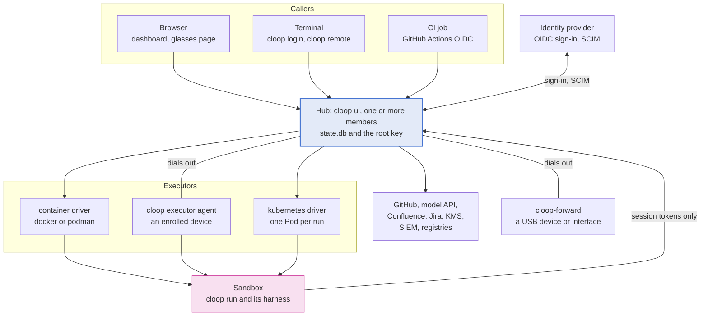
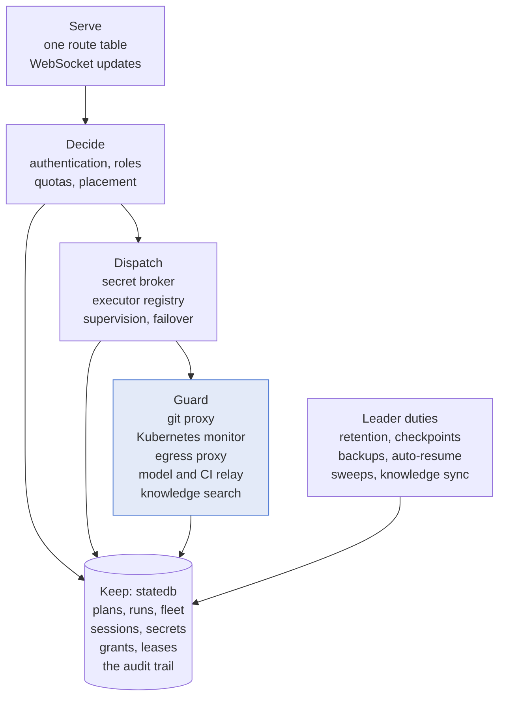
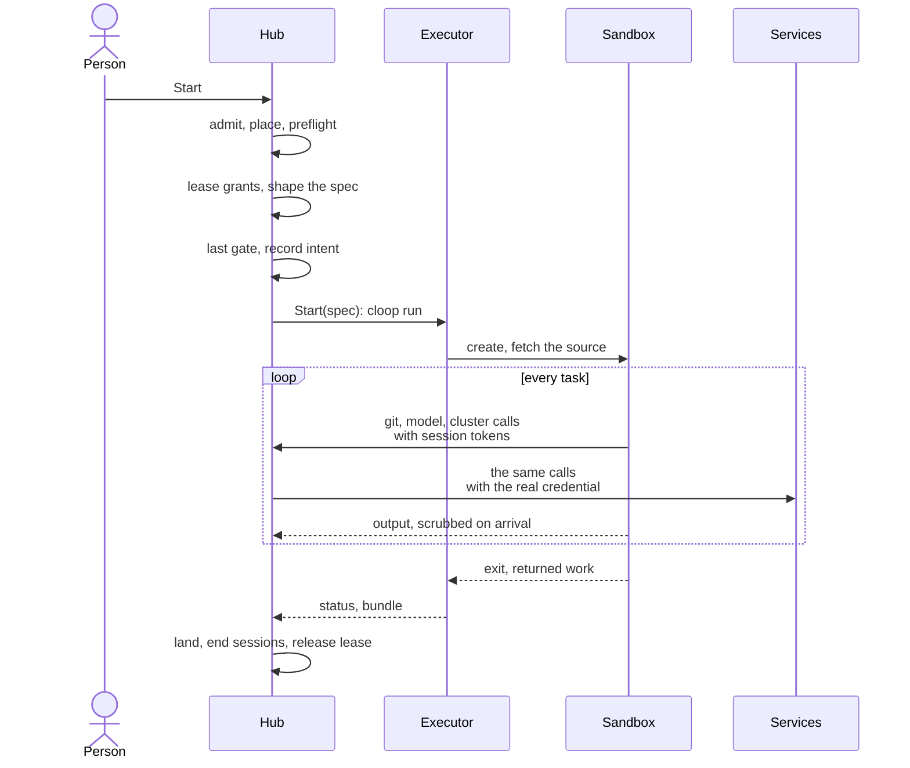
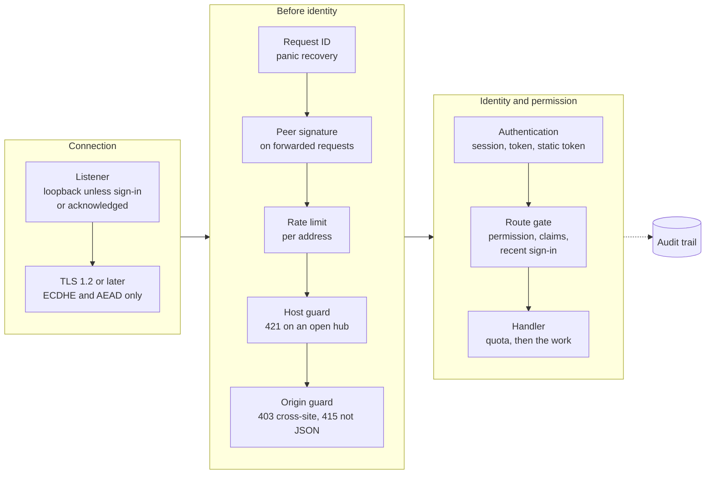
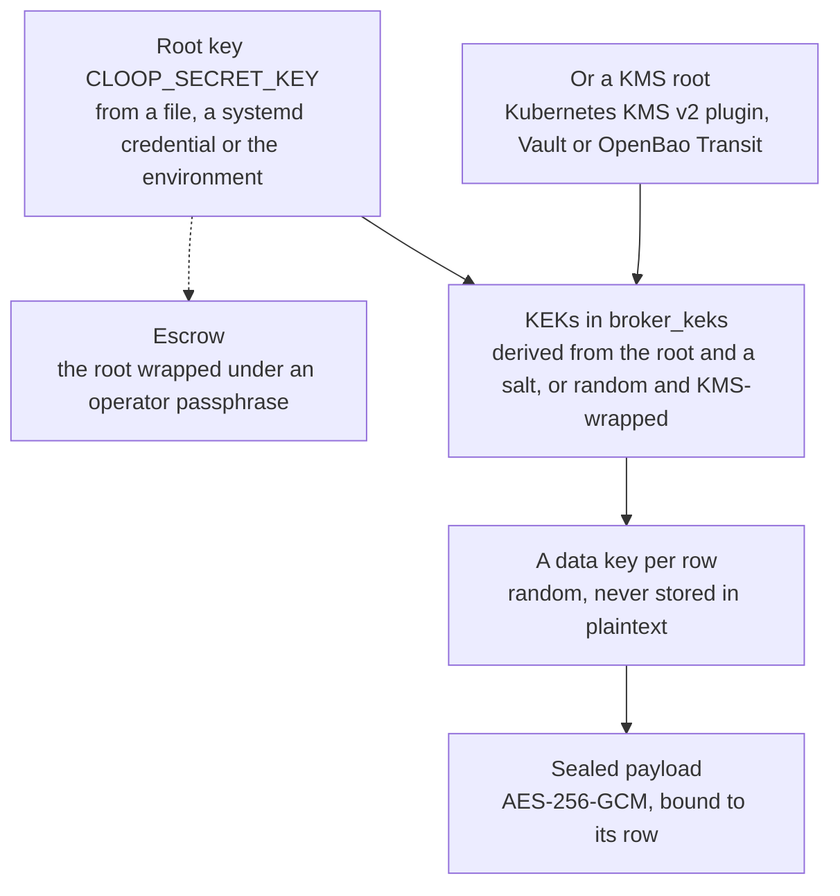
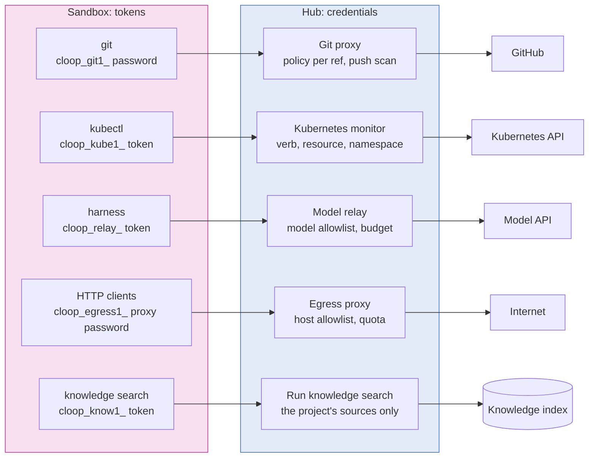

# Component and security architecture

The whole of cloop on one page: the processes it runs as, the components inside
each, the data they keep, the path a task takes from a click to a commit, and —
at every place where one part meets another — what is trusted, what proves the
other side is who it claims, and what stops a compromised part from reaching
further.

Every other page under Architecture and Security goes deep on one piece. This
one places them, says how they depend on each other, and links to where each is
argued in full. Package paths are real ones, and a test keeps them that way:
`tests/docs/architecture_overview_test.go` fails when a path named here stops
existing, and when a package is added under `pkg/` or a suite under `tests/`
without being named here — a package in the [component map](#component-map), a
suite in [how the architecture is kept true](#how-the-architecture-is-kept-true).

- [Two ways to run cloop](#two-ways-to-run-cloop)
- [The system at a glance](#the-system-at-a-glance)
- [Processes](#processes)
- [Inside the hub](#inside-the-hub)
- [What is kept, and where](#what-is-kept-and-where)
- [A run, end to end](#a-run-end-to-end)
- [Security architecture](#security-architecture)
  - [Design rules](#design-rules)
  - [Trust boundaries](#trust-boundaries)
  - [Identity and access](#identity-and-access)
  - [Secrets and keys](#secrets-and-keys)
  - [Sandbox containment](#sandbox-containment)
  - [Credential guards](#credential-guards)
  - [Transport and the agent channel](#transport-and-the-agent-channel)
  - [Supply chain](#supply-chain)
  - [Audit and evidence](#audit-and-evidence)
  - [Availability as a security property](#availability-as-a-security-property)
- [Component map](#component-map)
- [How the architecture is kept true](#how-the-architecture-is-kept-true)
- [Reading on](#reading-on)

---

## Two ways to run cloop

cloop is one Go binary — `main.go` hands over to `cmd`, a Cobra command tree —
used in two very different ways.

**On a checkout.** `cloop run` in a repository is the original product: the
orchestrator (`pkg/orchestrator`) turns a goal into a plan of tasks, runs a
*harness* — Claude Code's `claude`, GitHub Copilot's `copilot`, or a model API
called directly — once per task, detects the outcome, and keeps going. Plan,
history and costs live in the checkout's `.cloop/state.db`. The harness runs as
the developer, with the developer's files and credentials. There is no trust
boundary here beyond the machine itself, and the [first project](../getting-started/first-project.md)
and [how cloop works](../getting-started/concepts.md) describe this mode.

**As a hub.** `cloop ui` — the dashboard, its JSON API and WebSockets — hosts
many projects for many people, and the design rule turns over: **the hub
decides and records; executors run.** A run is dispatched as a `cloop run`
workload to an *executor* — a container on a host, an enrolled edge device, a
Kubernetes Pod — with the credentials its project was granted leased for the
run, and wherever cloop can arrange it, those credentials never enter the
sandbox at all: the sandbox holds a session token, and a proxy on the hub
spends the real credential on its behalf.

The split is visible in the import graph. `pkg/orchestrator` is imported by
`cmd` and nothing else: the hub does not contain the loop, it starts one
somewhere else. Everything below is about the second mode, because that is
where the trust boundaries are.

---

## The system at a glance

Three facts organise the rest of this page:

- **The hub is the only trusted component.** It holds the database, the root
  key and every credential. Everything else is assumed capable of lying: a
  browser session can be a stolen cookie, an enrolled device can be
  compromised, and a **workload is hostile by assumption** — it runs code the
  hub did not write, chosen by a model.
- **Devices and forwarders dial out.** The hub never opens a connection to an
  edge device; an agent behind NAT keeps one outbound WebSocket and receives
  its work over it.
- **Sandboxes reach the hub, not the services, wherever a guard is on.** A
  sandbox's git and its Kubernetes requests go to listeners on the hub, which
  decide each request and attach the real credential on the far side, once the
  git proxy and the Kubernetes monitor are on — `cloop hub bootstrap` turns on
  both. So do its knowledge searches, its Internet traffic when egress is
  leased, and its model calls when the model relay, which is opt-in and serves
  Claude Code and Anthropic API runs, is on.

---

## Processes

| Process | Started as | Runs on | Holds | Code |
| --- | --- | --- | --- | --- |
| Hub member | `cloop ui` | the control-plane host; several share one database as a [cluster](hub-cluster.md) | the database, the root key, sessions, the credential guards' listeners | `pkg/ui` |
| REST server | `cloop serve` | wherever it is run | one project's API, without the dashboard | `pkg/apiserver` |
| Run | `cloop run` | in a sandbox on an executor, or on a checkout | one project's plan, and the harness it starts | `pkg/orchestrator` |
| Harness | `claude`, `copilot` | as a child of the run | session tokens the hub minted for the run and, wherever no guard is on, the credential itself — by default its Claude or Copilot sign-in | `pkg/provider/claudecode`, `pkg/provider/copilot` |
| Device agent | `cloop executor agent` | an enrolled device, as a hardened service | its agent credential and, when enrolled with one, the hub's SPKI pin | `pkg/executor/agent` |
| Upgrade helper | `cloop-executor-upgrade.service` | the same device | no credential; root, to verify and install the signed builds the agent asks for | `pkg/executor/install` |
| Device forwarder | `cloop-forward` | a machine wired to hardware | a forwarder credential and, when enrolled with one, the hub's pin | `cmd/cloop-forward`, `pkg/deviceforward` |
| Terminal client | `cloop login`, `cloop remote` | a developer's machine | a terminal session approved from the browser | `pkg/hubclient` |
| Cluster share | `cloop remote kube share` | a developer's machine | runs the kubeconfig's exec plugin locally, uploads a narrow ServiceAccount token | `pkg/kubeexec`, `pkg/kubeshare` |
| MCP server | `cloop mcp` | beside a harness | the plan as Model Context Protocol tools and, in a run of a project with knowledge sources, the run's knowledge search | `pkg/mcp`, `pkg/knowledgerun` |

`cloop-forward` is a separate binary on purpose: its `main` imports
`pkg/deviceforward` and links no orchestrator, dashboard or hub code, so what
runs on the machine wired to the hardware is a byte pump with a credential
rather than a product
([device forwarders](../guides/device-forwarders.md)).

---

## Inside the hub

A hub member is one process, and most of what follows lives in `pkg/ui`. It
sorts into six concerns:

**Serve.** Every route is declared in one route table with the permission it
requires, the scope that permission is evaluated against, and whether it needs a
recent sign-in; `gate()` wraps each one at registration and `require()` is the
single enforcement point, so a handler cannot forget to check — a route that
declares no permission is refused at startup unless it is explicitly public.
The [HTTP API reference](../reference/http-api.md) is generated from that table
and gated against it. Live state reaches dashboards as WebSocket pushes, scoped
per project, and between members over the cluster's event bus.

**Decide.** Authentication resolves a caller to an identity; `pkg/authz`
resolves the identity to a role per scope; `pkg/quota` decides *how much* where
`pkg/authz` decides *whether*; placement (`pkg/executor`) decides *where* a run
may go. Each is described under [identity and access](#identity-and-access) and
in [executors: placement](executors.md#placement).

**Keep.** One SQLite database per control plane (`pkg/statedb`, schema in
numbered migrations) holds the fleet, sessions, grants and leases, sealed
secrets, proxy sessions, the knowledge index and the hub's own audit chain; each
project keeps its plan and its own chain in its `.cloop/state.db`. See
[what is kept](#what-is-kept-and-where).

**Dispatch.** The secret broker leases a project's grants for one run; the
executor registry resolves the project's binding to a driver; supervision
watches the handle, fails a run over when its executor dies, and brings back
what the run produced. See [a run, end to end](#a-run-end-to-end).

**Guard.** The credential guards are listeners the hub process itself serves,
because the process that mints a session must be the one that redeems it —
there is no separate proxy daemon to compromise or to drift out of step. See
[credential guards](#credential-guards).

**Leader duties.** Work that must happen once per control plane — retention and
the audit prune, head checkpoints, scheduled backups, auto-resume of paused
projects, the orphan sweep, knowledge syncs — runs on the member holding the
control-plane lease (`pkg/hublease`, `pkg/hubcluster`). A lone hub leads itself.

---

## What is kept, and where

| Store | What it holds | Protection |
| --- | --- | --- |
| `<hub>/.cloop/state.db` | executors and their sessions, dashboard sessions, API tokens, role bindings, project members, quotas, provisioned users and groups, secrets, grants, leases, grant requests, proxy sessions, cluster membership and bus, knowledge sources and chunks, telemetry, the hub's audit chain | SQLite in WAL mode with a bounded log; credential payloads sealed under the [key hierarchy](#secrets-and-keys); credentials the hub issues kept only as hashes |
| `<project>/.cloop/state.db` | the plan and its tasks, run state, events, costs, requirements and verdicts, the project's audit chain | the same schema and rules: migrations only add, a binary refuses a newer database unless every migration it lacks is recorded as harmless to it, and a save never erases a column an older binary does not know |
| `<project>/.cloop/` files | task artifacts, live output, checkpoints, attachments, the sandbox spec, config | crash-safe writes (`pkg/atomicfile`), size-bounded reads (`pkg/boundedread`), bounded by the janitor (`pkg/janitor`) |
| Root key | `CLOOP_SECRET_KEY`, from a file, a systemd credential or the environment — or KEKs held by a KMS | outside every `.cloop/` directory; escrowable under a passphrase (`pkg/keyescrow`) |
| Audit checkpoints | the head of each audit chain, every five minutes by default | written where the database cannot reach, so a truncated trail is detectable |
| Per-identity homes | each person's Claude Code and Copilot configuration on an SSO hub | one directory per identity; destroyed by offboarding |
| Device side | the agent's credential, `agent.json` in its state directory (mode 0600), and the hub's pin if it was enrolled with one | the credential is revocable from the hub, which then sends `bye` so the agent stops reconnecting |

The rule for credentials the hub *issues* — session cookies, API tokens,
enrollment tokens, agent credentials, proxy session tokens — is that no
database holds the plaintext. What is stored is a hash — a SHA-256, or a salted
HMAC-SHA256 for API tokens, glasses links and SCIM credentials — compared in
constant time, which authenticates a presented token and cannot be turned back
into one. That raises a question for a hub process that adopts another's run,
since it never saw the run's tokens:
how does it scrub them from the run's output? Every token the hub mints for a
run starts with a prefix that names its kind (`cloop_git1_`, `cloop_kube1_`,
`cloop_egress1_`, `cloop_relay_`, `cloop_know1_`, and GitHub's `ghs_` for App
installation tokens), so a candidate can be cut out of a stream and confirmed
against the recorded hash (`pkg/redact`).

---

## A run, end to end

What happens between **Start** and the task's commit landing, in the order the
hub does it (`startWorkloadAs` in `pkg/ui/executor.go`):

1. **Admission.** The request passes the [front door](#identity-and-access): a
   same-origin check, a JSON body, an authenticated identity, the route's
   permission at the project's scope, the identity's quota and the tenant's
   concurrency slot.
2. **Where.** The project's directory is re-checked against the confinement
   rule (`pkg/projectconfine`) before anything is chosen; then the project's
   executor binding is resolved, and the host-execution policy refuses a driver
   with no isolation. A run also has to clear a *harness preflight*: the
   executor must be able to give the harness a Claude or Copilot sign-in, or the
   run is refused before anything is minted.
3. **What it may hold.** The secret broker leases every grant whose subject
   matches the project and the executor, for this run, with a TTL. Repository,
   device and interface grants become mounts, `--device` arguments and namespace
   moves; the rest become environment variables and files — except a credential
   a guard will hold, which is withheld from the spec entirely.
4. **What it runs in.** The project's `.cloop/sandbox.yaml` narrows the spec
   (image, environment allowlist, ceilings, mounts) and is refused, not partly
   honoured, when the executor cannot provide it; the image is checked against
   the trust policy and pinned to a digest. Then the firewall levels, forwarded
   devices, the egress session, the workspace (for a feature, its branch
   bundle), the hub CA trust, the model relay session, the knowledge session
   and the operator's resource ceilings are applied, in that order.
5. **Last gate.** `executor.RequireRevocable` refuses an executor that could not
   take back a credential it is about to receive — after every step that can
   add one, because a check placed earlier would be asking about a spec that
   does not exist yet. The dispatch intent is recorded before the workload
   exists, so a member that dies at the wrong moment leaves a record the next
   one acts on rather than an unsupervised run.
6. **Run.** The driver starts the workload. Its output is scrubbed of every
   value the run was given before the hub's log bus, the database or a
   dashboard sees it; its pushes go through the git proxy's policy and are
   [scanned](../git-interception-proxy.md#the-push-scan) for those same values;
   its firewall's refusals are reported to the run.
7. **Return.** An executor that does not share the hub's filesystem returns the
   run's commits as a write-back bundle, or a seeded project's outcome as a
   result frame; the hub lands them, ends the run's sessions, releases its
   lease and destroys file-delivered credentials. If the executor is lost
   instead, supervision re-dispatches the run up to a cap and quarantines a
   task that two or more executors went down under.

[Executors: end to end](executors.md#end-to-end) walks the same path with every
driver's differences.

---

## Security architecture

### Design rules

These are the rules the code follows wherever a choice had to be made. Each one
names where it is enforced.

1. **The hub never runs a harness itself.** With `executors.allow_host_process:
   false` — which `cloop hub bootstrap` writes — no request can fork a process on
   the hub's host. The policy is a ratchet enforced at registration,
   resolution, placement, in the local driver and in every host-touching
   handler, and a call-graph test follows every route and background duty to
   prove nothing reaches `os/exec` ungated
   ([the no-host-execution guarantee](../security/model.md#the-no-host-execution-guarantee)).
2. **A workload is hostile.** Nothing a sandbox says is believed without
   evidence: its output is scrubbed, its pushes are scanned, its returned work
   is capped in size and accepted only for the handle that asked for it, and
   its claims about its own runtime are checked by a probe the image cannot
   replace.
3. **Credentials stay on the hub's side of the boundary.** A forge token, a
   cluster credential and a Claude token can be spent by guards on the hub —
   the git proxy and the Kubernetes monitor, which `cloop hub bootstrap` turns
   on, and the opt-in model relay — and a knowledge source's credential never
   leaves the hub at all. Behind a guard, a sandbox holds a session token worth
   one run's traffic through it, which a revocation ends at the next request.
   While a guard is off, a limit only it can enforce is refused or narrowed to
   read-only rather than delivered unenforced, unless an administrator records
   on the grant why it may go out.
4. **A declared capability is not a verified one.** A runtime's name is
   checked by the [isolation probe](#sandbox-containment), and a claim its
   evidence contradicts is refused; image tags are resolved to digests and
   signatures verified where the policy asks; release artifacts are verified
   against the workflow that must have signed them; devices report their build,
   and the hub refuses those below a floor.
5. **Refuse rather than degrade.** A driver that cannot honour a spec field
   refuses the workload; a guard that is configured but not running fails its
   traffic closed instead of handing the credential over; an unparseable or
   unsatisfiable grant constraint, or a payload that minimises to nothing, is a
   denial and an audit row — never a wider credential.
6. **Deny by default, and loud where it is not.** With RBAC in force — and
   `cloop hub bootstrap` writes the `default_role: none` that puts it in
   force — an identity no binding matches holds role `none`. A route without a
   declared permission is refused at startup. A listener with no sign-in in
   front of it binds loopback unless an operator says otherwise in writing. The
   one wide configuration — single sign-on without a role policy, kept so that
   an upgrade locks nobody out — is reported as such by the startup banner,
   `cloop hub doctor`, Settings and `/api/me`, beside a one-click remedy.
7. **Every decision that matters leaves evidence.** Authorisation outcomes,
   grants, leases, guard decisions and fleet changes are rows in a hash-chained
   audit trail whose head is checkpointed off the database and can be forwarded
   off the machine as it is written.
8. **Everything is bounded.** Request rates, WebSocket connections, bodies, log
   replay, returned work, file reads, the write-ahead log, disk use and
   retention all have ceilings, because an unbounded resource is a denial of
   service a single tenant can cause.

### Trust boundaries

The [security model](../security/model.md#trust-boundaries) numbers the four
boundaries between the hub and what it controls; the
[threat model](../security/threat-model.md) takes each through STRIDE. Around
them sit the cross-cutting ones:

| Boundary | Far side | It proves who it is with | The hub assumes it can | Detail |
| --- | --- | --- | --- | --- |
| ① Caller ↔ hub | browsers, terminals, CI jobs, SCIM clients | an SSO session, an API token, a terminal session, the static token, a federated CI token or a SCIM credential | replay a stolen cookie, forge cross-site requests, rebind DNS | [① Browser ↔ hub](../security/threat-model.md#①-browser--hub) |
| ② Hub ↔ device agent | enrolled devices | a single-use enrollment token exchanged for an agent credential; the device pins the hub's key when enrolled with it | be compromised, lie about its runtime or build, send back more than was asked | [② Hub ↔ remote agent](../security/threat-model.md#②-hub--remote-agent) |
| ③ Hub ↔ container runtime | the local docker or podman socket | nothing — the socket is root-equivalent; the hardening is in the argv the hub builds | run whatever the argv says | [③ Hub ↔ container runtime](../security/threat-model.md#③-hub--container-runtime) |
| ④ Hub ↔ Kubernetes | a cluster's API server | the brokered kubeconfig or projected ServiceAccount token | hold other workloads beside the Pod, and let a workload reach other cluster services | [④ Hub ↔ Kubernetes cluster](../security/threat-model.md#④-hub--kubernetes-cluster) |
| Sandbox ↔ guards | every workload | per-run session tokens, minted per guard | hold the token, misuse it within its scope, try to exfiltrate through it | [credential guards](#credential-guards) |
| Hub ↔ hub | other members of a cluster | an HMAC over each forwarded request, keyed by a secret in the shared database | nothing a member could not already do: anyone who can read the key can rewrite the database the hub trusts; the owner still re-checks the original caller | [hub members](../security/threat-model.md#cross-cutting-hub-members) |
| Hub ↔ forwarder | on-prem machines wired to hardware | a forwarder enrollment exchanged for a credential, pinned like an agent | be compromised | [device forwarder](../security/threat-model.md#cross-cutting-on-prem-hardware-through-a-device-forwarder) |
| Hub ↔ services | IdP, GitHub, model API, knowledge sources, KMS, SIEM | TLS to the service; the service's own signing keys where it signs | answer slowly or not at all; return text that tries to instruct an agent | [knowledge sources](../security/threat-model.md#cross-cutting-knowledge-sources), [SCIM](../security/threat-model.md#cross-cutting-scim-provisioning) |

### Identity and access

Every request to the hub passes the same layers, outermost first
(`buildHandler` in `pkg/ui/server.go`):

The health probes skip everything after panic recovery. An edge agent or a
forwarder connecting with its own credential, and a member's signed call to the
cluster's internal endpoints, skip the session authentication and the route
gate, because each authenticates itself.

**Who a caller can be.**

| Credential | Shape | Issued by | Kept as | Ends |
| --- | --- | --- | --- | --- |
| Dashboard session | `cloop_session` cookie: `HttpOnly`; `Secure` and `SameSite=Strict` under TLS | OIDC sign-in, authorization code with PKCE (`pkg/oidcauth`) | a hash, with the IdP refresh token sealed (`pkg/sessionstore`) | idle timeout (8 h), absolute ceiling (24 h), sign-out, admin or IdP revocation — which also closes every stream it opened |
| API token | `cloop_pat_<id>_<secret>` | a person or an admin, scoped and expiring (`pkg/apitoken`) | a salted HMAC | expiry or revocation |
| Terminal session | `cloop_cli_…` | `cloop login` (`pkg/hubclient`): a device code approved from a signed-in browser, issued by `pkg/oidcauth` | a hash | its own lifetime and idle timeout, sign-out or revocation |
| Static admin token | `CLOOP_UI_TOKEN` | the operator | named by a fingerprint, never stored (`pkg/statictoken`) | retired at runtime on every member, closing what it opened |
| Glasses link | a `cloop_pat_` token named *Display glasses link*, carried in the URL | a person, for their own display glasses | a salted HMAC | 30 days, rotation, revocation or offboarding |
| CI session | `cloop_ci_…` | the hub, for a GitHub Actions OIDC token an allowlist rule matched — checked by `pkg/ciauth` and `pkg/celmatch`, minted by `pkg/claudeproxy` | a hash | the session's lifetime, or revocation |
| SCIM credential | `cloop_scim_…` | an admin, for the IdP's provisioning client (`pkg/provision`) | a salted HMAC | revocation; rotated with an overlap |
| Agent enrollment, credential | `clet1.…`, then `clac1.…` | `cloop executor enroll`, then the first connection | hashes | single use; revocation |
| Forwarder enrollment, credential | `clft1…`, then `clfc1…` | `cloop forward enroll`, then the first connection | hashes | single use; revocation |

**What a caller may do.** Roles form a ladder — `none` < `viewer` <
`operator` < `maintainer` < `admin` — and, with RBAC in force, an identity's
role is decided per scope from three layers: role bindings mapped from the
IdP's claims in config, bindings written at runtime during an incident
(`pkg/rolestore`), and a project's own member list (`pkg/projectmember`). RBAC
is in force when single sign-on is on and an operator wrote a policy — a role
mapping or a `default_role` — and `authz.Enforced` is the one predicate the
request gate and every reporter ask
([when RBAC is in force](../security/model.md#when-rbac-is-in-force)). Above
the operator tier two more conditions apply: the session's claims must have
been re-checked at the IdP within `ui.oidc.max_claim_age_minutes` (5 minutes by
default), and a privileged route marked *sudo* needs an interactive sign-in
within `ui.oidc.sudo_max_age_minutes` (2 hours), or the answer is
`401 REAUTH_REQUIRED` and the dashboard sends the person back to the IdP
([identity, roles and permissions](../security/model.md#identity-roles-and-permissions)).

**How much.** Quotas cap projects, concurrent tasks and reproductions,
executors, sessions, and a daily token and cost budget per identity
(`pkg/quota`, `pkg/quotastore`); spend is attributed to the identity that
started a run and, with the model relay on, counted at the relay from the API's
own usage figures rather than taken from the run's report.

**Joining and leaving.** A person appears by signing in or by SCIM provisioning
(`pkg/scim`, `pkg/provision`); asks for access through grant requests that an
approver sees in the approvals inbox (`pkg/approvalnotify`); and leaves through
offboarding (`pkg/offboard`), which ends their sessions, tokens and glasses
links, revokes their grants and leases, stops their tasks, destroys their
personal secrets and their Claude Code home, and writes a deny binding. A person
disabled at the identity provider is suspended through SCIM in one request,
without an administrator, and offboarded once deleted
([SCIM provisioning](../guides/scim-provisioning.md)).

**What a page cannot do.** The dashboard sends `script-src 'self'` with no
`'unsafe-inline'`; markup carries no code, only `data-action` names a
delegated dispatcher looks up; state-changing requests need the hub's own
origin or a bearer token and a JSON body; WebSockets need an exact origin; files
a run produced are served so that none can be rendered as a document of the
hub's origin ([① Browser ↔ hub](../security/model.md#①-browser--hub)).

### Secrets and keys

**The key hierarchy.** A credential's payload is sealed under a data key of its
own, the data key under a key-encryption key, and the key-encryption key comes
from a root the database never holds:

- `pkg/rootkey` is the one resolver of the root, from a file the process owns
  (mode 0400 or 0600, outside every `.cloop/`), a systemd credential — which is
  how a TPM-sealed `LoadCredentialEncrypted=` reaches the hub — or the
  environment, in that order.
- A KEK is stretched from the root with a per-key salt (200,000 rounds of
  SHA-256) and verified against a check value, so a wrong root is told apart
  from a corrupt row at load time. With `secrets.kms`, a KEK is random and
  only the KMS's ciphertext of it is stored (`pkg/kms`): the KMS sees 32 bytes of
  KEK and never a secret, and the store cannot be opened without asking it.
- Both layers bind their ciphertext to its row with GCM associated data, so a
  sealed payload copied onto another row fails to open instead of delivering
  someone else's credential under the wrong name.
- Rotation re-wraps data keys, never payloads, so it runs online against a
  serving hub, as does changing the root itself; `pkg/keyescrow` keeps a copy
  of the root under a passphrase, so losing the root key file is not the end
  of every sealed credential ([key rotation](../operations/runbook.md#sealing-keys--online-resumable-no-credential-re-minting),
  [the root key](../operations/runbook.md#the-root-key)).

**From a secret to a run.** A *secret* belongs to the organisation or, on a
multi-user hub, to one person. A *grant* gives it to a subject — a project, an
executor, or every executor whose recorded labels match a selector — with
kind-specific constraints and a TTL. At dispatch the broker turns the grants
that match into one *lease* for the run: a short-lived, minimised
materialisation, renewed while the run lasts and recomputed from the current
grants at every renewal, so a revoked grant is never issued again. The lease is
what the workload's material comes from and what revocation takes back at once:
the hub sends a device a `revoke` frame, wipes the files a container reads,
empties a Pod's lease Secret, and ends the guard sessions standing on the
lease. Material that went into a process's environment cannot be taken back
from it, so a container or Pod holding some is stopped, and the report says so
([the lease-revocation guarantee](../security/model.md#the-lease-revocation-guarantee)).

| Kind | What it is | How it reaches a run |
| --- | --- | --- |
| `github_pat` | a GitHub token | held by the git proxy when it runs; otherwise a file that a credential helper answers from, for the granted repositories on the grant's forge host only |
| `github_app` | an App installation: app id, installation id, private key | the key never leaves the hub; an installation token scoped to the grant is minted per lease and renewed before its hour is up, and held by the git proxy when it runs |
| `kubeconfig` | a cluster credential | held by the Kubernetes monitor when it runs; otherwise rewritten to the allowed contexts and namespaces |
| `registry` | a registry login | a docker config filtered to the allowed registries, as `DOCKER_CONFIG` |
| `env` | opaque variables | the environment, filtered to the allowed keys and narrowed again by the sandbox spec's allowlist |
| `egress_proxy` | an outbound proxy, possibly with credentials | `HTTPS_PROXY` and `HTTP_PROXY`, its host allowlist enforced by the executor's network policy |
| `local_repo` | a directory of repositories on the hub | a bind mount of the matching repositories, read-only unless granted otherwise |
| `host_device` | device nodes on the executor's host | `--device` |
| `host_interface` | network interfaces on the executor's host | moved into the sandbox's network namespace for the run |

Values a run was given are scrubbed from everything it writes down, by exact
match (`pkg/redact`), and credential *shapes* from a single pattern registry
are scrubbed wherever exact values are unknown —
[credential patterns](../reference/credential-patterns.md) lists every one.
File-delivered material is destroyed when the run ends, and a sweep at startup
destroys what a crash left behind (`pkg/securewipe`).

### Sandbox containment

**Isolation is declared by the driver and verified by a probe.**

| Driver | Isolation | Kernel of its own | Notes |
| --- | --- | --- | --- |
| `localprocess` | `none` | no | only where `allow_host_process` is true; never on a strict hub |
| `container` | `container`, or `vm` with Kata | with gVisor or Kata | docker or podman; `--cap-drop=ALL`, `no-new-privileges`, a read-only root filesystem, the project directory owner's uid, no network unless egress is arranged, memory, CPU and process limits |
| `remote` | `remote` | per the device's runtime | an enrolled device, running work in a container runtime of its own or directly — or in virtual executors, each with its own engine, runtime and firewall |
| `kubernetes` | `remote` | with a gVisor or Kata RuntimeClass | one Pod per run, non-root with a read-only root filesystem and no service account token; a NetworkPolicy of its own when egress is filtered |

A project can require a VM or a kernel of its own, and placement does not take
a runtime's *name* for it. `cloop isolation-probe` reads, from inside a
sandbox, what only the serving kernel can answer — its boot ID, uptime,
hypervisor flag, DMI and gVisor's markers. A container or device executor binds
the probe in read-only from its own binary, so an image cannot replace it; on
Kubernetes, which cannot bind a file into a Pod, the probe is the cloop the
executor's own configured image ships. A claim the evidence contradicts is
refused under the `isolation_evidence` constraint, and an executor never probed
is admitted with a warning on the run unless `executors.isolation_evidence` is
`required` (`pkg/isolationprobe`, `pkg/isolationverify`).

**Images.** `sandbox.image_policy` allowlists registries and repositories, can
require a digest and a cosign signature — by key or by keyless identity — and
pins what it admits to a digest (`pkg/imagepolicy`). cloop's own images are
verified by digest against the workflow that publishes them before a sandbox
runs one: an unverified image is flagged on the run by default and refused
under `executors.image_provenance: required`, and a signature that is not that
workflow's refuses it either way. On Kubernetes a tag is resolved to a digest
at the registry before the Pod is built, so the Pod runs what the policy
evaluated; a tag the registry will not resolve is refused under
`require_digest` or `require_signature`, and otherwise goes in with a warning.

**Network.** A container has no network at all by default. Given egress, it
gets one of two mechanisms, chosen by the shape of the authorisation: an
`--internal` network with no route off the host, on which the hub's egress
proxy is the only way out, or — where it must dial named addresses directly —
a host nftables ruleset scoped to its bridge, installed *before* the workload
starts. A Pod gets a NetworkPolicy of its own. Firewall rules nest: a device's
rule set is the superset of what any sandbox on it may reach, a virtual
executor's may only narrow it, a project's may only narrow that
(`pkg/fwpolicy`) — and no allow list may contain a cloud metadata service by
accident (`pkg/cloudmeta`). Refused connections
fail fast unless the rules say to drop them, and are reported to the run with
the rule that refused them — except on Kubernetes, where a NetworkPolicy keeps
no log, and on devices older than protocol v24 (`pkg/netfilter`, `pkg/denylog`;
[firewall rules](../guides/firewall.md),
[sandbox network isolation](executors.md#sandbox-network-isolation)).

**Hardware.** Device nodes and network interfaces reach a sandbox through a
grant (`host_device`, `host_interface`), a virtual executor an administrator
gave them to, or a forwarder binding — never through a path in the
repository-committed sandbox spec, which is whatever a pull request says it
is. On-prem hardware reaches a cloud sandbox through a
[device forwarder](../guides/device-forwarders.md), attached by the executor
that runs the sandbox, with no listener anywhere.

**Resources and reuse.** CPU, memory, process count and disk are limited per
workload, under ceilings an operator sets per executor and per project; disk is
held to its limit by sampling (`pkg/executor/internal/diskwatch`). Every
workload a container or Kubernetes executor runs gets a container or Pod that
did not exist before it and does not survive it: there is no warm pool,
because a reused sandbox carries whatever the last tenant left in it.

**The agent's own privileges.** An agent that installs firewalls needs
`CAP_NET_ADMIN`; cloop clears ambient and inheritable capabilities at startup
and grants the one capability to `nft` alone (`pkg/caps`), so no workload
inherits it.

### Credential guards

Each guard is served by the hub process itself, and a sandbox reaches it
through its firewall: the git proxy and the Kubernetes monitor on listeners of
their own, over TLS that the hub's own CA certifies under `tls: auto`
(`pkg/hubca`, rotatable online); the model relay on the git proxy's listener by
default; the egress proxy on its own; the run knowledge search on the
dashboard's. Each takes a session token minted for one run, decides the request
against that run's policy, and only then attaches a credential the sandbox
never sees:

| Guard | Decides | Code | Detail |
| --- | --- | --- | --- |
| Git proxy | per pushed ref: branch allowlist, read-only, repository scope; refuses a push that carries a value the run was given | `pkg/gitproxy`, `pkg/executor/gitproxycreds`, `pkg/forgehost` | [git interception proxy](../git-interception-proxy.md), [git proxy architecture](git-proxy.md) |
| Kubernetes monitor | each API request parsed into verb, group, resource, subresource, namespace and name before the cluster credential is attached; shell-like subresources refused for every verb | `pkg/kubeguard`, `pkg/kubeshare` | [Kubernetes access monitor](kubernetes-access.md) |
| Egress proxy | each connection against its egress grant's hosts, addresses, ports and methods, and its byte quotas | `pkg/egressbroker` | [scoped network egress](../reference/configuration.md#scoped-network-egress) |
| Model relay | each model call against the project's model allowlist and the starter's daily budget; usage counted from the API's own figures | `pkg/claudeproxy`, `pkg/ui/model_relay.go` | [the model relay](../guides/secrets.md#with-the-model-relay-on-the-claude-credential-stays-on-the-hub) |
| Run knowledge search | searches only the sources bound to the run's project; retrieved text is fenced and cited | `pkg/knowledgerun`, `pkg/knowledge` | [knowledge sources](../security/model.md#knowledge-sources) |
| CI relay | a federated pipeline's model calls, against the rule that admitted it | `pkg/ciauth`, `pkg/claudeproxy` | [running an agent in CI](../guides/ci-pipelines.md) |

What the guards share:

- **A session lives no longer than its run.** The git proxy's, the Kubernetes
  monitor's and the model relay's stand on the run's secret lease, extended as
  it is and ended with it; the egress and knowledge sessions are renewed while
  the run lives and closed when it ends. Revoking the grant behind a session
  refuses its very next request.
- **Sessions survive the hub.** They are recorded in `proxy_sessions`
  (`pkg/sessionrecord`) by hash, and the member that adopts a run after a
  restart restores them with its lease, re-deriving the credential from the
  grant rather than from anything recorded.
- **They fail closed.** A guard that is configured but not running refuses the
  traffic; it never falls back to handing the credential to the sandbox.
- **They are audited** —
  [`gitproxy.push_denied`](../reference/audit-events.md#gitproxy),
  [`gitproxy.push_secret_refused`](../reference/audit-events.md#gitproxy),
  [`kubeguard.request_denied`](../reference/audit-events.md#kubeguard),
  [`egress.connect`](../reference/audit-events.md#egress),
  [`model_relay.denied`](../reference/audit-events.md#model_relay),
  [`knowledge.run.search`](../reference/audit-events.md#knowledge) — and
  metered ([metrics](../operations/metrics.md)).

Where no guard runs, a credential is leased into the sandbox the older way —
still scoped, minimised, revocable and scrubbed from output — but a grant whose
limits only a guard can enforce is not delivered as if they held. A GitHub
branch allowlist without the git proxy turns a `github_app` grant into a
read-only token and refuses a `github_pat`, which cannot be narrowed; a
kubeconfig's namespace or verb limits without the Kubernetes monitor are
refused unless an administrator records on the grant why it may go out
unenforced, audited as
[`secret.unguarded_ack`](../reference/audit-events.md#secret).

### Transport and the agent channel

- **TLS** is decided in one place (`pkg/tlsconf`) for the dashboard, `cloop
  serve` and the monitors' listeners: TLS 1.2 or later, ECDHE key exchange and
  AEAD ciphers only.
- **Devices pin the hub where they can.** An agent or a forwarder enrolled
  with the hub's SPKI fingerprint — which enrollment carries whenever the hub
  serves TLS itself — verifies it rather than the system store alone, and
  several pins can be staged for a rotation; one enrolled with no pin, behind a
  proxy that terminates TLS, verifies against the system store. Plaintext
  `ws://` to a host other than loopback is refused unless explicitly allowed.
- **The agent protocol is versioned** — the hub speaks versions 1 to 26 and
  stamps each frame with the version the session negotiated — and a hub refuses
  to place on a device too old for what a run needs, such as a `revoke` frame
  for revocable material, naming the device and the upgrade instead of
  failing later.
- **What a device sends back is bounded.** A handle accepts only the bundle its
  own dispatch asked for, up to that dispatch's cap, under a budget per
  executor and per hub process (256 MiB and 1 GiB by default), and nothing
  after its final status ([② Hub ↔ remote agent](../security/model.md#②-hub--remote-agent)).
- **Members sign what they forward** with an HMAC naming sender, recipient,
  time and a nonce; the owner re-authenticates the original caller rather than
  trusting the forwarder ([the peer channel](hub-cluster.md#the-peer-channel)).
- **The hub CA** certifies the git proxy's and the Kubernetes monitor's
  listeners under `tls: auto`, with short-lived certificates, and is rotated
  online in stages — staged, activated, retired — with an emergency path
  ([rotating the hub CA](../operations/runbook.md#rotating-the-hub-ca)).

### Supply chain

- **Releases are verified by who built them.** Release archives are signed
  keylessly by `release.yml` on a tag; the installer, `cloop upgrade` and an
  agent's upgrade verify that identity with cosign (`pkg/provenance`) instead of
  trusting a checksum that sits next to the archive, and fail closed when
  cosign is absent ([release provenance](../security/model.md#release-provenance-and-the-trust-root)).
- **The edge channel has a pin of its own.** Builds of `main` are signed by
  `edge.yml` and verified against that identity only; each carries its
  first-parent sequence on `main`, and a device's root helper refuses a build
  earlier than the installed one whatever the agent or the hub asks
  ([edge channel](../guides/edge-channel.md)).
- **cloop's images are signed per digest** as they are published, and a hub
  verifies cloop's own images by digest before a sandbox runs one —
  `executors.image_provenance` says whether an unverified one is flagged on the
  run or refused.
- **Builds know what they are.** `pkg/version` carries the commit, the sequence
  and the table of published releases with the agent protocol each speaks,
  which the Upgrade dialog and the auto-update policy (`pkg/executor/autoupdate`)
  read before they offer a device a build.

### Audit and evidence

- **A chain per database.** The hub's `state.db` and every project's carry an
  `audit_events` table whose rows are hash-chained: each row's hash covers its
  content and the previous row's, so an edit or a deletion breaks the chain
  from that point (`pkg/statedb`, verified by `cloop hub audit verify` and read
  as one trail by `pkg/auditmerge`).
- **One vocabulary.** Every action name the hub can write is registered in
  `pkg/auditaction`, and the [audit events reference](../reference/audit-events.md)
  is generated from that registry — a page citing an action that does not exist
  fails the build.
- **Losses are recorded, not hidden.** A failed append is counted and written
  into the chain as an [`audit.gap`](../reference/audit-events.md#audit) once
  the database takes writes again.
- **Truncation is detectable.** Every five minutes by default the leader
  writes each chain's head to a checkpoint outside the database
  (`pkg/auditcheckpoint`); pruning seals what it removes
  (`pkg/auditretention`).
- **The trail leaves the box as it is written.** Once `audit.forward` names a
  sink, the leader ships every row of every chain to syslog over TLS, an HTTPS
  endpoint such as Splunk's, or a file — at least once, from a cursor per sink
  that a new leader resumes from — and a chain that moved under a sink is
  itself recorded, as
  [`audit.forward.discontinuity`](../reference/audit-events.md#auditforward)
  (`pkg/auditforward`, [forwarding the trail](../operations/runbook.md#forwarding-the-trail-off-the-box)).
- **Health is reported, not guessed.** `/metrics` exports the hub's families
  (`pkg/hubmetrics`); `cloop hub doctor` and the dashboard's health panel check
  the deployment's configuration, and `cloop hub doctor --smoke` its dispatch
  circuit (`pkg/hubdoctor`); front-end telemetry, off by default, is scrubbed
  before it is stored (`pkg/telemetry`).

### Availability as a security property

- **One control plane, fenced.** A second `cloop ui` on the same database joins
  the cluster instead of silently diverging, and exactly one member holds the
  control-plane lease (`pkg/hublease`, `pkg/hubcluster`).
- **Runs outlive the process that started them.** A member that dies has its
  runs, agent connections, leases and guard sessions adopted by another
  ([hub cluster](hub-cluster.md#runs-agents-and-failover)); a member that dies
  between starting a workload and recording it leaves an intent that stops the
  workload rather than leaving it unsupervised.
- **A workload cannot take the fleet down one node at a time.** Failover is
  capped (`executors.failover.max_attempts`), and a task more than one executor
  died under is quarantined until someone resets it
  ([the failover cap](executors.md#the-failover-cap-and-the-node-killer-quarantine-task-20391)).
- **A full disk pauses rather than corrupts.** Runs pause below a free-space
  floor and record their outcome from a reserve (`pkg/diskreserve`); the
  write-ahead log is trimmed and truncated; the janitor and the leader's
  retention sweep prune what grows ([disk retention](../reference/configuration.md#disk-retention)).
- **Abuse is bounded at the door**: a token bucket per address, caps on
  WebSocket connections per address and in total, bounded request bodies, and
  panic recovery around every handler.

---

## Component map

Every package under `pkg/`, placed. The first column is the package; the
second, what it is for.

### Entry points

| Package | Role |
| --- | --- |
| `cmd` | the Cobra command tree behind `main.go`, grouped in `cloop --help`; most commands are thin wrappers over a package below |
| `cmd/cloop-forward` | the standalone device forwarder binary |

### Serving the hub

| Package | Role |
| --- | --- |
| `pkg/ui` | the hub: route table, handlers, dashboard assets, WebSockets, run dispatch, the guards' listeners, leader duties |
| `pkg/apiserver` | `cloop serve`, the REST API without the dashboard |
| `pkg/apidoc` | the HTTP API reference and `GET /api/openapi.json`, rendered from the route tables |
| `pkg/apierror` | the structured error both HTTP surfaces answer with |
| `pkg/jsonbody` | the one way a handler reads a JSON body |
| `pkg/sameorigin` | whether a request came from one of the hub's own pages; which forwarded headers to believe |
| `pkg/exposure` | which address the hub listens on, and the refusal of an open hub on the network |
| `pkg/reqid` | request correlation IDs through handlers, the orchestrator and providers |
| `pkg/clijson` | framing a JSON answer so it survives a stream that also carries diagnostics |
| `pkg/multiui` | the registry of projects the dashboard serves |
| `pkg/telemetry` | the model for browser diagnostic events |
| `pkg/stt` | speech-to-text for dictation |

### Identity and access

| Package | Role |
| --- | --- |
| `pkg/oidcauth` | OIDC relying party: authorization code with PKCE, ID-token validation, session cookies, terminal sign-in, sudo |
| `pkg/sessionstore` | durable dashboard sessions, with the one credential a session holds sealed |
| `pkg/apitoken` | scoped, expiring, individually revocable API tokens |
| `pkg/statictoken` | the static admin token: named without being stored, retirable |
| `pkg/hubclient` | the terminal's side of `cloop login`, `cloop remote` and `cloop whoami` |
| `pkg/ciauth` | federating a CI pipeline's OIDC token into a hub session |
| `pkg/celmatch` | the strict CEL subset pipeline rules are written in |
| `pkg/scim` | SCIM 2.0 as the hub speaks it |
| `pkg/provision` | what provisioning, suspending and deleting a user means to the hub |
| `pkg/offboard` | offboarding in one operation |
| `pkg/authz` | roles, permissions, scopes, bindings and the enforcement predicate |
| `pkg/rolestore` | role bindings written at runtime |
| `pkg/projectmember` | per-project members at a role |
| `pkg/projectconfine` | which directories may be a hub project |
| `pkg/quota` | quotas and admission |
| `pkg/quotastore` | per-identity quotas and overrides in the hub database |
| `pkg/approvalnotify` | telling approvers a request or a token waits on them |
| `pkg/claudecodeauth` | Claude Code sign-in per identity, driven from the browser |
| `pkg/copilotauth` | one person's Copilot CLI kept apart from everyone else's |

### State and persistence

| Package | Role |
| --- | --- |
| `pkg/statedb` | the SQLite schema and its stores: migrations, audit chains, proxy sessions, WAL bounds |
| `pkg/state` | loading and saving a project's state, with external edits merged |
| `pkg/pm` | the plan and task model |
| `pkg/taskqueue` | the record of every unit of work |
| `pkg/config` | `.cloop/config.yaml`, its per-instance overlays, defaults and bounds |
| `pkg/configdiff` | drift between the YAML file and its database mirror |
| `pkg/configvalidate` | schema and semantic validation of config and state |
| `pkg/atomicfile` | crash-safe writes |
| `pkg/artifact` | per-task output artifacts |
| `pkg/attachments` | files attached to a task, reached only through their store's directory |
| `pkg/eventlog` | tailing, replaying and verifying the audit log |
| `pkg/dbbackup` | hot backups and restores |
| `pkg/dbmaintain` | VACUUM and ANALYZE |
| `pkg/dbverify` | SQLite integrity checks |
| `pkg/janitor` | automatic retention of `.cloop` |
| `pkg/diskusage` | what `.cloop` costs on disk, by producer |
| `pkg/diskreserve` | the reserve that records a run's outcome when the disk is full |
| `pkg/boundedread` | size-capped reads of files a run wrote |
| `pkg/logtail` | the last lines of a log without reading all of it |
| `pkg/migrate` | upgrading and repairing a `.cloop` directory |
| `pkg/archive` | the task archive |
| `pkg/snapshot` | full `.cloop` backup and restore |

### Running the control plane

| Package | Role |
| --- | --- |
| `pkg/hublease` | fencing a control plane to the member that leads it |
| `pkg/hubcluster` | membership, leadership, the event bus, ownership and the peer channel |
| `pkg/hubdoctor` | diagnosing a deployed control plane |
| `pkg/hubmetrics` | the hub's metrics registry |
| `pkg/version` | this build's identity and the published release table |
| `pkg/runprobe` | whether a run is executing, for a process that is not a hub |
| `pkg/taskrecover` | repairing tasks a dead run left in progress |
| `pkg/pausereason` | why a run paused, machine-readably |
| `pkg/runbuild` | a long-lived run moving to a newer build at a task boundary |
| `pkg/outlive` | a run surviving the control plane that started it |
| `pkg/upgrade` | self-update from verified releases |
| `pkg/provenance` | verifying a release artifact's signer |

### The run

| Package | Role |
| --- | --- |
| `pkg/orchestrator` | the loop: pick a task, run the harness, read the outcome, persist, evolve |
| `pkg/provider` | the provider interface, retries and circuit breaker; `anthropic`, `openai`, `ollama`, `claudecode`, `copilot`, `mock`, `cached`, `fallback` and `agentproc` beneath it |
| `pkg/router` | which provider a task role uses |
| `pkg/watchdog` | cancelling an in-flight task on demand |
| `pkg/procgroup` | process groups a harness leaves behind |
| `pkg/checkpoint` | mid-task checkpoints |
| `pkg/reviewgate` | the review gate: a second model checks a task's changes before they leave |
| `pkg/donecheck` | done means committed |
| `pkg/requirements` | project requirements and their checks |
| `pkg/reqproof` | red-green proofs of requirement tests |
| `pkg/worktree` | a worktree per parallel task |
| `pkg/mergequeue` | serialising merges of task branches |
| `pkg/mergeresolve` | resolving merge conflicts with a model |
| `pkg/feature` | parallel features in one project |
| `pkg/featureops` | creating, removing and publishing a feature |
| `pkg/knowledgerun` | a run's access to its project's knowledge |
| `pkg/provideraudit` | the per-project log of provider calls |
| `pkg/cost` | pricing token usage |
| `pkg/budget` | a project's daily budget |
| `pkg/globalbudget` | the cross-project daily budget |
| `pkg/ratelimit` | Anthropic rate-limit headers and Claude Code subscription usage |
| `pkg/secret` | the project's own encrypted secrets file |
| `pkg/env` | per-project environment variables |
| `pkg/hooks` | shell hooks before and after tasks and plans |
| `pkg/condition` | conditions that decide whether a task runs |
| `pkg/approvalgate` | human approval before critical tasks |
| `pkg/multiagent` | specialist sub-agents per task |
| `pkg/consensus` | multi-model voting on critical tasks |
| `pkg/git` | git helpers for task branches and commits |
| `pkg/github` | a small GitHub REST client |
| `pkg/gitremote` | reading a remote as the GitHub repository it names |
| `pkg/notify` | desktop and chat notifications |
| `pkg/webhook` | event webhooks |
| `pkg/alert` | threshold alerts on a plan |
| `pkg/metrics` | run metrics export |
| `pkg/tracing` | OpenTelemetry spans |
| `pkg/logger` | structured logging |
| `pkg/memory` | session learning carried between runs |
| `pkg/learning` | cross-session lessons distilled from a plan |
| `pkg/promptstats` | which prompts correlate with success |
| `pkg/promptopt` | prompt A/B testing |
| `pkg/replay` | the structured step log |
| `pkg/cache` | a disk cache of provider responses |
| `pkg/mcp` | `cloop mcp`: the plan as Model Context Protocol tools, and the knowledge search a run's agent is given |

Between tasks the loop applies per-task context overrides (`pkg/ctxedit`) and
deadline-driven priority escalation (`pkg/promote`), and calls model-backed
helpers: `pkg/clarify`, `pkg/coach`, `pkg/diagnosis`, `pkg/docs`, `pkg/eval`,
`pkg/optimizer`, `pkg/review`, `pkg/risk` and `pkg/verify`.

### Execution

| Package | Role |
| --- | --- |
| `pkg/executor` | the `Executor` interface, registry, binding, placement, host-execution policy, supervision and failover |
| `pkg/executor/localprocess` | the host driver |
| `pkg/executor/container` | the docker and podman driver |
| `pkg/executor/remote` | the hub's side of enrolled devices, and the agent protocol |
| `pkg/executor/kubernetes` | the Pod driver |
| `pkg/executor/agent` | the device agent |
| `pkg/executor/install` | installing the agent as a hardened service, with its upgrade helper |
| `pkg/executor/autoupdate` | which devices roll forward, and when |
| `pkg/executor/reconcile` | turning the executors section of config into registered executors |
| `pkg/executor/gitprovision` | materialising the source tree where the workload runs |
| `pkg/executor/gitwriteback` | turning what a harness changed into something the hub can merge |
| `pkg/executor/gitcreds` | leasing the credential a workspace fetch needs |
| `pkg/executor/gitproxycreds` | interposing the git proxy between a sandbox and the forge |
| `pkg/executor/projectseed` | carrying a project into a sandbox that fetched its own source |
| `pkg/executor/resultframe` | carrying a seeded run's outcome out through its output stream |
| `pkg/executor/featurehub` | the hub's half of a feature on an isolating executor |
| `pkg/executorstore` | enrollment, agent credentials and handles in the database |
| `pkg/sandbox` | parsing and validating `.cloop/sandbox.yaml` |
| `pkg/imagepolicy` | which images may run, pinned to a digest |
| `pkg/isolationprobe` | what a sandbox's kernel says about itself, and the verdict |
| `pkg/isolationverify` | running the probe under each executor's runtime |
| `pkg/writeback` | landing an isolated executor's work in the project's repository |
| `pkg/netfilter` | compiling an egress authorisation into an nftables ruleset |
| `pkg/fwpolicy` | firewall containment between levels |
| `pkg/cloudmeta` | the table of cloud metadata services |
| `pkg/denylog` | what a sandbox's firewall refused, per run |
| `pkg/caps` | keeping Linux capabilities with the one program that needs them |
| `pkg/securewipe` | destroying credential files, and saying whether it worked |
| `pkg/deviceforward` | the forwarder protocol, enrollment and the device side |
| `pkg/forwarderstore` | forwarder enrollment and bindings in the database |

### Secrets and credential guards

| Package | Role |
| --- | --- |
| `pkg/secretstore` | the secret broker's SQLite backend |
| `pkg/secretbroker` | secrets, grants, leases, envelope encryption and the keyring |
| `pkg/rootkey` | resolving the root key |
| `pkg/kms` | KEKs held by a KMS |
| `pkg/keyescrow` | the root wrapped under an operator passphrase |
| `pkg/security` | the HMAC key that lets a tampered agent or forwarder enrollment token be refused on its shape, before any lookup |
| `pkg/redact` | scrubbing known values and credential shapes from text |
| `pkg/sessionrecord` | durable records of the guards' sessions |
| `pkg/hubca` | the hub's CA and the short-lived certificates of its guards |
| `pkg/tlsconf` | server TLS parameters and SPKI pinning |
| `pkg/gitproxy` | the git smart-HTTP interception proxy |
| `pkg/forgehost` | which forge host a repository reference names |
| `pkg/kubeguard` | the Kubernetes API monitor |
| `pkg/kubeshare` | a cluster shared through a least-privilege ServiceAccount |
| `pkg/kubeexec` | running a kubeconfig's exec plugin on the developer's machine |
| `pkg/egressbroker` | the egress proxy and its leases |
| `pkg/claudeproxy` | the model relay's engine, for CI pipelines and runs |

### Knowledge

| Package | Role |
| --- | --- |
| `pkg/knowledge` | sources, bindings, sync, the chunk index and retrieval; Confluence and Jira connectors and embeddings beneath it |
| `pkg/kb` | a project's own knowledge base file |

### Audit and observability

| Package | Role |
| --- | --- |
| `pkg/auditaction` | the registry of audit action names |
| `pkg/auditcheckpoint` | chain heads written beyond the database's reach |
| `pkg/auditexport` | the trail in the formats a SIEM consumes |
| `pkg/auditforward` | shipping the trail off the hub as it is written |
| `pkg/auditmerge` | reading the hub's and the projects' chains as one |
| `pkg/auditretention` | sealing and pruning the trail |
| `pkg/audit` | `cloop audit`: a security and compliance scan of a project |
| `pkg/doctor` | `cloop doctor`: checking a developer's checkout |
| `pkg/integrations` | health of configured integrations |
| `pkg/chaos` | fault injection for resilience claims |

### The rest of the CLI

Planning and analysis, reports, terminal UIs and local workflow tools: each is a
package with a thin command beside it in `cmd`, and most call a model and print
or apply the result. None is on the hub's dispatch path. Where the dashboard
offers one that asks a model — Split, Revise, the blocker analysis, the plan
assistant, suggestions — the question is a workload on the project's executor
under the caller's own account; only the two inline replays run in the hub, and
they are gated like host execution
([model calls the dashboard makes](../security/model.md#model-calls-the-dashboard-makes)).

`pkg/acceptance`, `pkg/adr`, `pkg/agent`, `pkg/aipair`, `pkg/analyze`,
`pkg/ask`, `pkg/autodeps`, `pkg/backlog`, `pkg/batchedit`, `pkg/bench`,
`pkg/blocker`, `pkg/brief`, `pkg/calibrate`, `pkg/changelog`, `pkg/chat`,
`pkg/cipipe`, `pkg/commitmsg`, `pkg/compact`, `pkg/compare`,
`pkg/complexity`, `pkg/contextgraph`, `pkg/critique`, `pkg/daemon`,
`pkg/decompose`, `pkg/depseditor`, `pkg/epic`, `pkg/explain`,
`pkg/feedback`, `pkg/filewatch`, `pkg/finetune`, `pkg/flow`,
`pkg/forecast`, `pkg/githubsync`, `pkg/ical`, `pkg/impact`,
`pkg/importer`, `pkg/insights`, `pkg/journal`, `pkg/kanban`,
`pkg/linter`, `pkg/microstandup`, `pkg/milestone`,
`pkg/naming`, `pkg/narrative`, `pkg/nlcli`, `pkg/notebook`,
`pkg/notifywizard`, `pkg/onboard`, `pkg/perfprofile`, `pkg/pivot`,
`pkg/plandiff`, `pkg/planedit`, `pkg/planio`, `pkg/plugin`, `pkg/pr`,
`pkg/prioritize`, `pkg/profile`, `pkg/query`, `pkg/recipe`,
`pkg/release`, `pkg/reorder`, `pkg/report`, `pkg/retro`,
`pkg/riskmatrix`, `pkg/roadmap`, `pkg/scaffold`, `pkg/scope`,
`pkg/search`, `pkg/selfimprove`, `pkg/session`, `pkg/shell`,
`pkg/simulate`, `pkg/skill`, `pkg/sprint`, `pkg/standup`,
`pkg/suggest`, `pkg/summarize`, `pkg/sync`, `pkg/taskadd`,
`pkg/taskreplay`, `pkg/taskstats`, `pkg/taskwatch`, `pkg/tdd`,
`pkg/team`, `pkg/teamassign`, `pkg/template`, `pkg/testgen`,
`pkg/testrun`, `pkg/timeline`, `pkg/timetravel`, `pkg/trace`,
`pkg/tui`, `pkg/viz`, `pkg/voice`, `pkg/whatif`, `pkg/wizard` and
`pkg/workspace`.

---

## How the architecture is kept true

The claims on this page and the pages it links to are held by suites beside
each package's own tests. Two read the source rather than run it — `tests/arch`
and `tests/docs`, with the call-graph check in `tests/security` — and the rest
run the real code:

| Suite | What it holds the code to |
| --- | --- |
| `tests/security` | the executable form of the threat model: the call graph from every route and duty to `os/exec`, strict mode, secret non-disclosure, lease and grant revocation, redaction and push scanning, image trust and provenance, workspace provisioning and write-back, sealing keys, sessions, sudo and offboarding; with the package suites, the rows of the [guarantee → test table](../security/model.md#the-guarantee--test-table) |
| `tests/arch` | structural rules read with go/ast: no orphan packages, no writer that replaces rows, one RBAC predicate, every production dispatch through the harness preflight, no nil resolver of a starter's account, every SQLite open through the shared connection policy |
| `tests/docs` | the documentation against the code: executor kinds, secret kinds, roles, permissions, workspace kinds, placement constraints and quota resources documented; the HTTP API, audit events and credential patterns regenerated; cited tests and actions real; diagrams legible in both schemes; every package and suite named on this page |
| `tests/hermetic` | that no test reads the developer's real home |
| `tests/e2e` | the real binary end to end: hub restarts that adopt runs, features, the review gate, the model relay, egress and firewall denials in containers, terminal sign-in, requirement gates and proofs, knowledge sources against fake Atlassian servers |
| `tests/flagship` | the flagship circuit: hub bootstrap, container executor, a repository-scoped lease, write-back |
| `tests/cluster` | several hub members on one database: failover, revocation after a member dies, adopted credentials, a Pod's workspace session, a KMS and a change of root |
| `tests/kube` | the Kubernetes driver on a real cluster, with the git proxy, the monitor, image resolution and cluster shares |
| `tests/upgrade` | a rolling upgrade from the latest release to `main` on one database and one cluster, and the way back |
| `tests/forwarder` | device forwarders with real USB/IP and TAP devices |
| `tests/soak` | concurrent tenants: no cross-tenant bleed, no leaked containers, credentials or goroutines |
| `tests/ciscripts` | the scripts CI runs: changelog coverage, the failure annotations, release notes, the security-fix age, the upgrade rehearsal |
| `tests/ciworkflow` | the published CI workflow against a real hub and a real Claude Code, with GitHub Actions played by a shell |

`make requirements-check` holds cloop to its own requirements in
`.cloop/requirements.yaml` — its security and correctness guarantees written as
[requirements](../guides/requirements.md) with the tests that check them.

---

## Reading on

| To understand | Read |
| --- | --- |
| how a workload is placed, provisioned, supervised and failed over | [executors](executors.md) |
| what the hub trusts and which test proves each claim | [security model](../security/model.md) |
| what an attacker at each boundary can still do | [threat model](../security/threat-model.md) |
| how pushes are limited without the sandbox holding a forge token | [git interception proxy](../git-interception-proxy.md), then [git proxy architecture](git-proxy.md) |
| how a sandbox reads one namespace of a cluster and nothing else | [Kubernetes access monitor](kubernetes-access.md) |
| how several hub processes serve one control plane | [hub cluster](hub-cluster.md) |
| how credentials are minted, granted, leased and revoked | [secrets and egress](../guides/secrets.md) |
| how to run, back up, rotate and upgrade all of this | [operator runbook](../operations/runbook.md) |
