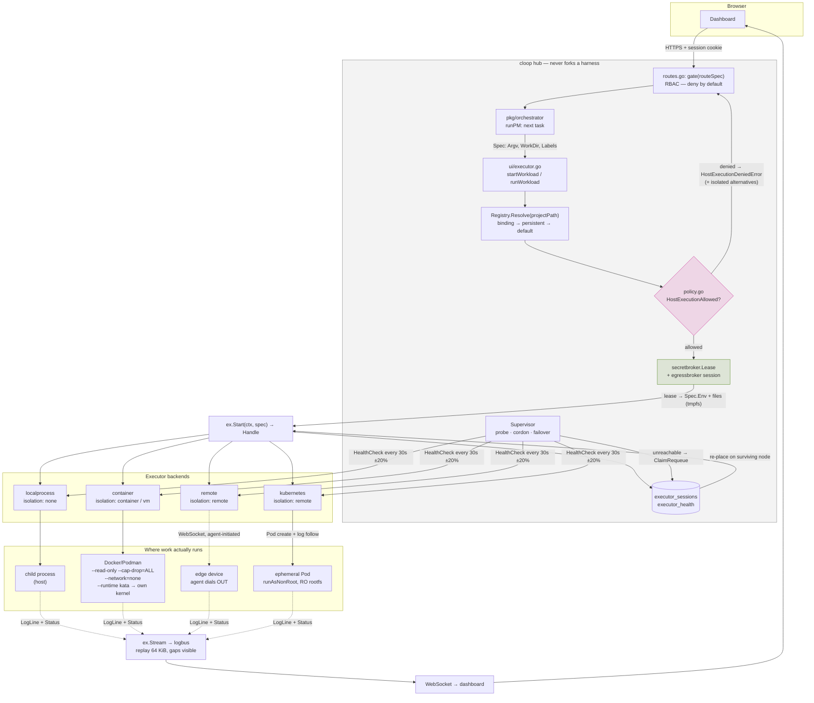
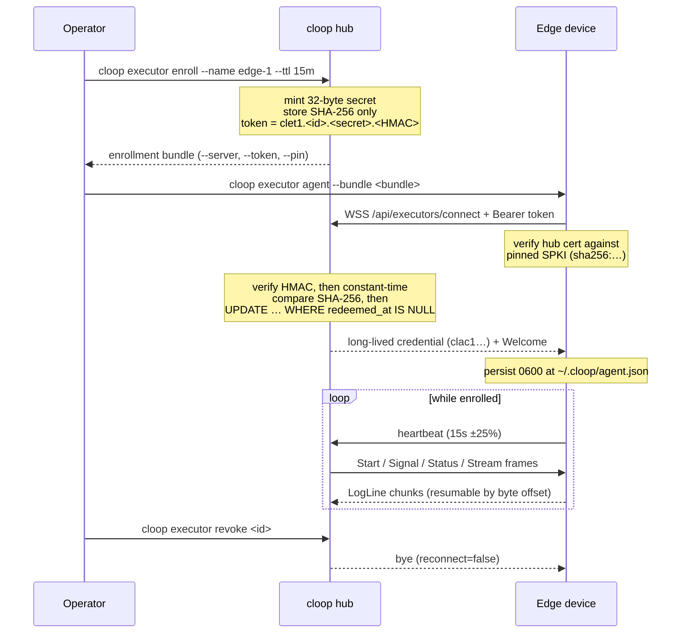
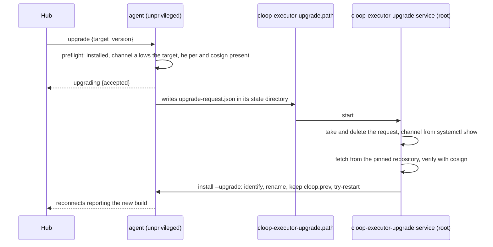

# Executor architecture

This page describes how a task travels from the orchestrator to a sandbox and
back.

The hub never runs a harness itself. It picks an executor, hands it a `Spec`,
and reads back the output. The rest of this page explains how that holds across
four very different backends, a fleet that can lose nodes in the middle of a
task, and a control plane that must not end up running the work it is meant to
isolate.

- [The interface](#the-interface)
- [Backends](#backends)
- [Registry and binding](#registry-and-binding)
- [Placement](#placement)
- [Workspace provisioning](#workspace-provisioning)
- [Supervision, health and failover](#supervision-health-and-failover)
- [End to end](#end-to-end)
- [Remote agent enrollment](#remote-agent-enrollment)

---

## The interface

`pkg/executor/executor.go` defines one interface every backend implements:

```go
type Executor interface {
	ID() string                                                          // stable instance id
	Kind() string                                                        // driver name — a Kind* const
	Capabilities() Capabilities                                          // isolation, streaming, limits, platform
	Start(ctx context.Context, spec Spec) (Handle, error)                // launch; workload outlives ctx
	Signal(ctx context.Context, handleID string, sig Signal) error       // interrupt / terminate / kill
	Status(ctx context.Context, handleID string) (Status, error)         // point-in-time snapshot
	Stream(ctx context.Context, handleID string) (<-chan LogLine, error) // live output, replayed from start
	HealthCheck(ctx context.Context) error                               // can this node accept work?
}
```

Two properties of this interface are easy to get wrong:

**`ctx` applies to the call, not the workload.** Cancelling the context passed
to `Start` aborts starting; it doesn't kill what has started. The Web UI starts
long-running runs from short-lived HTTP handlers, so tying a workload's lifetime
to the request context would kill every run as soon as its request returned
(`executor.go:311-319`). Callers that do want the workload bound to the context
use the `Run` helper, which turns cancellation into `SignalKill`.

**`Stream` replays.** Output produced between `Start` and `Stream` is buffered
and replayed (up to 64 KiB), so a subscriber doesn't miss the workload's first
writes. The channel never blocks the producer: when a subscriber's buffer fills,
chunks are dropped, and the gap shows as a jump in `LogLine.Seq`
(`internal/logbus`).

### Spec, Handle, Status

| Type | Carries | Notes |
| --- | --- | --- |
| `Spec` | `WorkDir`, `Argv`, `Env`, `Labels`, `ResourceLimits`, `TimeoutMinutes` | `Argv` is never shell-quoted, because there is no shell. `Env == nil` inherits the control plane's environment on `localprocess`, and means empty on `container`. |
| `Spec` (sandbox) | `Image`, `SetupCommands`, `Mounts`, `DisableNetwork`, `SandboxHash` | Derived from the project's [`.cloop/sandbox.yaml`](../reference/sandbox.md). `SandboxHash` records which spec produced this workload, so a run can be traced to the file it was started with. |
| `Spec` (credentials) | `Secrets`, `Workspace` | Neither holds credential material. `Secrets` is a `SecretBinding` list (which lease delivered which env names and file paths), so a `revoke` frame can take one credential back during a run. `Workspace` names a grant, never a token. |
| `Handle` | `ID`, `ExecutorID`, `PID`, `StartedAt` | `PID` is 0 where there is no local process to name (Pods, remote agents). |
| `Status` | `State`, `ExitCode`, `Error` | States: `pending`, `running`, `exited`, `failed`, `killed`, `unknown`. |
| `LogLine` | `HandleID`, `Stream`, `Text`, `Time`, `Seq` | `Seq` gaps mean dropped chunks, not reordering. |

For the fields in the second and third rows, a driver that can't honour a field
refuses the workload instead of dropping the field. `Spec.SandboxRequirements()`
is the single definition of what a Spec needs, and both ways of starting a
workload (`Select` on the failover path and `CheckSandboxSupport` on the binding
path) run it through the same matcher. A field added there is enforced in both
places without anyone having to add a second call.

A `Spec` is persisted by `pkg/executorstore` (so failover can dispatch it again
unchanged), marshalled across the remote-agent boundary, and echoed into audit
rows. That is why the type has no place for credential material at all: a token
placed here would be stored in three places before anything read it.

### Isolation

The host-execution policy reads `Capabilities().Isolation`, so a driver's value
for it is a security decision, not a hint:

| Isolation | Meaning | Reported by |
| --- | --- | --- |
| `none` | shares the host's filesystem, network and user | `localprocess` |
| `container` | own filesystem and network namespace, **host kernel** | `container` on the CLI's default runtime (runc/crun) |
| `vm` | a virtual machine or microVM with **a kernel of its own** | `container` configured with a Kata `oci_runtime` |
| `remote` | a different machine entirely | `remote`, `kubernetes` |

### Virtualization is a second axis, not a fifth value

`Capabilities` carries a separate boolean, `Virtualized`. It isn't another
`Isolation` value because of the last row of that table: a Kata Pod on a cluster
is both remote (the machine is not the hub's) and virtualized (the kernel is not
the node's). `Isolation` is one enum field and can hold only one of those facts.
It is also not a total order: a container on this host and a process on a remote
device are isolated differently, not more or less. So no single value could mean
both without misstating one of them. `Isolation` holds the fact every driver
has, and `Virtualized` holds the one some drivers add:

| Driver | `Isolation` | `Virtualized` | `KernelIsolated` | Turned on by |
| --- | --- | --- | --- | --- |
| `localprocess` | `none` | ❌ | ❌ | — |
| `container`, default runtime | `container` | ❌ | ❌ | — |
| `container`, gVisor runtime | `container` | ❌ | ✅ | [`executors.container.oci_runtime`](../guides/enterprise-hosts.md#3-per-project-sandbox-with-gvisor) |
| `container`, Kata runtime | `vm` | ✅ | ✅ | [`executors.container.oci_runtime`](../reference/configuration.md#vm-isolated-sandboxes-kata-containers) |
| `remote` | `remote` | ❌ | ❌ | — |
| `kubernetes`, default class | `remote` | ❌ | ❌ | — |
| `kubernetes`, gVisor RuntimeClass | `remote` | ❌ | ✅ | [`executors.kubernetes.runtime_class`](../guides/enterprise-hosts.md#3-per-project-sandbox-with-gvisor) |
| `kubernetes`, Kata RuntimeClass | `remote` | ✅ | ✅ | [`executors.kubernetes.runtime_class`](../reference/configuration.md#vm-isolated-sandboxes-kata-containers) |

Both drivers decide it from the configured runtime name, through one shared
matcher, `executor.IsVirtualizedRuntime` (`pkg/executor/virtualization.go`). The
two drivers name the same technology in different ways (an OCI runtime passed to
`--runtime`, a Kubernetes RuntimeClass), and with two copies of the matcher the
same sandbox could be described one way by the container driver and another way
by the Kubernetes driver.

The matcher is narrow: `kata`, `katacontainers`, any `kata-*` / `kata.*` name,
and the containerd shim name `io.containerd.kata.v2`. Everything else is false.
The two possible mistakes have different costs. A **false negative**
under-describes a sandbox: a Kata executor registered under an unrecognised name
is called a container, a project that requires virtualization is refused
placement on an executor that would have met the requirement, and the operator
sees an error they can fix by renaming. A **false positive** tells an operator a
workload runs behind a hypervisor when it shares the host kernel, and places
work that must be virtualized on an executor that isn't. So gVisor's `runsc`
reports false even though it is a stronger boundary than runc: it is a userspace
kernel, not a virtual machine, and calling it one would misstate what an escape
reaches.

#### The name is checked: isolation evidence

The OCI and RuntimeClass APIs show a client only a runtime's name, so an
operator could register runc under the name `kata` (a `daemon.json` alias, or a
RuntimeClass whose handler is runc), and the executor would claim a VM while its
workloads ran on the host kernel. The hub therefore checks the claim.

**The probe.** `cloop isolation-probe` is a mode of the cloop binary that reads,
from inside a sandbox, what only the kernel serving it can answer: `uname`,
`/proc/version`, the boot ID that kernel generated when it booted
(`/proc/sys/kernel/random/boot_id`), its uptime, the CPU's `hypervisor` flag,
the DMI vendor and product (`QEMU`, `Cloud Hypervisor`, Firecracker's), and
gVisor's markers (its fixed kernel build string and the boot log only the Sentry
writes). The container driver binds the running binary (the hub's, or a device
agent's) into the sandbox read-only at `/.cloop-isolation-probe/`, with the
host's own loader and C library beside it when the binary is dynamically linked.
The image supplies only a root filesystem and nothing the probe reads, so an
image can't substitute a probe that gives whatever answer it likes. A Kubernetes
Pod can't be handed a file from the hub, so there the probe is the cloop in the
executor's configured image, which is the operator's, never a project's
`image:`.

**The verdict.** `isolationprobe.Classify` compares that evidence with the
executing host's own kernel. The hub reads that directly for its own container
executor, the agent reports it for a device, and on Kubernetes a second Pod
bound to the same node under the cluster's default runtime reads it, because the
executor Role can't read Node objects. The boot ID settles most cases: a runc
container reads its host's, while a VM and a gVisor sandbox each generate their
own. The result is one of `host-kernel`, `userspace-kernel`, `vm` or `unknown`.
A claim is **verified** when the evidence shows at least what it claims,
**contradicted** when it shows less, and **unverified** otherwise. A hypervisor
flag or a cloud vendor's DMI string never counts on its own: every host this was
built on is itself a VM, so a runc container there shows both.

| Runtime named | Probe finds | Standing |
| --- | --- | --- |
| `kata` | its own kernel behind a hypervisor | verified |
| `kata` | the host's boot ID | **contradicted**: the host kernel |
| `kata` | gVisor's markers | **contradicted**: no hypervisor |
| `runsc` | gVisor's markers, or a VM | verified |
| `runsc` | the host's boot ID | **contradicted** |
| anything | nothing it can classify, or the probe could not run | unverified |

**When it runs.** When configured container and Kubernetes executors are
reconciled, at each device's hello, after a runtime changes (the Sandbox dialog,
a virtual executor's definition), daily, and when an administrator presses
**Re-probe** on the card. Each attempt is recorded per executor and runtime in
`isolation_evidence` (migration 0082, a guarded new table). A verdict that
changes is audited as `executor.isolation_verdict`, and every probe is counted
in `cloop_executor_isolation_probes_total`. A probe that couldn't run records
the attempt and keeps the previous verdict, so breaking the probe doesn't clear
a contradiction. A device's agent answers from protocol v26; an older one is
recorded as unverified, and the message names the upgrade.

**A wrong reference can't produce a false `vm` verdict.** The comparison needs a
reference that describes the machine the runtime runs on, and two checks stop a
wrong reference from making the host kernel look like isolation. The hub checks
the engine's reported kernel release against the reference. And `vm` requires
the sandbox's kernel to be younger than the reference's, because a VM serving a
sandbox boots after the machine it runs on. A cluster whose default runtime is
itself a VM gives the reference Pod a fresh guest kernel, and an agent inside a
VM that drives an outer host's engine reads its own kernel. In both cases the
host kernel the probe found has been up longer than the reference, and the
verdict is `unknown`, not `vm` (`TestAnAgentInsideAVMComparesItsOwnKernel`). The
reference has no minimum age: a node booted minutes ago, such as an autoscaled
node or a CI runner, is still the host, and its boot ID says so
(`TestAFreshNodeIsStillTheHost`).

**What it does not do.** The probe tells you what serves the sandbox's system
calls, not whether that kernel is configured well, and a claim it couldn't check
(an agent too old to ask, an image that isn't there) stays unverified.

#### `KernelIsolated` is the third column, and the reason there is one

`Virtualized` alone leaves a gap. With only that field, a gVisor sandbox would
be described as a plain container, no different from runc. A project whose real
requirement is "my task's syscalls must not reach the host kernel" would have no
way to ask for it, and `virtualized: true` would refuse the gVisor executor that
meets that requirement.

So there is a second boolean and a second predicate, which ask a different
question:

| Predicate | Question | True for |
| --- | --- | --- |
| `IsVirtualizedRuntime` | is there a hypervisor? | Kata |
| `IsKernelIsolatedRuntime` | are the workload's syscalls served by something other than the executing machine's kernel? | Kata **and** gVisor |

`Capabilities.KernelIsolated` is set from the second, so it covers both Kata and
gVisor and is a strict superset of `Virtualized`: virtualization implies kernel
isolation but not the reverse, and the difference between the two columns is
gVisor. `runc` and `crun` are false in both. Their boundary is namespaces,
cgroups and seccomp, so a kernel bug is a host bug.

It is a separate field, not a wider `Virtualized`, because the two are different
guarantees and a project needs to be able to ask for the weaker one. A
`.cloop/sandbox.yaml` with `capabilities: kernel_isolated: true` is satisfied by
either technology; `virtualized: true` requires a hypervisor and is checked
against the narrower field. Widening `Virtualized` to include gVisor would tell
an operator they have a VM when they don't. The matching constraints are
`virtualization` and `kernel_isolation` (see [Placement](#placement)).

Like `Virtualized`, `KernelIsolated` stays false unless the driver is certain,
because `RequireKernelIsolation` is checked against it, and a false positive
would run a workload on the host kernel it must stay off. Both drivers
derive it from the same configured runtime name through the same matcher, so the
two claims are always consistent: a name can't be virtualized without also being
kernel-isolated. `Isolation` stays `container` for gVisor even when
`KernelIsolated` is true, and the two don't conflict. gVisor is a container by
every measure that enum describes (namespaces, a cgroup, an image, no VM). What
it changes is what executes the syscalls, which is a separate question, so it
gets a field instead of a fifth enum value that nothing else understands.

Either API exposes only the name, which is a real limit: an operator can
register runc under the name `kata`. A name matcher alone can't catch that,
which is why the container driver's
[preflight](#container--kind-container-isolation-container-or-vm) separately
checks that the host can start a VM at all.

---

## Backends

### `localprocess` — Kind `localprocess`, isolation `none`

Starts child processes of the hub with `os/exec` in `Spec.WorkDir`. There is no
isolation: same user, same filesystem, same network. It reports a real OS PID,
which the UI relies on to stop a run. It doesn't create a new process group, so
Ctrl-C at a terminal still reaches the children. `TimeoutMinutes` is enforced
with a `time.AfterFunc` that sends SIGKILL.

`Stream` drops the chunks a consumer falls behind on, so a stalled log viewer
can't stall a run. `executor.Run`, which the hub uses for helper subcommands
whose replies it parses, can't afford a gap. The driver implements
`executor.Collector`, and `Run` starts through its `StartCollected`: the
collector is subscribed before the first byte and is never dropped a chunk; the
workload's output waits for it instead.

[Strict mode](../security/model.md#the-no-host-execution-guarantee) exists to
forbid this backend. It is still the default for single-user local development,
where the hub and the workload are in the same trust domain anyway.

### `container` — Kind `container`, isolation `container` or `vm`

Runs containers through the Docker or Podman CLI. The argv is built by a pure
function, `buildRunArgs` (`container/argv.go`), so the sandbox flags can be
[tested exhaustively](../security/model.md#the-guarantee--test-table) without a
runtime. These flags are forced on every invocation:

```
--pull=never  --cap-drop=ALL  --security-opt=no-new-privileges  --read-only
--tmpfs /tmp:rw,nosuid,nodev,exec,size=<N>m
--user <uid derived from the project directory owner>
--network=none              (unless an executor opts in)
--memory-swap == --memory   (swap pinned to the memory ceiling)
--workdir /cloop/work  --volume <project dir>:/cloop/work
```

Only the project directory is mounted. With `--pull=never`, a missing image
fails at once with an error, and nothing unexpected is pulled at task
time; pulling images in advance is the operator's job. The project directory is
also where the work lands on the host's disk, so it is what a disk limit has to
bound. No flag can do that (`--storage-opt size=` bounds the writable layer,
which `--read-only` already closes), so the driver measures the workspace at the
start and then at intervals while the workload runs, keeping the cost of
measuring bounded. It refuses a tree that is already over the limit and stops
one that grows past it (`disklimit.go`, `pkg/executor/internal/diskwatch`).
Secrets are passed as bare `--env NAME`, so the runtime reads the value from its
own environment and it never appears in the host's process table. A denylist
(`deniedExtraArgs` in `argv.go`) rejects operator-supplied `ExtraArgs` that
would undo any of this.

**Two runtime settings.** `executors.container.runtime` picks the CLI: podman or
docker. `executors.container.oci_runtime` picks the OCI runtime that CLI hands
each container to, passed as `--runtime <name>` at the top of the isolation
flags in the argv. Empty means the CLI's own default (runc or crun), and then no
flag is passed at all, so the usual deployment gets the same command line it got
before this setting existed.

Naming a Kata runtime (`kata`, `kata-qemu`, `kata-clh`, `kata-runtime`) makes
this executor a **VM sandbox**: every container boots inside a lightweight VM
with its own kernel, so a kernel exploit reaches the guest, and the host kernel
sits behind a hypervisor. It also changes what enforces the flags after
`--runtime`: under runc they are host-kernel features, while under Kata they
belong to the guest kernel, inside a VM the host kernel can't see into. The
executor then reports `Isolation: vm` and `Virtualized: true`. For setup and
prerequisites, see [the Kata guide](../guides/kata.md).

The value is a name, never a path. A path would point at a binary that docker's
daemon runs as root, so a setting that could name any executable could run any
code as root, which is also why the CLI itself is allow-listed. A bare name
can't do that: docker resolves it only against `/etc/docker/daemon.json` and
podman only against `containers.conf`, both root-owned files the operator
already controls, so the name is a lookup in a trusted table.
`ValidateOCIRuntime` therefore checks only the form: no path separators, no
leading dash, only letters, digits, `.`, `_` and `-`, and at most 64 characters.
The set of valid names is open (operators and clusters register Kata under
whatever name they like), so a fixed allow-list would reject working
deployments. The strict check is applied to the VM claim instead, as described
above.

A malformed `oci_runtime` disables the executor instead of being cleared, and it
is the only container key that does. Every other clamp falls back to a driver
default that confines at least as much as the rejected setting. Clearing a Kata
runtime would fall back to runc, turning the VM sandbox the operator asked for
into a container sandbox while the executor keeps running and reporting success.
A hub that starts with one executor fewer is a visible failure you can diagnose;
a hub that starts with a weaker sandbox than its config describes is not
(`clampContainerExecutor`, `pkg/config/executors.go`).

Preflight adds two checks, only when an `oci_runtime` is set. A deployment on
the CLI's default has nothing here to get wrong, and a finding that is always
green would bury the ones that matter:

| Check | Asks | On failure |
| --- | --- | --- |
| `oci-runtime` | is the name registered with the CLI that has to resolve it? | `fail` on docker, listing the runtimes it does have; `warn` on podman, which can't be asked |
| `kvm` | does `/dev/kvm` exist and open read-write? (Kata runtimes only) | `fail`, pointing at nested virtualization or `kvm` group membership |

Only docker can answer the first: `docker info` includes the daemon's Runtimes
table, which is the set `--runtime` resolves against. Podman resolves against
`containers.conf` and only shows the active runtime, with no way to list the
others, so on podman the finding is a warning that the name is unverified until
the first run, never a failure. A check that can't tell "absent" from "can't be
listed" must not report "absent", because that would turn a working Kata
deployment into a startup failure.

The KVM check opens the device instead of calling stat on it. `/dev/kvm` is mode
0660 `root:kvm` on most distributions, so stat succeeds for a user who can't use
it. The usual failure, a rootless podman user outside the `kvm` group, doesn't
show up in a stat but fails an open at once. Neither check can prove that a VM
will boot. The smoke test that follows does, and records in its result the
`oci_runtime` it ran under.

### `remote` — Kind `remote`, isolation `remote`

Runs on an enrolled edge device that connected out to the hub over WebSocket, so
the device needs no inbound port and no static address. See [Remote agent
enrollment](#remote-agent-enrollment).

Handles survive disconnects: the hub names the handle, and after a reconnect the
agent resumes output at a byte offset instead of replaying from zero. So one
`Executor` spans many WebSocket sessions, and workloads outlive the connection
that started them. Agents send a heartbeat every 15 s (±25 % jitter), and three
missed heartbeats mark the node unreachable (about 45 s).

The device shares nothing with the hub. It either fetches the project's source
tree itself before starting the harness or, for a project with no repository of
its own, keeps its own working directory, which the hub seeds with the project's
state. See [Workspace provisioning](#workspace-provisioning). Fetching needs
`git` on the device and protocol v3; seeding needs protocol v10. An agent below
either is refused placement instead of being trusted to notice. A plan that
holds a pending [human review gate](../guides/human-review-gates.md) also needs
protocol v27: an older agent's cloop would run the gate as a task, so the hub
refuses to send it there and names the upgrade.

#### Where the payload runs on the device (Task 20307)

`isolation: remote` says where the workload runs, not how it is contained. It
means the workload is on another machine whose filesystem the hub can't read,
whether the device runs the harness in a container or as a plain process with
the agent's own privileges.

Without a sandbox configuration, the agent runs the harness as a plain process
with a `localprocess.Executor`, even if it found `docker`, `podman` or `nerdctl`
on `PATH` (the fleet card shows those as chips).

An admin can configure this per executor, from the Executors panel (**Sandbox**
button) or with `PUT /api/executors/{id}/sandbox`:

| Field | Meaning | Empty means |
| --- | --- | --- |
| `mode` | `host` or `container` | unset, so the device behaves as it always has |
| `engine` | `docker`, `podman`, `nerdctl` | the device detects one |
| `runtime` | the `--runtime` name: `runc`, `crun`, `runsc`, `kata`… | the engine's default |
| `image` | the sandbox image | the executor's configured default |
| `network` | the container network: `none`, `bridge`, or one the operator created on the device | `none` |

The default `network` is safe but, for most real projects, not enough. Denying
by default is right, because a payload that can't reach the network can't
exfiltrate what it was given. But everything cloop brokers is a network service:
repositories arrive through the git interception proxy, clusters through the
Kubernetes access monitor, and the Internet through the egress broker, each
addressed by URL. A container-mode executor left on `none` will be granted
credentials it has no way to use, and the failure shows up inside the sandbox as
`Could not resolve host`, not at the hub as a refusal. Set it to `bridge`, or to
a network you created on the device that reaches the hub.

`host` and `container:<id>` are refused outright: both give the payload the
network namespace the sandbox is meant to take away, and with it every service
bound to the device's loopback.

The configuration lives in the control plane (`executor_sandbox`, migrations
0044 and 0047), not on the device, for the same reason `project_executors` does:
it is an operator's policy about an executor, not a fact about it. A device that
stored its own containment setting could be made to misreport it by its own
operator, and the hub would have no way to tell. Instead the hub reads the row
at dispatch and stamps it on every start frame (`StartPayload.Sandbox`, protocol
v8). An admin's change in the panel applies to the next task, with no agent
restart and no window in which the device's idea of its containment differs from
the control plane's.

Four refusals make sure the setting is enforced. Each prevents a failure that
would be silent, unhelpful, or both:

- **A pre-v8 agent is refused container-mode work.** It wouldn't reject an
  unknown `sandbox` field; it would ignore it, run the harness on its host and
  report success. `ErrSandboxModeUnsupported`.
- **An unreadable configuration fails the dispatch.** Not being able to read
  whether the executor should be contained must not lead to running the workload
  on the host, which would let a busy database weaken containment on a hub too
  unhealthy to notice. `ErrSandboxModeUnavailable`.
- **A device that can't provide the configured containment fails the start.**
  There is no fallback to a host process. `pkg/executor/agent/driver.go` applies
  the container driver's own rule one machine further out: an operator who
  configured a container executor and got host execution without an error would
  believe they had an isolation boundary they don't have.
- **A device that can't start a VM is refused a Kata runtime.** Unlike the three
  above, this failure is visible, but it doesn't help. The payload arrives, Kata
  launches QEMU with `accel=kvm`, and about fifty seconds later the shim gives
  up with `timed out waiting for QMP ready: Connection refused`, which mentions
  neither KVM nor nested virtualization nor the executor.
  `ErrVirtualizationUnavailable`.

Only container mode requires a protocol version. Host and unset are what a
pre-v8 agent does anyway, so refusing them would strand a fleet in the middle of
an upgrade for no reason.

Capabilities follow both the configuration and the device, so a Kata edge device
is described as one without every other device being described that way too. The
runtime the hub names says what an admin asked for, and only the machine knows
whether it can deliver it, so from protocol v9 the agent reports it
(`AgentCapabilities.Virtualization`, from opening `/dev/kvm`). `Virtualized` and
`KernelIsolated` are reported only when the mode is `container`, the live
session can honour it, and, for a Kata runtime, the device answered yes.

Each condition has its own reason. A runtime recorded against host mode confines
nothing. An executor must not advertise containment its own `Start` would
refuse. A device with no `/dev/kvm` loses `Virtualized` outright, because
claiming a hypervisor that can't exist is the false positive the runtime matcher
is written to avoid. It also loses `KernelIsolated` under Kata, whose isolation
is the guest kernel, but keeps it under `runsc`, whose Sentry never opens
`/dev/kvm`. A pre-v9 agent is not demoted: a missing field means unknown, not
no, and reading a zero value as a denial would strand every Kata device already
deployed.

Credential files follow the payload into the container. The agent writes a
lease's files into a directory it owns under `/dev/shm` and points the
workload's environment at that path. In container mode it also binds that
directory into the sandbox read-only, at the same path, because the broker wrote
the path into `CLOOP_LEASE_DIR`, `GIT_CONFIG_GLOBAL` and `KUBECONFIG` before the
frame was sent, and the agent's own revocation index points at it; remapping
would break both. Without the bind, the workload would hold paths that exist
only outside its namespace, which git reports as `could not read Username`.

The first thing you are likely to run into with container mode on a small
device: the driver refuses to run a workload as uid 0. Root inside a container
defeats `--cap-drop=ALL`, so a runtime escape would become host root. The
sandbox user is derived from the workspace directory's owner, so an agent
running as root with a root-owned `workdir_root` is refused with a message that
says how to fix it. The hardened service unit that
`cloop executor agent install` writes already runs the agent as a dedicated
unprivileged user, so a device set up that way meets this requirement.

#### What a device's returned work may hold on the hub (Task 20399)

A device sends a run's work back as a write-back bundle, streamed as result
chunks and closed by a result frame, and a seeded run's project state as one
`project_result` document. The hub holds both in memory until whatever settles
the run collects them. A device is the least trusted party in the system, so how
much it can make the hub hold is limited at three levels. Every byte is counted
when it is kept and released from the count when it is dropped:

| Bound | Size | Set by |
| --- | --- | --- |
| One handle's bundle | the cap its spec asked for (`WriteBack.BundleCap`, 32 MiB unless the dispatch named one, at most 128 MiB); none for a push or no write-back | the dispatch, persisted with the handle's row |
| One handle's project state | 640 KiB, and only for a run that was seeded | the protocol |
| One executor, across all its handles | 256 MiB | `executors.remote.max_pinned_writeback_bytes` |
| The hub process, across all executors | 1 GiB | `executors.remote.max_pinned_writeback_total_bytes` |

Without these limits, a device could make one hub process hold 128 MiB for each
of the 256 finished handles the hub keeps per device, plus the running ones: 32
GiB per device.

**A handle accepts only what its spec asked for, and nothing late.** The hub
writes what a run may send back into the handle's durable row (`Meta`:
`writeback_mode`, `writeback_cap`, `project_seeded`). A hub that restarted, or
another member that adopted the run, then holds the device to the same cap when
it resends its bundle from offset 0. A row written by an older hub has none of
this, and its handle gets the hard ceilings instead of a refusal, so a run in
flight during the upgrade still lands. Once a handle has reported its final
status, or its write-back has closed with a result frame, every further chunk or
result is refused before anything is allocated for it. A correct agent sends
chunks, then the result, then the status, and nothing after; a restart from
offset 0 is allowed only before the result. None of this depends on a protocol
version, because it asks nothing of the agent that every agent doesn't already
do.

**Past a budget, that run's write-back fails** with `ErrWriteBackBudget`, and
the reason (which limit, and how much was already held) is recorded on the run,
so the journal says why its work didn't come back. Nothing held for other runs
is affected. The bundle is kept as one exactly-sized copy per chunk, not one
growing buffer. Each chunk is counted as its own bytes plus 64 bytes
(`ResultChunkOverhead`) for the memory that holds it, so the memory held stays
within the allocator's rounding of what is counted, however a device splits its
bundle. A device sending one-byte chunks is charged for each of them. The copy
matters as much as the count. A chunk's bytes arrive as base64, in which the
JSON decoder skips newlines, so a frame padded to the 1 MiB limit can decode a
one-byte chunk out of more than three quarters of a megabyte. Keeping the
decoded slice would keep all of that memory. A sandbox terminal's inbox, the
only other place the hub queues bytes a device sent, copies for the same reason.

**What is held is released** when:

- it is collected;
- its run ends without the result frame that would make it collectable (the
  run's write-back then says how much had arrived);
- the run is abandoned to a failover, its handle is evicted, or its device is
  revoked or deregistered, including finished runs' uncollected work, because
  nothing a revoked device sent is landed afterwards;
- nobody has collected it 15 minutes after its run ended, checked on each
  heartbeat.

It is never released when a session detaches: the handle outlives the
connection, and in a hub cluster other members still track the run. The budget
belongs to the executor, not to a session, so a device that reconnects
(rehydration runs on every handshake) finds the bytes it left still counted.

A revoke from the dashboard also removes the executor from the hub member that
served it. Other members drop it when the deletion reaches them over the cluster
bus, which does not deliver a member's own events back to it.

The current level is in `cloop_writeback_pinned_bytes` and
`cloop_writeback_pinned_bytes_max`, and refusals are counted in
`cloop_writeback_frame_refusals_total`; see [the
metrics](../operations/metrics.md#returned-work-held-in-memory).

### `kubernetes` — Kind `kubernetes`, isolation `remote`

One short-lived Pod per workload: `generateName`, `restartPolicy: Never`, no
long-lived identity. `Start` creates the Pod and returns. A watcher goroutine
follows its phase transitions and opens the log API with `follow=true` once the
Pod is Running. `Signal` deletes the Pod, so `SignalInterrupt` arrives in the
container as SIGTERM, because the kubelet only ever sends TERM and then KILL.

The Pod spec forces `runAsNonRoot`, a read-only root filesystem, all
capabilities dropped, `seccompProfile: RuntimeDefault`, and
`automountServiceAccountToken: false`. The kubeconfig comes from a [secret
broker lease](../guides/secrets.md#kubeconfig). It is held in memory for the
handle's lifetime, renewed while the workload runs, released when it ends, and
never written to the hub's disk. Here the hub acts as itself, so this kubeconfig
does not go through the [Kubernetes access monitor](kubernetes-access.md). That
monitor governs the kubeconfigs delivered into a sandbox, and a read-only policy
in front of this one would stop the hub from creating Pods at all.

There is no bind mount, so `/workspace` starts empty and the source tree arrives
through a `workspace` init container (see [Workspace
provisioning](#workspace-provisioning)). Anything that reads a container status
must therefore select the container named `harness`, not assume there is only
one.

The Pod runs an image digest the hub chose. A tag in a Pod spec would be
resolved by whichever kubelet pulls it, whenever the Pod is scheduled, which is
after the image trust policy evaluated it. So before the Pod is built, the hub
resolves every tag it would carry (the project's image,
`executors.kubernetes.image`, one of cloop's own) at its registry, verifies the
digest's signature when the policy requires one, and writes `repo@sha256:…` into
the spec. The run's log starts with what resolved to what, and the handle names
the digest (`kubernetes/imageresolve.go`). The resolution happens before
anything is leased for the run. A private registry is queried with the login in
`executors.kubernetes.registry_secret`, a registry secret the hub opens as its
own credential, never with the namespace's `imagePullSecrets`, which belong to
the kubelet. A tag the hub can't resolve is refused under `require_digest` or
`require_signature`, and otherwise runs as a tag with a warning; see [Resolving
image tags for Kubernetes
Pods](../reference/configuration.md#resolving-image-tags-for-kubernetes-pods).

The project itself (`.cloop/`, which a clone of the source repository doesn't
contain) comes with the run, and its outcome goes back. The hub's seed travels
in the run's lease Secret to the init container, and what the run recorded comes
back as a framed block at the end of the Pod's log. A repository needs no
`.cloop/` committed, and a task a Pod finished shows as finished on the
dashboard. See [Kubernetes: the seed in a Secret, the outcome in the
log](#kubernetes-the-seed-in-a-secret-the-outcome-in-the-log-task-20402).

`executors.kubernetes.runtime_class` sets `runtimeClassName` on every Pod, and
is how you request a **remote Kata sandbox**. The kube-scheduler places the Pod
on a node that advertises that handler, and the workload boots in a VM with a
kernel of its own, on a machine that is not the control plane's. Isolation stays
`remote`, and `Virtualized` becomes true as well. The class must already exist
in the cluster. cloop doesn't create it; it is a cluster-scoped object an
operator installs with the Kata node pool. Those pools are usually tainted, so
this key normally comes with `tolerations` and `node_selector`. The name is
validated as an RFC 1123 subdomain at startup, not at dispatch, so a typo is
reported against the config line that caused it instead of as a 422 on
somebody's first run (`ValidateRuntimeClass`, `kubernetes/validate.go`).

Unlike the container driver, there is no preflight check for it. A RuntimeClass
is a cluster-scoped object, and the hub holds only a namespaced Role in the
workload namespace, so it can't read one. A wrong class therefore shows up at
dispatch, as a Pod that never runs and a rejection naming the class it asked
for.

---

## Sandbox network isolation

Two backends run workloads that have a network: the container driver and the
Kubernetes driver. Without a filter, a container's `Network` is either `none`
(no interfaces at all) or a runtime network with unrestricted outbound access. A
Pod joins the pod network, and no field in a Pod spec takes that away, so the
`cloop.dev/egress` label on a Pod is only documentation. The [egress
broker](../reference/configuration.md#scoped-network-egress) only restricts a
workload that honours `$HTTP_PROXY`.

`pkg/netfilter` adds filtering with one compiler and several renderers.
`Compile` turns an authorisation into an ordered, first-match-wins `Policy` that
ends in an implicit drop, and the backends render that `Policy` as an `nft(8)`
script or as a Kubernetes `NetworkPolicy`. `Evaluate` answers "what would this
policy do to that packet" without any backend, so a test can compare the filter
with the proxy address by address instead of trusting two hand-written rule sets
to agree. The package depends only on the standard library, so every driver can
use it without pulling in the broker's storage and crypto code.

### `Capabilities.FilteredEgress`

```go
NetworkEgress  bool // can workloads reach the network at all?
FilteredEgress bool // is what they reach bounded by a policy cloop installs?
```

They are two fields because they answer two questions. `NetworkEgress` says
whether the workload has a network interface, which is what
[placement](#placement) needs: `RequireNetworkEgress` and the `network_egress`
rejection reason read it. `FilteredEgress` says whether what it reaches through
that interface is restricted, which is what an operator auditing a fleet needs.
A sandbox can have the first without the second, and that is the combination an
operator needs to be able to find.

`false` doesn't mean nothing filters the traffic. A cluster may run its own
`NetworkPolicy`, and an operator may firewall the host; `false` means cloop
isn't doing it. Both drivers report the field from their
`egress_filter.enabled`.

It does not report whether the filter is effective. On Kubernetes the CNI
applies a `NetworkPolicy`, and the API can't tell you whether the cluster runs
one that implements it, so the field says what cloop installed and the preflight
`egress` finding carries the caveat. Nothing in placement requires the field. It
is a report, not a constraint.

### The container driver: two mechanisms

The authorisation decides which applies; there is no separate switch. An
`egress_filter` that names only `internal` gets the first. One that names CIDRs,
resolvers, a broker endpoint or the public Internet gets both.

**An `--internal` runtime network.** The runtime installs no route off the
bridge, so nothing on it reaches the Internet. Put the egress broker on the same
network and it becomes the only way out, which makes the broker's host allowlist
enforceable. This needs no privileges, no `nft` and no `CAP_NET_ADMIN`, and it
is the strongest option, because the layer-3 filter and the layer-7 allowlist
then describe the same set.

**A host-side nftables ruleset scoped to the sandbox bridge**, for when the
authorisation names addresses the sandbox must connect to directly, such as a
Kubernetes API server or an internal registry. The table is `inet`, not a
separate `ip` and `ip6` pair: two families mean two rulesets that can drift
apart, and a forgotten v6 ruleset lets a AAAA record bypass the whole firewall.
The script is fed to `nft -f -` on stdin, which nft commits as one transaction,
so either the sandbox is filtered by the whole policy or the start fails.
`add table` / `delete table` / `table` makes applying it again replace the rules
instead of adding to them, which a reconcile loop needs. Tearing down a table
that is already gone counts as success.

Two things to know before reading a bridge ruleset:

- **Both the `forward` and the `input` hook carry the rules.** The routing
  decision picks the hook: traffic the host forwards goes through `forward`, and
  traffic to the host itself goes through `input`. A ruleset with only a
  `forward` chain filters the Internet and leaves the host wide open. See the
  [threat
  model](../security/threat-model.md#vulnerabilities-found-while-building-this).
- **The chain policy is `accept`, not `drop`.** All base chains on the same hook
  run, and a drop in any of them kills the packet, so a `policy drop` chain here
  would cut off every other container on the host. Instead, each chain returns
  at once for traffic whose `iifname` is not this sandbox's bridge, and ends
  with an explicit `drop` that only packets from that bridge can reach.

**Why the filter is installed on the host and not inside the namespace.** A
workload that starts before its filter exists has a window of unrestricted
egress. Starting the container, finding its PID, entering its namespace with
`nsenter` and installing rules there gives no ordering guarantee. Filtering on
the host side has no such window: the bridge exists from the moment the network
is created, which is before any container can join it, so the rules are always
in place first. `installFirewall` runs before the image is even resolved, and if
it fails, the `Start` fails. A sandbox that ran without the requested filtering,
with no error, would be worse than one that refuses to run.

The network name is derived from the executor id (`cloop-sbx-<id>`), not taken
from config, so two executors with different filters can't share one bridge,
where the second would replace the first one's rules without any error. It also
means the policy is per executor: every sandbox that executor starts joins the
same bridge under the same ruleset. Enabling the filter makes the driver stop
using the configured `Network`, because an operator-named network could be
shared with workloads this executor doesn't manage, and a default-deny ruleset
on their bridge would cut them off too.

### The Kubernetes driver: a NetworkPolicy per Pod

`RenderNetworkPolicy` translates the same compiled `Policy`. The translation is
not mechanical, because the two models differ: a `Policy` is ordered and has
both verdicts, while a `NetworkPolicy` is an unordered union of allow rules with
no deny rule at all. So the drops become `ipBlock.except` entries and the
ordering becomes set arithmetic. "Allow the public Internet" becomes `0.0.0.0/0`
with every blocked prefix excepted, and "a granted CIDR overrides the block that
covers it" becomes a second peer for that CIDR: peers are a union, so the
granted prefix is allowed even though the Internet peer excepts the range
containing it. Peers are grouped by port signature instead of emitted one per
rule, because within one egress rule peers and ports form a cross product, and a
granted CIDR on 6443 next to the Internet on 443 would otherwise each get the
other's ports.

Three details come from the object model, not from the policy:

- The `podSelector` must match only the Pod it governs (an empty selector in
  Kubernetes means every Pod in the namespace), so the driver selects by the
  unique handle-id label and the renderer refuses an empty selector outright.
- `policyTypes` names `Ingress` with no ingress rules. Leaving the type out
  would leave inbound traffic unrestricted; naming it with no rules denies it.
- Cluster DNS is opened with a `namespaceSelector` on `kube-system`, not by
  address. The Service ClusterIP is in private address space, and whether the
  CNI applies its DNAT before or after the policy varies by CNI, so the selector
  is the form that works everywhere. It is on by default, because a default-deny
  egress policy without it breaks name resolution, and that failure looks like
  "the network is broken" instead of "DNS is denied".

This renderer drops the namespace-local rules (the sandbox's own loopback)
instead of emitting a meaningless `127.0.0.0/8` peer, because a `NetworkPolicy`
never sees traffic that doesn't reach a wire.

The renderer can't promise enforcement. A `NetworkPolicy` does nothing unless
the cluster runs a CNI that implements it; flannel doesn't, and the API server
accepts the object anyway. cloop can't read that from the API, so preflight
reports it as a standing `egress-enforcement` warning. Managing the objects also
needs `networkpolicies: [create delete list]` on the executor's Role, and
preflight lists policies to prove the leased identity has it. A `403` there is a
`fail`, because every `Start` would refuse instead of running a Pod with
unfiltered egress.

### Reaching the hub's egress proxy: `Spec.EgressProxy`

A run whose project holds an egress grant gets a session on the proxy the hub
hosts ([Scoped network
egress](../reference/configuration.md#scoped-network-egress)), and the session's
URL goes into the workload's environment, declared sensitive. The hub can't make
the address in that URL reachable by itself: the engine decides which bridge a
container joins, and so which gateway address the host answers on, and what a
sandbox's firewall lets through is decided when the driver compiles it. So the
Spec carries a route, and the driver completes it:

```go
type EgressProxyRoute struct {
    Host    string // the host the proxy URL names
    Port    int
    Gateway bool   // pin Host, inside the sandbox, to its bridge's gateway
}
```

It carries no credential, so it is safe to persist and to send to a device.

| Executor | Route the hub chooses | What the driver does with it |
| --- | --- | --- |
| host process | the bound address | nothing: the workload is on the host |
| container (hub's engine), proxy on every interface | `host.containers.internal`, `Gateway: true` | `--add-host host.containers.internal:<gateway>` for the bridge the sandbox joined, ahead of any operator pin; when a ruleset is installed, the gateway and port added to it as an allow, TCP only |
| container, proxy on one host address | that address | the address and port added to a ruleset |
| Kubernetes | `advertise_addr` | nothing: the hub has already checked, with `netfilter.Evaluate`, that the Pod's policy allows it |
| remote agent, virtual executor | `advertise_addr` | a v18 agent's container driver does what the hub's does; a v17 one is given no session behind a firewall |

This has two consequences for the container driver. First, the proxy is opened
in the compiled `Policy` itself. `provisionNetwork` asks the policy's own
`Evaluate` whether the sandbox can reach `gateway:port` before anything is
installed, and refuses the start if an operator deny list covers it, instead of
starting a sandbox with a session it can't use. Second, a ruleset that opens the
proxy is different from one that doesn't, so the proxy's port is part of the
confinement key. Such sandboxes get a bridge and a table of their own
(`cloop-sbx-<id>-…-x<port>`), so applying the second ruleset can never close the
first one's way out. An `--internal` bridge with no ruleset needs no opening,
because its gateway is on-link, so its sandboxes keep sharing one bridge.

### Seeing what a policy compiles to

`cloop egress firewall` renders the policy without touching a host, in the same
text the driver installs (see [the command
reference](../reference/commands.md#cloop-egress-firewall)). You can diff it
against `nft list table inet cloop_sbx_<id>` on the host or
`kubectl get netpol -o yaml` in a cluster, and `--check <addr:port>` tells you
what the policy does to one address, with the verdict in the exit status.

---

## Registry and binding

`pkg/executor/registry.go` answers one question: which executor runs work for
this project?

```
Registry.Resolve(projectPath)
  → in-memory binding      (Bind, set from the UI/CLI)
  → persistent lookup      (SetBindingLookup → statedb, survives restart)
  → default executor       (the first one registered, or SetDefault)
  → policy check           (refuse isolation=none under strict mode)
```

Project paths are canonicalised (made absolute and passed through
`filepath.Clean`), but symlinks are not resolved, because the binding must match
what the operator typed in the config, not where the filesystem happens to point
today (`registry.go:302-311`).

`Resolve` fails closed in both directions. An unknown project with no default is
an error, and under strict mode a resolved executor that offers no isolation
gives a `*HostExecutionDeniedError` with the list of isolated alternatives, so
the UI can show how to fix it.

### Who may use an executor

`Resolve` answers which executor, not for whom. It is given a project path and
no identity, and it is called from places that have no identity (the CLI, the
failover supervisor, a scheduled run that continues after the person who started
it has gone home).

So an executor's access list is enforced one layer up, at the two HTTP requests
where a person chooses an executor:

| Request | Gate |
| --- | --- |
| `POST /api/projects/{idx}/executor` | refuses the binding |
| `POST /api/run` | refuses the run |

The run check matters most. An admin may narrow an access list after a project
was bound, and a binding made yesterday must not outlast the access it was made
under.

An executor with no access-list entries is unrestricted, which is every executor
until an admin adds the first entry, so existing deployments are unaffected.
Adding the first entry turns the check on, so the API refuses an addition that
would leave the calling admin unable to use the executor they restricted
(`executor_audience_self_lockout`).

Entries are matched against OIDC claims by `pkg/authz`'s own binding matcher, so
a group path (`/platform-team`) and the bare name are interchangeable, as they
are in role bindings. The access list is a gate, not a grant. Role bindings are
additive and can't express "everyone except", and the permission being
restricted is one the caller already holds for the whole fleet.

Managing an executor and being allowed to use it are separate rights. An admin
can restrict a device they can't run work on themselves, and the panel tells
them so.

### How much one workload may be given

Three ceilings apply, from the widest scope to the narrowest, and each can only
lower the limit:

| Source | Set in | Answers |
| --- | --- | --- |
| `fleet` | `executors.limits` in config.yaml | what any workload on this hub may have |
| `executor` | `PUT /api/executors/{id}/limits` | what any workload **on this device** may have |
| `project` | per-project, operator-set | what this one project may have |

The executor ceiling covers what the other two can't. The fleet ceiling applies
everywhere, so setting it to the weakest device's capacity would hold the whole
fleet down to it, and the project ceiling is set before anyone knows which
executor the work will land on.

`BoundSpec(spec, projectPath, executorID)` applies all three and returns a
`Clamp` for each reduction, naming the source, so a developer whose run was
capped can tell whether to ask the hub admin, the device's admin, or nobody. A
ceiling never fills in a limit the project left unset (`pkg/executor/ceiling.go`
explains why): that would turn "stated nothing" into "explicitly asked for the
ceiling", which the drivers treat as more specific than their own configured
default, so the ceiling could raise an allowance.

The drivers apply the ceiling instead, after resolving their own default: the
container driver bounds `--cpus`, `--memory`, `--pids-limit` and the workspace's
disk limit by `CeilingFor` in `buildRequest`, and the Kubernetes driver fills in
an unset Pod limit. A device reads no ceiling of its own, so the remote driver
writes the device's (or virtual executor's) ceiling into the spec it dispatches
when the device runs payloads in a container. The disk ceiling goes only to an
agent at protocol v20 or later, because an older agent's container driver
refuses any disk limit (`MinDiskLimitVersion`).

**Disk** is a resource a driver may or may not be able to enforce, independently
of the others, so it has a capability of its own. `Capabilities.DiskEnforcement`
is `sampled` (the container driver, on the hub or on a v20 device, which
measures the workspace and stops a workload that outgrows it), `eviction`
(Kubernetes), or empty. A spec that states `resources.disk` requires it at
placement (`RequireDiskLimit`, constraint `disk_limit`). A disk ceiling in force
on an executor without it is reported by `CeilingUnenforceable` on every
dispatch, whether or not anything was clamped, because it also applies to
projects that asked for nothing. How the container driver measures, and what a
stop records, is in
[`resources.disk` and the
workspace](../reference/sandbox.md#resourcesdisk-and-the-workspace).

### Which directory a project may be

A project's directory is the one host path every sandbox it runs in is given:
the container driver bind-mounts it read-write at `/workspace`, the host driver
starts the harness in it, and `?delete_root=true` removes it. So the choice of
directory decides what model-written code may read and write on the hub's host,
and one predicate decides it everywhere (`pkg/projectconfine`).

It judges the directory the kernel would create, not the string that was sent:
absolute, lexically cleaned (`..`, `.`, a trailing slash), and with the symbolic
links of the deepest existing ancestor resolved. So a link under the projects
root that points at the hub is followed before any rule is applied. Then, for
every caller, the directory must be:

- not a system tree, not `/`, not a bare top-level directory, not the hub user's
  home or anything containing it, nothing inside a `.cloop`;
- not `ui.projects_root` and not a directory containing it, because the root
  holds every project created by name;
- not equal to, inside or above the hub's own directory (its control plane),
  with two exceptions: the hub's own entry, which is the operator's directory
  and not something registered through the API, and a directory inside a
  projects root that the operator put inside the hub's directory. The packaged
  image uses that layout, with `HOME`, the control plane and the default root
  all under `/var/lib/cloop`;
- not equal to, inside or above any other directory holding a hub's control
  plane, meaning one with `.cloop/hub.env` above the candidate or up to eight
  levels below it (a tree too broad to search is refused as unverifiable). It
  must also be neither equal to nor above the working directory of a `cloop ui`
  running on the host, which need not keep a `hub.env`;
- not overlapping another registered project, in either direction, and not one.
  Features live in their project's `.cloop/features` and are never registry
  rows, so a feature is judged as its project;
- not a project whose `.cloop` is a link out of its directory.

For a caller without `executor.manage` (the administrator's permission over
which machines run work, which is the same kind of decision), the directory must
also be strictly inside `ui.projects_root`, with no hidden directory on the way.

Where it is applied:

| Where | What happens to a directory that breaks it |
| --- | --- |
| `POST /api/projects/new` (the dashboard, `cloop remote init`) | refused before anything exists. Refusals that depend on the host (a project there the caller can't see, the hub's directory, another hub's, a creation holding the path) are one identical `409` to anyone but an administrator. A path outside the root is a `403` naming `executor.manage` and the root |
| the registry write ending a creation (`multiui.AdmitOwned`) | checked again under the registry's lock, so a row an operator added in the meantime can't slip in |
| `cloop ui --projects` / `--scan` | registered as given, with a warning per directory: the operator owns the host |
| every dispatch (`startWorkloadAs`, `runWorkloadEnvFor`, a reproduction) and the run routes, before any other gate | `409 project_unconfined` naming the overlap (but never another tenant's path), before a lease is minted or anything is bound |
| the container and host drivers (`projectconfine.Backstop`) | refuse a work directory that contains the hub's directory, or sits in its `.cloop` or another hub's, whoever dispatched it; `reconcile.Options.ControlPlaneDir` and `localprocess.Executor.SetControlPlaneDir` hand them the hub's directory |
| the Projects tab | the row is listed (the list is the index every project route addresses), with a line saying the hub will not run it |
| `cloop hub doctor` | `projects.confinement` fails, listing every row with what it overlaps; nothing is moved or deleted |
| a project's own state | an `active_session` that is not a plain name under `.cloop/sessions`, or a stored `workdir` naming another directory, is ignored: the hub reads and writes the registered directory |

A creation also claims its directory in the control plane before it creates it
(`project_claims`, migration 0068). The claim is refused while a live claim
holds the same path, a path inside it or one above it, so two requests for one
path, or for a path and its parent, can't both run `cloop init`. The claim
records whether the hub made the directory itself, inside the projects root.
Only that record lets `?delete_root=true` remove a directory, and a deletion
checks again that it is still that directory and still overlaps nothing.
Creations, their refusals and deletions are audited as `project.create` and
`project.delete` in the control plane's chain.

---

## Placement

`Registry.Resolve` picks the executor for a project. `pkg/executor/placement.go`
picks one for a workload out of a fleet. It is used on failover, and by any
caller that states requirements instead of a binding.

`Select(candidates []Candidate, req Requirements) (Candidate, error)` is a pure
function: no I/O, no clock, no registry. That makes fleet behaviour testable.

A `Candidate` carries the executor and its scheduling context: `Health`,
operator `Labels`, detected `Harnesses`, `ContainerRuntimes`, `MemoryMB` and the
in-flight count. `Requirements` can pin `ExecutorID` and require `Labels`,
`Harnesses`, `Platform`/`Arch`, `MinMemoryMB`, `RequireIsolation`,
`AllowedIsolations`, `RequireVirtualization`, `RequireKernelIsolation`, and
capability flags (`RequireStream`, `RequireSignal`, `RequireContainerRuntime`,
`RequireNetworkEgress`, `RequireResourceLimits`, `RequireImageOverride`,
`RequireSandboxBuild`, `RequireSandboxMounts`, `RequireHostMounts`,
`RequireDevices`, `RequireEgressScope`, `RequireWorkspaceProvisioning`,
`RequireHostFilesystemWorkspace`, `RequireWriteBack`).

`RequireVirtualization` is separate from `AllowedIsolations` because it cuts
across it. Both a local Kata container (`vm`) and a Kata Pod on a cluster
(`remote`) satisfy it, and no set of `Isolation` values selects only those
two without also admitting every non-Kata remote executor. It is checked against
`Capabilities().Virtualized`, which is why that field is false unless the driver
is certain: otherwise a workload that must run behind a hypervisor could land on
one that doesn't.

`RequireImageOverride`, `RequireSandboxBuild` and `RequireSandboxMounts` come
from a project's [`.cloop/sandbox.yaml`](../reference/sandbox.md). They stop a
per-project sandbox spec from being ignored without an error. A project pinning
`image: rust:1.79` and placed on a driver with no image concept would run
against whatever toolchain the host has, produce a plausible-looking build
failure, and send its author looking through their own code. Refusing placement
and naming the constraint points at the deployment instead. Every field a driver
could drop has a flag that says whether it does.

`RequireHostMounts` is the same idea, but the request comes from a grant instead
of a file committed to the repository: a
[`local_repo`](../guides/secrets.md#local-git-repositories) grant binds
directories from the control-plane host into the sandbox at `/repos`, and
`Capabilities().SupportsHostMounts` says whether the driver can do that at all.

| Driver | `SupportsHostMounts` | Why |
| --- | --- | --- |
| `container` | ✅ | it runs on the hub and has a mount namespace to bind into |
| `localprocess` | ❌ | shares the hub's filesystem, so there is nothing to bind: the granted repositories are already visible at their own paths |
| `kubernetes`, `remote` | ❌ | the workload runs on a machine that has never seen those files |

It is not implied by `SharesHostFilesystem`, as the middle row shows: a driver
has to run on the hub and also have a namespace to bind into, and `localprocess`
only does the first. A driver that ignored the field would start a harness with
an empty `/repos`; the constraint turns that into an error naming the grant and
the binding.

`RequireDevices` and `RequireEgressScope` do the same for two capabilities that
depend on what the host can do, not on what the transport can carry.
`Capabilities().SupportsDevices` says whether a driver can expose a host device
node inside the sandbox, which a
[`host_device`](../guides/secrets.md#host-devices) grant asks for.
`Capabilities().SupportsEgressScope` says whether it can confine one workload's
IP-layer egress independently of the other workloads on the same executor, which
`capabilities.egress` in a project's
[`.cloop/sandbox.yaml`](../reference/sandbox.md) asks for.

| Driver | `SupportsDevices` | `SupportsEgressScope` | Why |
| --- | --- | --- | --- |
| `container` | ✅ | ✅ | it runs on the machine with the hardware, and the runtime takes `--device`. A scope gets a bridge and an nftables table of its own, which this driver provisions |
| `kubernetes` | ❌ | ⚠️ once enforcement is proven | Kubernetes takes no device paths; a device plugin gives the container whichever unit it has free. Egress is confined per run by a `NetworkPolicy` that selects one Pod by its unique handle-id label, but the cluster's CNI applies a `NetworkPolicy`, so the capability is advertised only once enforcement is [proven or asserted](#does-the-cluster-actually-enforce-a-networkpolicy) |
| `remote` | ❌ | ❌ | a device path names the hub's host, and the agent runs each workload as a plain process, so there is neither a sandbox to put a device into nor a per-workload network namespace to filter |
| `localprocess` | ❌ | ❌ | the workload is a process in the hub's own namespaces: every device the hub user can open is already open to it, and confining its egress would mean filtering the control plane's own traffic |

Why these are refusals and not best effort:

`SupportsDevices` is not implied by `SupportsHostMounts`, because a device is
more than a file to bind: a container runtime needs a cgroup rule permitting the
`major:minor` pair as well as the node itself, and the Kubernetes driver needs
the node to advertise the hardware at all. `HostDevice` carries a
`KubernetesResource` field for the extended-resource form that driver would
need. It is not used, and not approximated with a `hostPath`, because mounting
`/dev/nvidia0` from whatever node the scheduler picked would expose an unrelated
piece of that node's hardware, which is worse than refusing. A driver that
dropped the field would produce a sandbox whose `/dev` is missing the hardware
the task needs.

`SupportsEgressScope` can't be best effort because ignoring it fails open
without any error. An executor that ignored a project's request to be cut off
from private address space would give the harness the access to the operator's
internal network that the project had asked not to have, and report success.
`container` always advertises it, whatever `egress_filter.enabled` says, because
a scope exists so that a project can ask to be confined on an executor whose
default is unfiltered. A host without `nft(8)` fails at install time with an
error naming it.

### Does the cluster actually enforce a NetworkPolicy?

On Kubernetes, cloop can install the right policy and still get no filtering.

`pkg/executor/kubernetes/networkpolicy.go` compiles a `NetworkPolicy` per run
from the same `pkg/netfilter` policy the container driver's nftables ruleset is
compiled from, selecting only that Pod by its unique `cloop.dev/handle-id`
label. `Start` creates it before the Pod it governs, because a Pod that started
first would have a window of unfiltered egress, and that window is enough for
exfiltration.

None of that matters if the cluster's CNI doesn't implement `NetworkPolicy`.
flannel is the well-known case: the API server validates the object, stores it
and returns `201`, and nothing ever reads it, so `kubectl get netpol` lists a
firewall that doesn't exist. The Kubernetes API can't tell you which case you
are in, so cloop doesn't guess:

| Evidence | Status | `SupportsEgressScope` |
| --- | --- | --- |
| nothing | `unverified` | ❌; placement refuses, naming the probe |
| `network_policy_enforced: true` | `asserted` | ✅ on the operator's word |
| a probe proved it | `proven` | ✅ |
| a probe refuted it | `refuted` | ❌, and preflight reports a **fail** |
| `network_policy_enforced: false` | `denied` | ❌ |

Precedence, and the reasons for it:

1. An explicit `false` wins outright. It is the restrictive direction, and the
   only control that takes effect immediately; otherwise you would have to edit
   the config and then race a recorded verdict that has not yet expired.
2. A fresh probe beats an assertion in both directions. An operator who asserted
   enforcement on a cluster that ignores policies has made a mistake, and the
   measurement catches it.
3. An assertion beats nothing.
4. Nothing is `unverified`, and `unverified` fails closed.

A verdict expires after 30 days (`DefaultVerdictMaxAge`), because a platform
team that has never heard of cloop can replace the CNI. An expired verdict is
treated as absent, not as evidence either way. A verdict recorded for a
different executor is ignored: executors differ in namespace and in the
credential they connect with, and a `NetworkPolicy` is namespaced.

#### The probe

```
cloop hub doctor --probe-network-policy [--executor k8s] [--probe-image …]
```

It is the only `hub doctor` check that writes to the cluster, so it runs only
when you ask for it. In the executor's own namespace it creates:

1. a **target** Pod serving one byte over HTTP;
2. a **control** client Pod that fetches it with no policy in place, which must
   succeed;
3. a **policed** client Pod with a label that a default-deny egress policy
   selects, fetching the same address, which must fail.

Step 2 is what makes the result meaningful. Without it, "the client could not
connect" can't be told apart from "the target never came up", "the image has no
`wget`", "the node is stuck" or "the namespace already denies everything", and
each of those would be recorded as enforcement. A control that doesn't succeed
gives `ErrProbeInconclusive` and no verdict either way.

The probe's Pods use the executor's `image_pull_policy`. Where that is `Never`
(a kind cluster with images loaded by hand, like CI's), the default
`busybox:1.36` is not on the node, the target never starts, and the probe
reports *inconclusive* only when its timeout runs out. Pass `--probe-image` an
image the nodes already hold that provides `sh`, `httpd` and `wget`;
[`tests/kube`](../../tests/kube/README.md) uses its harness image, alpine with
`busybox-extras`. On CI's kind cluster the probe refutes enforcement on every
run: its CNI accepts the policy and the policed Pod still connects. So CI
creates and removes a per-Pod policy there, and does not check that it takes
effect.

The connection attempt is the Pod's command, and the result is its exit code,
read from the Pod's status, so the probe needs no `pods/exec` RBAC, only the
`pods` and `networkpolicies` verbs the egress filter already requires. Every
object is registered with a janitor before it is created (a create that times
out may still have succeeded) and removed on a detached context from a deferred
call, so a probe interrupted by Ctrl-C, a timeout or a panic still cleans up. A
default-deny policy left behind in a shared namespace would break whatever is
scheduled there next.

The verdict is stored in the hub's control-plane database and pushed to the live
driver, so it takes effect without a restart and survives one. It is not kept in
an in-cluster `ConfigMap`, which would need `configmaps` RBAC the executor
doesn't otherwise hold: a security check that fails closed whenever its
bookkeeping is unauthorised teaches operators to widen the Role until the
warning goes away.

#### Sweeping what it leaves

Every per-run policy is deleted with its Pod, and `ReconcileOrphans` collects
any that a control-plane restart left behind, using the same label selector and
grace period as the Pod sweep. Here the grace period protects against the
opposite mistake: deleting a Pod too early kills a run, while deleting a policy
too early removes the filter from a run that is still going.

The sweep runs whenever the executor `createsNetworkPolicies()`, which is true
for a configured `egress_filter` or for a scope-capable executor. The second
condition matters: an executor with `egress_filter.enabled: false` and a proven
CNI still creates a policy for any project that asks for one, and checking only
the filter would leave one behind for each interrupted run. Probe objects carry
the sweep's labels for the same reason: a probe killed with `SIGKILL` runs no
deferred cleanup, and while its Pods carry `activeDeadlineSeconds`, nothing in
Kubernetes ever expires a `NetworkPolicy`.

`RequireWorkspaceProvisioning`, `RequireHostFilesystemWorkspace` and
`RequireWriteBack` apply the same idea to the source tree. The first two pull in
opposite directions: one requires a node that can fetch, the other one that
doesn't have to. `RequireWriteBack` asks whether the files the task changed can
be returned at all. See [Workspace provisioning](#workspace-provisioning).

`CheckSandboxSupport(ex, req, projectPath)` runs the bound executor through the
same `reject()` as a candidate list of one, so a constraint added to `Select` is
enforced on the binding path too.

Ranking, applied as a stable sort:

1. Ready before degraded
2. More free capacity first, which spreads work evenly across the fleet
3. Isolated before un-isolated, so a sandbox is preferred when both would do
4. Executor ID, alphabetically, as a deterministic tie-break

**There is no fallback.** When nothing matches, `Select` returns a
`*PlacementError` carrying the headline `Constraint`, a `Rejection` list with
one entry per candidate, and how many candidates were considered. The
constraints are: `no_candidates`, `executor_id`, `health`,
`host_execution_policy`, `isolation`, `virtualization`, `kernel_isolation`,
`isolation_evidence`, `labels`, `platform`, `arch`, `harness`,
`container_runtime`, `network_egress`, `resource_limits`, `disk_limit`,
`stream`, `signal`, `memory`, `capacity`, `image_override`, `sandbox_build`,
`sandbox_mounts`, `host_mounts`, `devices`, `interfaces`, `egress_scope`,
`workspace`, `write_back`, `secret_files`, `revocation`, `agent_build`. So when
nothing is scheduled, an operator gets an answer for each node.

The `virtualization` message names the two config keys that fix it, because the
candidate is otherwise healthy. It "shares the executing machine's kernel",
which is normal for a container or a plain Pod, and the fix is a line of hub
configuration, not anything about the node's health, labels or capacity.

`kernel_isolation` is the weaker requirement. It asks only that the workload's
syscalls are not served by the executing machine's kernel, which gVisor's Sentry
satisfies without a hypervisor. A project whose real requirement is "a kernel
bug in my task must not be a kernel bug on the host" can ask for that without
requiring a VM, which would rule out every `runsc` node in the fleet.

`isolation_evidence` comes straight after those two and checks whether the claim
they accepted holds up. Those two read `Virtualized` and `KernelIsolated`, which
come from a runtime's name; this one reads what the isolation probe found when
it ran under that runtime. Evidence that contradicts the claim (a runtime named
`kata` found to be the host kernel, or gVisor) always refuses a project that
requires either property, and the message quotes the evidence and its date. A
claim that was never verified is admitted with a warning in the run's journal,
or refused when `executors.isolation_evidence` is `required`. Only projects that
ask for isolation are affected. See [The name is
checked](#the-name-is-checked-isolation-evidence).

`interfaces` is narrower than `devices` in two ways. A `host_interface` grant
needs an executor on the machine the interface is attached to, like a device
grant. It also needs a runtime whose kernel notices a link that appears after
the sandbox has started. A Kata guest kernel and a gVisor Sentry both build
their view of the network when the sandbox starts, so on those runtimes the move
succeeds, the host loses the interface, and the workload sees nothing. The
capability is therefore false there, and placement says why. See [Hardware and
network devices](../guides/enterprise-hosts.md#4-hardware-and-network-devices).

`devices` and `egress_scope` refuse because of where the work would run, not
because a feature is missing. A `host_device` grant names hardware on one
machine, so a project that holds one and is bound to a Kubernetes or remote
executor has asked for something no retry will produce. `egress_scope` needs a
driver that can confine one project's egress independently of its neighbours,
which means a bridge and an nftables table of its own. Both errors say what to
do instead: the first says which executor to bind to, and the second says to
enable `executors.container.egress_filter` on a host with `nft(8)`, or to drop
the key and inherit the executor's own policy. See [critical hosts as
executors](../guides/enterprise-hosts.md).

Two of those names describe the request, not a node. `no_candidates` means the
registry was empty: nothing was rejected because there was nothing to reject,
which is a deployment problem, not a matching one. `executor_id` means the
workload was pinned to a specific executor that was not among the candidates. A
pin says where to run, but doesn't permit running on a node that is dead or that
policy forbids, so a pinned workload is still checked against every other
constraint.

`CheckSandboxSupport` does not turn `workspace`, `write_back` and `secret_files`
into a host-policy denial. Every other capability gap on an un-isolated node
reads as "bind this project to a sandbox", but for these three that advice is
backwards. The bound executor is already isolated, and that is why it can't see
the tree, return the diff, or open the hub's lease directory.

`secret_files` prevents the least visible failure in the list. An executor that
can't receive a secret lease's credential files still receives its environment,
so the workload starts with `GIT_CONFIG_GLOBAL` and `CLOOP_LEASE_DIR` pointing
at a directory that doesn't exist on that machine and, for a repository-scoped
`github_pat`, with no token at all (see [Secret file
delivery](#secret-file-delivery)). The run looks successful in every other way.
Refusing placement is the only point at which anything can name the cause.

`revocation` is the same kind of failure one level up. A driver that can't take
a lease back still starts the workload and delivers the credential, but has no
way to withdraw it, so on that backend the lease TTL and push revocation would
not be enforced. Nothing observable changes, so nobody would notice until an
operator revoked a credential during an incident and it kept working.

The constraint is satisfied by the driver implementing `executor.Revoker`, not
by a capability flag, because a flag could drift and claim a guarantee the
backend doesn't implement. A new driver opts in by writing the code. Until it
does, every workload carrying a brokered credential is refused there by name.
See [Revocation per backend](../security/model.md#revocation-per-backend).

`agent_build` is the only constraint that isn't about a capability. Every other
entry asks whether a node can do something; this one asks whether the cloop
build it runs is recent enough to be trusted with the work.

The negotiated protocol version can't express most of what changes between
builds. The protocol number changes only when a frame changes, so two devices
can speak the current protocol and still differ by a year of fixes to things the
wire never sees: a workspace cleaned up wrongly, a credential not wiped, a
signal not forwarded. The floor lets an operator who has deployed such a fix
stop scheduling onto the devices that predate it.

The floor is set once for the fleet with `executors.min_agent_build` (see
[configuration](../reference/configuration.md#execution-backends-executors)) and
applied as a ratchet: a hub reads many tenants' `config.yaml`, so a file a
tenant controls must not be able to lower it. It is read inside the shared
rejection path, so `Select` and `CheckSandboxSupport` apply it identically and
neither can be used to get round it.

A device that can't show that it meets the floor is refused along with one that
is older, and the message tells them apart, because the fixes differ. A device
that reports no build at all predates build-version reporting, one that reports
the placeholder `1` is from before agents knew their own version, and one that
reports an unreleased `dev+g…` build carries nothing that can be ordered against
a release.

Container, Kubernetes and local-process executors are never subject to it. They
run the control plane's own binary, so there is no separate build to compare,
and treating them as "build unknown" would take every sandbox out of the fleet
as soon as a floor was set.

How recent the build is also counts in ranking, below capacity and above the ID
tie-break: among otherwise equal nodes, the newer build wins. Ranking it above
capacity would pile the whole fleet's work onto whichever device was upgraded
last. Leaving it out would let a stale device keep taking work because it sorts
first alphabetically.

The message names `cloop executor agent install --upgrade` as the fix. It is
safe to run on a critical host: it runs the staged binary before replacing
anything and restores the previous one if the service doesn't come back. See
[Upgrading a device](#upgrading-a-device).

A node that advertises no harnesses passes the harness requirement. Empty means
detection failed, not that the node has none, and rejecting it would strand
every node whose probe hasn't run yet.

---

## Workspace provisioning

`Spec.WorkDir` names a directory, but something has to get the project's source
tree into it. `container` bind-mounts the host path, so the tree is already
there. A Kubernetes Pod starts with an empty `emptyDir`, and the remote agent
creates an empty directory beneath its root (`MkdirAll`).

If nothing fills the directory, the failure doesn't look like one. The run
starts cleanly, the harness finds an empty directory, and the model writes a
confident report about a repository it never read. Nothing in the hub's view
tells it apart from a real run: no error, no exit code, no missing artifact.

So every dispatched `Spec` carries an explicit `Workspace`, which says where the
code comes from. There are five kinds:

| `Kind` | Meaning | Chosen when |
| --- | --- | --- |
| `bind` | the tree is already at `WorkDir`; the executor is looking at the same filesystem the hub is | `Capabilities().SharesHostFilesystem` |
| `git` | the executor fetches it before the harness starts | the project is a checkout with a fetchable https remote |
| `executor` | the directory belongs to the executor and is kept there between runs; only the project's state crosses | the project is not a git repository at all |
| `bundle` | the executor builds it from a git bundle the hub ships beside the Spec, leaving the checkout on the shipped branch | a feature runs on an executor that isolates from the hub, and its branch cannot be shipped as commits on top of a `git` clone ([Features](#features-shipping-a-branch-task-20367)) |
| `none` | the workload wants an empty directory | the workload has no project at all (the voice handler runs `cloop listen --file …`) |

### Projects with no repository of their own (Task 20324)

Many projects have no repository of their own. A project is a unit of work, and
its code is whichever repositories have been [granted](../guides/secrets.md) to
it. The harness clones them itself once it is running, authenticating with the
credential helper its lease installs, or through the [git
proxy](../git-interception-proxy.md) where the hub runs one. Such a project's
own directory holds `.cloop/` and little else, so there is nothing useful to
fetch from it. The `executor` workspace kind is for these projects.

The harness is told which repositories those are. A GitHub lease announces its
allowlist and access level in `CLOOP_GITHUB_REPO_ALLOWLIST` and
`CLOOP_GITHUB_PERMISSIONS`. `cloop run` turns them into a *Repository access*
section of the task prompt: the repositories, whether a push will be accepted,
how to clone them, and that work committed but not pushed stays on the device.
Without it, an agent asked to "commit it to the repo" finds no repository in its
working directory, runs `git init` there, and reports a commit nobody will ever
see.

(Older hubs refused these dispatches and told the operator to run
`git remote add origin …` and push a directory with no source in it.)

Only `Spec.ProjectSeed` crosses: the goal, the instructions and the plan,
without the step history (see
[`pkg/executor/projectseed`](https://github.com/blechschmidt/cloop/blob/main/pkg/executor/projectseed/projectseed.go)).
That is usually a few hundred bytes to a few hundred kilobytes, and no source
tree is sent. Three consequences:

- **`WorkDir` names a path on the executor, not on the hub.** It is
  `DeviceWorkDir(<hub path>)`, a stable name derived from the hub's project
  path, resolved beneath the agent's own `--workdir-root`. The device is never
  asked to open the hub's absolute path.
- **The directory is kept.** The name is deterministic and the agent doesn't
  wipe it, so a repository cloned by one task is still there for the next. This
  is the only kind for which `WorkspaceKind.KeepsWorkDir()` is true. The
  previous dispatch's `.cloop/state.db` is not kept: writing the seed removes
  it, so the run loads the plan as the hub has it now. A newer seed is not
  enough on its own, because `cloop run` opens the project database before it
  compares the two; without the removal, a task reset on the hub would stay
  failed on the device. Removing the database loses nothing, because the run
  that wrote it sent its outcome back when it ended
  ([below](#the-project-comes-back-task-20339)).
- **The seed is required.** On a `git` workspace, `.cloop/` may already be
  committed in the fetched repository, so an executor without seed support only
  degrades. Here nothing is fetched, so such an executor would start the harness
  in a directory with no project. `SandboxRequirements()` therefore derives
  `RequireProjectSeed` from the kind, and such an executor is refused placement.

A project that is a git repository but has no usable remote is still refused,
because it has local history that an executor-owned workspace would leave behind
on the hub. Only a project with no `.git` at all gets an `executor` workspace.

Kubernetes refuses `executor` outright. A Pod's working tree is an `emptyDir`
that dies with the Pod, so it can't keep the directory between runs. A Pod can
be seeded, so the refusal comes from the driver, not from the seed check, and
says what to do: give the project a git remote, or bind it to a remote agent,
which keeps a working directory.

The zero value is `""`, meaning unspecified, and leaves a driver's existing
behaviour alone. It exists so that a caller with no workspace concern
(`cloop executor test`, a smoke run) doesn't have to declare something it has no
basis for. `none` is different: it says an empty tree is intended, so an
intended empty tree can't be mistaken for a failed provisioning.

**A `bind` driver must never clone.** On the container and host drivers,
`WorkDir` is the operator's own checkout: the working tree they have open in an
editor, with uncommitted changes in it. A provisioner that ran there would
`git init` over it, fetch, and check out a detached `FETCH_HEAD`, discarding
work that exists in only one place. That is why `SupportsWorkspaceProvisioning`
is `false` on those drivers, and why `Workspace.Validate()` refuses a `bind`
spec that also carries a `Repo`: a spec with a harmless extra field can't be
told apart from one whose author expects a clone to happen.

### Per-driver matrix

| Driver | `SharesHostFilesystem` | `SupportsWorkspaceProvisioning` | Gets | How |
| --- | --- | --- | --- | --- |
| `localprocess` | ✅ | ❌ | `bind` | forks in the operator's own directory |
| `container` | ✅ | ❌ | `bind` | `--volume <project dir>:/cloop/work` |
| `kubernetes` | ❌ | ✅ | `git` | a `workspace` init container, before the harness container starts (`executor` is refused: an `emptyDir` cannot be kept) |
| `remote` | ❌ | ✅ *if* the device has `git` on `PATH` **and** speaks protocol ≥ 3 | `git` | a pre-step on the device, before it hands the Spec to its inner host driver |

Kubernetes always reports `true`, including when no secret broker is configured.
The capability says the driver materialises the tree, which it does for a public
repository with no broker at all. Tying it to a credential source would refuse a
public clone at placement for lack of a credential it doesn't need. A missing
grant gets the typed error described below, not a message about a capability.

For the remote row: an older agent would accept the start frame, ignore the
workspace, and run the harness in the empty directory it created, on a machine
the operator can't see. So the hub refuses the dispatch instead of trusting the
device to complain, and the error names the device and the upgrade.

### How the hub decides

`pkg/ui/workspace.go` is the only place a `Workspace` is chosen. It runs after
the sandbox spec is applied and before dispatch. For a `git` workspace it reads
the project's own `.git/config` and `.git/HEAD` without running git. `pkg/ui`
may not start processes at all (a control plane that can fork can only run work
as itself), and `git remote get-url` would apply the hub's ambient configuration
anyway, so an `insteadOf` rewrite someone left on the hub would change
the clone URL.

- The origin remote is normalised to `https://`. The scp form every forge prints
  (`git@host:owner/name.git`) and `ssh://` URLs are rewritten; `http://`,
  `git://`, `file://` and bare local paths are refused by name. The credential
  travels as an `Authorization` header, which over cleartext would publish the
  token, and over ssh there is nothing the broker can lease.
- The ref is the branch `HEAD` points at. A detached `HEAD` gives an empty ref,
  which means the remote's default branch: the commit the hub happens to have
  checked out may not be reachable by a fetch, and inventing a ref that then
  fails is a worse error than starting from the default.
- Userinfo in the URL is stripped, not refused. The URL still names the right
  repository, and the authority is meant to come from the grant.
- A project on a non-sharing executor with no usable git remote is refused with
  an error naming the project, the executor and both fixes (give the project an
  https remote, or bind it to an executor that shares the host filesystem). The
  tree can't be materialised, so the run must not start.

The grant is chosen from broker metadata (`ListGrants` and `ListSecrets`), not
by taking a lease. A lease unseals every matching payload and writes an audit
row per grant, and this decision only needs one string: the grant's name. The
matching follows `LeaseFor` (same requester shape, same active-grant
rule, same repository allowlist), because a grant chosen here that `LeaseFor`
wouldn't produce makes a Spec that fails at dispatch with a worse error. When
several grants admit the repository, the newest wins, which is what an operator
who has created a new grant expects.

Two cases fetch anonymously instead of refusing. A repository URL that is not
`owner/name` (a GitLab subgroup, for example) can't be matched against an
allowlist, so no grant could ever authorise it. And an install with no secret
broker configured hasn't adopted one yet. In both cases a public repository
works, and a private one fails inside the fetch with git's own authentication
error. Neither ends in an empty tree without an error.

### The mechanism

Both drivers use the same engine, `pkg/executor/gitprovision`. A second
implementation would drift, and a provisioner that has drifted produces runs
that look fine.

The plan is `git init` → `remote add` → `fetch` → `checkout --detach
FETCH_HEAD`, not `git clone`. `clone --branch` can only name a branch or a tag,
while a fetch can name any ref, including a bare commit SHA. `Workspace.GitPlan`
renders that sequence as a pure function (no I/O, no clock, no environment), so
both callers emit the same commands and a test can check them without a git
binary.

**Kubernetes** renders an init container named `workspace` whose argv is
[`cloop workspace provision`](../reference/commands.md#cloop-workspace-provision).
It makes four choices:

- It uses the harness image, not a separate git image. A second image would need
  its own registry allowlist entry, its own digest pin and its own pass through
  the [image trust policy](../reference/sandbox.md#image-trust-policy): three
  more places where the provenance of the container that handles a credential
  could differ from everything else.
- It provisions into `workDir`, not into `/workspace`. When a Spec puts the
  harness in a sub-directory of the workspace volume, cloning into the volume
  root would leave the harness's directory empty.
- It does not inherit `Spec.Env`. The harness's environment carries brokered
  provider keys, which a git fetch doesn't need, and the smaller the
  environment, the less a hostile repository's hooks can reach.
- Its `securityContext` is built by the same function as the harness's, so the
  two can't drift apart. An init container with one more capability than the
  harness would allow privileged work in a Pod that looks hardened.

**The remote agent** runs the engine as a first step in `prepareWorkspace`, with
a 30-minute limit. A first clone over an edge uplink can take minutes, and
without a limit a fetch stalled on a half-open connection would hold a handle
forever. Provisioning output goes into the workload's own retained buffer, so it
reaches the run's live log by the same offset-acknowledged path as the harness's
output, including across a reconnect. The agent then rewrites the workspace to
`bind` before handing the Spec to its inner host driver, which is accurate at
that point: the tree is now on the machine that runs the harness.

The engine also handles what a pure plan can't express:

- **An existing checkout is reused, never re-initialised.** With the same
  origin, it fetches and checks out, which is also much cheaper on a slow
  uplink. With a different origin, it refuses with an error naming both URLs,
  because cloning again would discard whatever is there.
- **Cleanup only removes what it created.** A failed provisioning removes the
  partial repository only if this machine created it. Files that were in the
  directory before are left alone, because deleting them can't be undone.
- **The size limit is enforced.** `resources.disk` from
  [`.cloop/sandbox.yaml`](../reference/sandbox.md#resourcesdisk-and-the-workspace)
  is checked straight after the fetch, the earliest point an oversized
  repository is visible, and again after the checkout. On a machine with no
  runtime quota this check is the only thing between the fetch and the
  filesystem, and the disk being filled belongs to whoever owns the machine.
- **The environment is closed.** A fetch that read the machine's `~/.gitconfig`
  could pick up a credential helper, an `insteadOf` rewrite pointing it at
  another host, or a proxy, all chosen by whoever last configured that machine
  and not by the grant. The one exception is transport (`HTTPS_PROXY`,
  `NO_PROXY`, `SSL_CERT_FILE`, `GIT_SSL_CAINFO` and similar variables), because
  an edge device behind a corporate proxy with a private CA can't clone
  otherwise, and none of those variables can name a repository or supply a
  credential. `GIT_SSL_NO_VERIFY` is not passed through. Nor is the rest of the
  machine's `GIT_CONFIG_COUNT` block, except the certificate settings scoped to
  an https URL (`http.<url>.sslCAInfo` and `.sslCAPath`). That is how a Pod's
  provisioner trusts the git proxy's private CA without replacing its trust
  store for every other host
  ([`git_ca_bundle`](../reference/configuration.md#on-kubernetes-the-git-proxys-ca-for-its-url-only)).

Provisioning writes two audit rows of its own: `start` before the first byte
moves, and `end` once, with the duration and the outcome. Provisioning is when a
brokered credential is used against an external service, and the run's own
record can't say which grant fetched which repository onto which executor. Both
rows name the grant and lease IDs, and neither can carry credential material.

### The credential

[The security model](../security/model.md#workspace-provisioning) covers this in
full. In outline: a `Spec` carries the name of a grant, the driver dispatching
the workload leases the material at the last possible moment, and the material
reaches only one child process, the single `fetch` step marked
`Authenticated` in the plan, as a URL-scoped `http.<base>.extraHeader` in its
environment.

A driver leases an `executor.WorkspaceAccess`: the credential and the repository
URL it is valid for, which `Apply` writes onto the workspace before anything is
rendered. With no interception the URL is empty and `Apply` changes nothing.
With the [git interception proxy](../git-interception-proxy.md) enabled, the
credential is a short-lived session token and the URL is the proxy's, so the
fetch and the write-back push both go to the proxy and the forge PAT never
leaves the hub. The two travel together: a driver that took the credential and
ignored the URL would send the sandbox to the forge with a token the forge
doesn't know, which fails at once instead of falling back to the direct
path.

Which copy of the workspace is rewritten differs by driver. The Kubernetes
driver rewrites the workspace the Pod is built from, so the init container's
fetch, the checkout and the push all agree. The remote driver rewrites only the
Spec it ships: the persisted and audited copy keeps naming the real repository,
because an operator reading a run row wants `github.com/acme/tool`, not a proxy
URL whose session ended with the run. `container` and `localprocess` never reach
this path, because they bind the operator's own checkout and provision nothing.
Their workloads' own git still goes through the proxy, by way of a GitHub lease
instead of a workspace; [git proxy architecture](git-proxy.md) covers both paths
and what each backend contributes. On Kubernetes, the init container
authenticates to the proxy with the session id, which the run's workspace Secret
carries beside the token.

A workspace whose fetch no grant can authorise fails with a typed
`*executor.WorkspaceGrantError` that names the repository, the grant and the
executor. Its `Remediation()` prints the `cloop secret grant` command that fixes
it, and the Web UI shows that remediation directly, as HTTP 409
`workspace_grant_missing`.

`Spec.Validate()` also refuses `Kind: git` together with `DisableNetwork`. A
tree can't be fetched by a workload that may not reach the network, and the
error you would otherwise get ("could not resolve host", from a step nobody knew
ran) gives no hint of the two settings that caused it.

### Kubernetes RBAC consequence

The chart's executor Role has three verbs on `secrets` in the workload
namespace: `create` and `delete`, and `patch`, which replaces the GitHub App
token in a running Pod's lease Secret before GitHub's hour runs out (see
[replacing a file under a running
workload](#replacing-a-file-under-a-running-workload)). It has no `get`, `list`
or `watch`. The driver writes the per-run Secrets, points the Pod at them with
`secretKeyRef`s and volumes, and deletes them, the workspace credential as soon
as the init container terminates. It never reads a Secret back, so it holds none
of the read verbs.

The whole Role is one table in the driver, `executorRole` in
`pkg/executor/kubernetes/rbac.go`, and every RBAC remedy the driver prints is
rendered from it. `TestHelmChartExecutorRoleIsExactlyWhatTheDriverCalls` renders
the chart with `helm template` and requires its Role to match the table in both
directions, and CI's kind job checks every verb on every resource with
`kubectl auth can-i` against the installed release. So an extra `patch` on
`networkpolicies`, which would allow widening a running sandbox's firewall,
can't ship unnoticed.

These verbs don't give the hub's identity more reach in the namespace than it
already has. With `pods: create` and `pods/log: get`, which it needs anyway, it
can already read any Secret in the namespace by mounting it into a Pod and
printing it, the equivalent of one `kubectl run`. The namespace is the boundary,
and `create` and `delete` on Secrets don't move it. A ClusterRole would, as
would a rule in the release namespace where the hub's own credentials live, and
neither exists.

In return, no credential ever appears in a Pod spec: neither the workspace
token nor the workload's environment (see [the environment, on
Kubernetes](#the-environment-on-kubernetes)). Without Secrets, the only ways to
get a token into a container are an `env` value or an argv element, and both
publish it to everyone with `get pods`, to every `kubectl
describe`, and to the API server's audit log. There is no `update` or `patch` on
Pods or NetworkPolicies, so a compromised hub can't rewrite a running workload's
spec or widen its firewall. The one `patch` the Role holds replaces a GitHub App
token in a lease Secret's files.

A hub without the rule fails at `Start` with a 403 that prints the YAML to add.

A control plane killed between creating the Secret and seeing the init container
finish would leave the Secret, named `cloop-ws-<handle>`, behind. Sweeping it
would need `list secrets`, which this driver does not hold.

Instead, both per-run Secrets carry an `ownerReferences` entry naming the Pod
that uses them, so the cluster's garbage collector deletes them when the Pod
goes, whether the driver, the orphan sweep, a node eviction or an operator with
`kubectl` deletes it. Setting an ownerReference on create needs no verb beyond
the `create` the Role already has. `blockOwnerDeletion` is left false, because
setting it would make the `OwnerReferencesPermissionEnforcement` admission
plugin demand `update` on `pods/finalizers`.

This is why the Secrets are created after the Pod. An ownerReference needs the
owner's UID, which the API server assigns, so a Secret created first can't name
the Pod that comes second. The Pod is unscheduled in the gap, and the kubelet
can't resolve a `secretKeyRef` before the scheduler has bound the Pod, so losing
that race costs a kubelet retry, not a run.

**The NetworkPolicy has no owner.** It has to exist before the Pod, because a
Pod that starts before its policy has a window of unfiltered egress, so it can't
name the Pod's UID. Adding the owner afterwards would need `patch` on
`networkpolicies`, which would also allow widening a running sandbox's firewall,
and the Role must never have it. The policy doesn't need an owner: unlike a
Secret, the driver can list policies, so the orphan sweep collects it. This is
one reason the orphan sweep runs periodically and not only at startup.

---

## The tree is not the project: seeding `.cloop/` (Task 20316)

Everything above gets the source tree onto the executor. A cloop project also
has `.cloop/`: the goal, the instructions, the provider and effort selection,
and the plan. The hub holds all of that in its own `.cloop/state.db`.

The dispatched argv is `cloop run`, and that process reads `.cloop/` from its
working directory. On a `bind` workspace that directory is the hub's project. On
a `git` workspace it is a fresh clone of a source repository, which contains no
cloop project, so without a seed the run exits on its first line with:

```
Error: no cloop project found (run 'cloop init' first)
```

The only workaround would be to commit `.cloop/state.db`, a live SQLite file
with a write-ahead log, into the repository. That publishes the plan to everyone
who can read the repository, adds a binary file that the sandbox then rewrites,
and loses data without any error unless the author remembers to run
`PRAGMA wal_checkpoint` first.

So a `git` workspace carries the project with it.

| | |
| --- | --- |
| Field | `Spec.ProjectSeed []byte` (`json:"-"`) |
| Format | gzip-compressed JSON in the legacy `.cloop/state.json` shape |
| Built by | `projectseed.Build`, from `state.LoadLite` |
| Placed by | `projectseed.Write`, into `<workspace>/.cloop/state.json` |
| Capability | `supports_project_seed` |
| Wire | `StartPayload.ProjectSeed`, protocol **v10** |
| Ceilings | 4 MiB compressed, 32 MiB inflated |

**Why the legacy `state.json` shape.** It is not a new format: `state.Load`
already migrates from it on every open. So the sandbox side needs no new code.
The first `state.Load` finds a `state.json` and no `state.db`, migrates, and
returns a populated project through the import path every legacy project on disk
has used for a year. It also deals with a reused work directory on an edge
device, which kept the previous dispatch's `state.db`, so the next run read
stale state and reported every task already complete without running anything. A
freshly written `state.json` is newer than that database, which is the
migration's second trigger, so the stale state is replaced.

**What a seed leaves out.** Step history, which is most of a long-running
project's state and which the sandbox doesn't need; leaving it out keeps a
482-task plan in the hundreds of kilobytes. And `WorkDir`, which is cleared: it
is the path `Save` writes back to, so a seed carrying the hub's absolute path
would point the sandbox's writes at a directory on another machine. The
receiving side works it out again from wherever it is migrating.

**What a seed carries instead of the config.** `.cloop/config.yaml` never
travels, because it can hold API keys, and credentials reach a sandbox only
through [grants](../guides/secrets.md). A run can't do without two of its
choices, so the hub resolves the provider and model the same way it does when it
picks the harness to prepare (config, then state, then the default) and writes
them into the seed's state. On the receiving side `cloop run` finds no
configuration of its own, and in that case only, the project's recorded choice
takes precedence over `Default()`'s. An older cloop on the executor doesn't do
this, and runs every seeded run with `claudecode` whatever the project chose. A
flag, `CLOOP_PROVIDER`, a profile or a real config file still take precedence.

**The payload names no destination.** Nothing in a seed affects where it is
written: the receiving side always writes `<workspace>/.cloop/state.json` inside
the directory it has already confined. A seed that carried its own path could
write any file on whichever host placed it, which is also why `SecretFile.Name`,
below, is a bare file name.

**Why `json:"-"`, like `Spec.SecretFiles`.** The rule is the same, for a
different reason. Secret files are excluded because they are plaintext
credentials; a seed is excluded because it is large and can be rebuilt.
`pkg/executorstore` persists the dispatched Spec, the audit trail echoes it, and
reconcile reads it back after a restart, so a few hundred kilobytes of plan
would be written to three places on every dispatch, undoing the control plane's
own retention work. A wire format that needs the bytes includes them explicitly.

**This capability degrades instead of refusing placement**, an exception to the
rule the rest of this page follows. Every other capability gap is a refusal,
because a workload that needs something the executor can't do will fail. A seed
is different: every project-scoped run carries one, so requiring it would refuse
every dispatch to every pre-v10 agent in a fleet, including installations that
work by committing `.cloop/` into the repository. A capable executor gets the
seed. An older one runs as it did before, and the project's journal gets a
`project_seed` row naming the executor and the upgrade.

`Spec.SandboxRequirements()` still derives `RequireProjectSeed` from the field,
so a future caller that attaches a seed without checking the capability is
refused instead of having the seed dropped.

**Kubernetes is seeded too.** The seed travels as a key of the run's lease
Secret, projected into the `workspace` init container only, and
`cloop workspace provision --seed` places it after the checkout. See
[Kubernetes: the seed in a Secret, the outcome in the
log](#kubernetes-the-seed-in-a-secret-the-outcome-in-the-log-task-20402). The
remedy in the `project_seed` journal row depends on the executor's kind: only a
device is told to upgrade an agent.

---

## The project comes back (Task 20339)

A seed carries the project out to the executor. The run then records its
outcomes in its own copy of the project, on the device, while the dashboard
shows the hub's copy. Without a way back, a task the device finished would still
show as pending on the dashboard, and starting the project again would run the
task again.

So when a seeded workload exits, the device reads back what the run changed and
sends it, and the hub merges that into its own copy before it settles the run.

| | |
| --- | --- |
| Built by | `projectseed.Harvest`, on the device, from the workspace's `.cloop/state.db` |
| Merged by | `projectseed.Merge` / `Apply`, on the hub, from `runEnded` |
| Wire | `project_result` frame, protocol **v13**, sent before the terminal status |
| Capability | `returns_project_state` |
| Ceilings | 640 KiB compressed, 16 MiB inflated; step output shrinks first |
| Journal | one `project_result` row per seeded run, whatever happened |

**Only the changes travel.** The device compares the run's database with the
seed it was sent and returns every task whose record differs (with both
versions), every task the run created, and the run's steps, journal events and
cost rows. The last three are all new, because a seed carries none and the
previous dispatch's database was removed before the run began. A 500-task plan
in which one task finished returns one task.

**The device reads the database.** A run killed half way through reports
nothing, but the tasks it finished before it died are in its database, and that
work would otherwise be lost. The read is confined like everything else the
agent does in a workspace: it reads only `<workspace>/.cloop/state.db`, never
through `active_session`, `session.json` or a legacy `state.json` the workload
could plant, and never through a symbolic link.

**It is sent at the same point as the write-back:** after the harness exits,
because only then is the database final, and before the terminal status, because
that frame closes the hub's log stream and `runEnded` settles the run as soon as
it closes. A result that couldn't be delivered is kept and sent again after the
next reconnect.

**The hub's copy wins.** The result is a report from the least trusted party in
the system about work done out of the hub's sight, and the hub's copy may have
changed in the meantime. So the merge takes the run's word only where the run is
the one that knows:

- A task's **outcome** (status, summary, timings, counters, notes) is taken as a
  unit, and only while the hub's outcome for that task is still the one it sent.
  A task the operator reset, skipped or finished by hand while the run was out
  keeps the operator's outcome, and the journal row says so.
- Everything else about a task the hub already has (title, description,
  priority, dependencies, condition, schedule, approval) is never read from a
  result.
- A task deleted on the hub while the run was out stays deleted. One whose ID
  now names a different task (the hub reuses IDs) is left alone.
- A task the run created is added, renumbered if the hub has since used its ID,
  with only what a plan entry needs. A condition is a shell command, a
  recurrence is a schedule and an approval is an authorisation, so none of them
  is kept.
- **The hub records where the run executed.** Tasks are stamped with the
  executor, isolation and run id of the hub's own dispatch. The device writes a
  placement record beside the seed so that its run doesn't record itself as a
  bare local process, but the hub doesn't rely on it.
- **Spend is billed to whoever the hub billed the dispatch to**, priced from the
  hub's table where it knows the model, and recorded through the ledger so it
  counts towards the global budget the same way a run on the hub would.
- Free text is scrubbed on the hub of the credentials the hub leased to the run,
  with the same set that scrubs the live log.

**A run that ends mid-task is recovered.** Its result says the task is in
progress and the project running. Both are merged, and dead-run recovery, which
`runEnded` runs straight afterwards, requeues the task and pauses the project
with the executor's account of how the run ended. The exception is a task whose
outcome the run had already decided but not yet stored when it ended: the review
gate failed it, a verification rejected it, or its background work never
finished. The orchestrator writes that decision to the task's verdict sidecar
first, and the device applies it before reading the run back, so the hub hears
"failed by the review gate" instead of "in progress", with the recovery in the
journal. The device reads only the sidecars for this, refuses symbolic links in
their path, and writes nothing. A run that finished the plan it was sent while
the hub's plan grew is paused as *idle*, not marked complete.

**Like the seed, this degrades instead of refusing.** A v10–v12 agent runs a
seeded project correctly but can't report the outcome. Refusing it placement
would mean no remote runs at all until every device was upgraded, so instead the
project's journal gets a `project_result` row naming the executor and the
upgrade. The rule that is enforced runs the other way: an agent never sends the
frame on a session below v13, because an older hub has no handler for it.

**A hub restarted mid-run.** A hub that restarts while a device is running a
seeded task keeps the run. The dispatch record the merge needs is the run's
owner row (`hub_owners`), which carries the executor, the handle, the provenance
a result is merged under and, for a feature, what its returned work lands
against. It survives both a graceful stop and a SIGKILL. The new process
rehydrates the handle, the agent reconnects and offers it back, and the process
adopts the run. It streams the run, merges its result once (one `project_result`
row, with its cost rows booked once), lands a feature's commits by fast-forward
or keeps them on `cloop/returned/…`, and settles it. What the dispatching
process held only in memory is taken over too:

- **The run's secret lease.** Leases are recorded in `secret_leases` (ids and
  names, never values) under the hub process that holds them, and the owner row
  names the run's lease. The adopting process takes it over: the same lease id,
  extended from then on by its keepalive, listed in its Secrets panel, and
  released by it when the run ends. It derives again from the lease's grants the
  values it scrubs from the run's output and scans the run's pushes for: every
  credential a grant delivered, narrowed the way the delivery narrowed it. The
  tokens the dispatching process minted (App installation tokens, and the git
  proxy, Kubernetes monitor, egress and model relay session tokens) have no
  stored plaintext. The driver and the push scan find each one by its minted
  prefix and confirm it against the hash recorded at minting, before anything of
  the run is streamed or taken over. A lease that lapsed, or whose grants were
  withdrawn, while no hub held it is taken back from the device instead, and the
  leader's lease janitor sweeps up a lease whose holder never came back, once it
  lapses.
- **What the lease feeds.** The run's git proxy and Kubernetes monitor sessions
  are recorded in `proxy_sessions` (token hashes and scopes, never a credential)
  and restored in the adopting process under the ids and tokens the workload
  holds. Their scope is limited to what the grant and the hub allow now, their
  upstream credentials are derived again from the lease, and a GitHub App token
  is minted afresh at its recorded scope. The App token slots recorded in
  `app_token_slots` come with the lease, so the new holder's keepalive renews a
  token delivered as a file before its hour is up. The run's egress session,
  named in the owner row, is restored with its byte counters, so its quota still
  applies. A session whose grant was revoked or expired in the meantime is
  closed with the reason instead. Nothing in a record decides where a credential
  goes: the upstream is the hub's own, and an App token's repositories are
  checked against the grant again. See [a hub restarted
  mid-run](git-proxy.md#a-hub-restarted-mid-run).
- **The run's executor session.** The restart sweep leaves a device's session
  open until its agent reconnects, and the adopting process watches it to its
  end, so the session records how the run ended and stays visible to failover in
  the meantime.

`tests/e2e/hubrestart_test.go` stops a real hub with SIGTERM and with SIGKILL
under a real agent and checks all of the above, for a plain project and for a
feature. `tests/e2e/hubrestart_proxies_test.go` does the same to a hub running
the git proxy and the Kubernetes monitor: after the restart, the device workload
pushes through the restored git session and reads a cluster through the restored
monitor session. Helper subcommands dispatched to a device (`cloop reset` from
the dashboard) are not merged. They are not runs, and a reset expressed as a
diff would not reset anything the diff can't name.

### Kubernetes: the seed in a Secret, the outcome in the log (Task 20402)

A Pod shares nothing with the hub and talks to nobody: its ServiceAccount token
is not mounted, and its `/workspace` is an `emptyDir` that dies with it. Without
a seed and a way back, a repository with no `.cloop/` committed would produce a
run that exits on its first line with *no cloop project found*. A repository
with `.cloop/` committed would record finished tasks only in the Pod's copy, so
the dashboard would still show them pending and the next Start would run them
again. The Kubernetes driver reports both `supports_project_seed` and
`returns_project_state`, and the code is in
`pkg/executor/kubernetes/projectresult.go`.

**In: a key of the lease Secret, read by the init container alone.**

| | |
| --- | --- |
| Carried in | the run's lease Secret, `cloop-lease-<handle>`, under the key `project-seed`, beside the run's credential files and environment |
| Projected into | the `workspace` init container only, read-only, at `/run/cloop/seed/seed.gz` (a Secret volume naming that one key) |
| Placed by | `cloop workspace provision --seed /run/cloop/seed/seed.gz --seed-copy /run/cloop/dispatch/seed.gz`, after the checkout: `projectseed.Write`, as the remote agent does, then `gitprovision.HideControlDir` |
| Baseline copy | `/run/cloop/dispatch/seed.gz`, a 2 MiB `emptyDir` the init container writes and the harness mounts read-only. The run's changes are measured against it afterwards |
| Ceiling | the Secret's whole data (keys and values of the credential files, the environment and the seed) is at most 1 MiB, the API server's limit for a Secret |

The simpler-looking channels are not used. An argv or a value in `env` is
readable by every identity with `get pods` in the namespace, printed by every
`kubectl describe` and written to the API server's audit log, and a project's
instructions and plan belong to the operator, not to the namespace. A ConfigMap
is the same object without the handling a Secret gets (the kubelet doesn't keep
it on tmpfs), and the executor's Role has no `configmaps` rule at all.

**The 1 MiB ceiling applies only to Kubernetes.** `projectseed` itself allows 4
MiB compressed, but a Pod can only carry whatever room is left in its lease
Secret after the credential files and the environment. `Start` refuses a run
whose seed doesn't fit before it creates anything in the cluster. The error
gives the project's state, its size and the room available, and the two ways
out: archive finished tasks (`cloop task archive`), which shrinks the plan and
so the seed, or bind the project to a remote agent, which takes the full 4 MiB.
A plan big enough to hit the limit has hundreds of finished tasks in it.

**A placed `.cloop/` is never committed.** The push write-back runs `git add
--all` (`pkg/executor/gitwriteback`), and so may the harness. So the init
container excludes `/.cloop/` in the checkout's `.git/info/exclude` and marks
every file the repository tracks under it as skip-worktree, as it does for a
shipped feature branch (`gitprovision.HideControlDir`). The project's state
database therefore can't reach the `cloop/` branch, and from there the
repository. The remote agent applies the same exclusion to a seed it places
into a `git` checkout.

**A seed replaces a committed `.cloop/`.** This changes behaviour for
installations that committed `.cloop/` to their repository as a workaround.
Placing the seed removes the committed `state.db` from the working tree before
writing the hub's project, as it does on a device, and the skip-worktree mark
keeps both the removal and the seed out of the commits. So the run sees the
hub's project, not the repository's copy: a task edited, reset or added on the
hub is what runs, and a plan committed to the repository is ignored. You can
delete the committed copy from the repository; nothing reads it any more.

**Out: a frame at the end of the log.** The harness container's command is
`cloop workspace writeback --dir /workspace --seed /run/cloop/dispatch/seed.gz --project-result-frame <handle> -- <argv>`,
plus the push write-back's flags when one was asked for. After the harness
exits, the wrapper reads back what the run changed (`projectseed.Harvest`) and
prints it as the last thing on stdout, after the write-back's own report, as a
[`pkg/executor/resultframe`](https://github.com/blechschmidt/cloop/blob/main/pkg/executor/resultframe/resultframe.go)
block:

```
##cloop-project-result-v1## <handle> begin result <length> <sha256>
##cloop-project-result-v1## <handle> data <base64, 3072 characters a line>
…
##cloop-project-result-v1## <handle> end
```

Each line is one `write(2)` of under 4 KiB, below `PIPE_BUF`, so another
process's line can come before or after it in the container log but never split
it. An empty line before the frame ends anything the workload left unfinished on
the same stream. If a run's state can't be read back, the frame is of kind
`error` and carries the reason, so the hub can say why.

**The driver removes the frame before anything reads the log.** Every chunk the
log follower reads goes through the record's frame scanner before the log bus.
The frame's lines (protocol, up to a megabyte of base64) never reach the live
log or the run's artifact. Everything else is forwarded unchanged; a line is
held back only while it could still turn out to be part of a frame. A final line
in the log says what came back: *read the run's project state back from pod …*
or *no project result came back from pod …* with the reason.

**What the hub accepts from a Pod is what it would accept from a device.**

| | |
| --- | --- |
| Result ceiling | 640 KiB (`executor.MaxProjectResultBytes`), refused on the frame's declaration before a byte is kept |
| Reason ceiling | 4 KiB (`executor.MaxProjectResultErrBytes`), the bound a device's `project_result` frame has |
| Accepted for | a seeded run only. A frame in an unseeded run's log is ordinary output and passes through untouched |
| Accepted when | whole: the declared length, the SHA-256 and an end line all match, and nothing else bearing the handle's tag was seen before or after |
| Otherwise | `executor.ErrProjectResultUnavailable` and no bytes, when the frame is truncated (the log ended inside it), interleaved (a second begin inside the first), duplicated (a second frame, or a line of one, after the first ended) or unframed (data or end with no begin) |
| Handed over | once, by `ProjectResult`; a second call is unavailable, because merging a run twice books its spend twice |
| Scrubbed | the result by the hub with the run's redaction set, as for a device; a refusal's reason by the driver before it reaches the journal, since it can quote a line the workload printed |

Other lines may appear between the frame's lines without breaking it, because
the runtime merges stdout and stderr line by line and the wrapper writes
progress to stderr. Lines tagged with another handle (a fixture printed by a run
working on cloop itself, or a nested run's frame) are treated as ordinary
transcript.

**The workload writes to the same stream.** It can print a frame with the right
tag, but the wrapper's real frame always comes after the harness exits, so a
forged frame makes the pair a duplicate and neither is accepted. A workload can
only deny itself its own result, which it could also do by corrupting its own
database. The workload controls the content of a result on every transport
anyway (a device reads it out of the database the workload wrote), which is why
[the merge](#the-project-comes-back-task-20339) treats every result as an
account from the least trusted party and takes the run's word only for outcomes.

**Memory.** A result is held from the end of the Pod's log until the hub
collects it, which for a run happens at once, because `runEnded` settles a run
as soon as its stream closes. Results nobody collects (a helper subcommand's,
whose outcome the hub doesn't merge) are bounded: past 32 MiB per executor the
oldest uncollected one is dropped, and a collector that turns up later is told
so.

**A hub restarted mid-run.** The handle's durable row records `project_seed`,
and an adopted Pod's log is re-read from the start, so the frame is found
whether it was printed before or after the restart. The run's owner row carries
the provenance the merge needs, as it does for a device.

**The harness image must carry this release's cloop or a later one.** The init
container and the wrapper run the image's own `cloop` (the path the harness's
argv names, or else `cloop` on `PATH`). An older one fails the init container
with `unknown flag: --seed`, and the run fails as *the workspace could not be
provisioned, so the harness never ran*. The Helm chart's
`executor.kubernetes.image` defaults to the hub's own image, which carries the
same cloop. An image built for real tasks has to be rebuilt on the hub's
release.

**The journal.** A `project_result` row about a run that sent nothing back says
what goes wrong for that kind of executor and gives the driver's own account
(for a Pod, a log that ended without a complete frame, and why), not a
device's dropped connection. No row tells a Kubernetes executor to
upgrade an agent it doesn't run. Features are still refused on Kubernetes:
shipping a feature's branch needs a channel from the hub into the Pod that can
hold a bundle, and a 1 MiB Secret is not one. A log can't carry a bundle back
either.

`pkg/executor/kubernetes/projectresult_test.go` covers the Pod's shape, the
Secret ceiling and the round trip against the fake API server, including every
malformed frame. `pkg/executor/resultframe` has unit tests and two fuzz targets
(`FuzzScanner`, `FuzzRoundTrip`, in `make fuzz`).
[`tests/kube`](../../tests/kube/README.md) runs a project whose repository has
no `.cloop/` on CI's kind cluster, and checks that the hub's plan shows its task
done afterwards and that a second Start doesn't run it again.

---

## Features: shipping a branch (Task 20367)

A [feature](../guides/features.md) is a linked git worktree on the hub. Its
`.git` names the parent repository by an absolute host path, so the worktree
itself can't be sent to another machine. On a hub with
`executors.allow_host_process: false`, every executor isolates from the hub, so
this applies to every executor. Mounting the parent's `.git` into the sandbox to
make the path resolve is not an option, because hooks and configuration written
there would run on the hub at the next git command in that repository.

So a feature travels as its branch.

| | |
| --- | --- |
| Shipped | `Workspace.Branch` (`executor.BranchBundle`): the branch, its head, the bundle's size and SHA-256, and for a shallow slice its boundary commits. On a `git` workspace pinned at the feature's base it is the feature's own commits (an *overlay*); on a `bundle` workspace it is the whole branch, or its newest 50 commits, or its newest one. The bytes travel beside the Spec (`Spec.BranchBundleFile` on the hub), never in it. |
| Built by | `pkg/executor/featurehub.Ship` on the hub; `gitprovision` on the executor, always into an emptied directory, on the branch itself (attached), with `.cloop/` excluded from its commits |
| Wire | `branch_chunk` frames (≤ 512 KiB each), protocol **v16**, written before the start frame on the same connection; the device checks size and digest before building anything |
| Returned | a write-back bundle onto the same branch (`Spec.WriteBack`, mode `bundle`), plus the project result |
| Landed by | `featurehub.Land`: `pkg/writeback.Vet` into quarantine, then a fast-forward of the hub's worktree, but only if the worktree is clean and on its branch, the work builds on its HEAD, and it touches nothing under `.cloop/`. Otherwise the work is kept on `cloop/returned/<slug>/<run>` and the feature records a conflict |
| Capability | `supports_branch_bundle`; placement requirement `RequireBranchBundle` |
| Cap | `executors.feature_bundle_mb` (default 32, at most 128), applied by the hub when shipping, by the sandbox when bundling its work, and by the hub again when landing it |

**Per driver.**

| Driver | Feature workloads |
| --- | --- |
| `container` | Stages a standalone checkout in a directory of its own (never the hub's worktree) and mounts it at `/workspace`, with an output directory at `/cloop-out`. The harness runs inside `cloop workspace writeback --place-seed …`, so the seed is placed, the run's state is read back, and its work is committed and bundled inside the container. The host only reads two files out of `/cloop-out`, as bytes, refusing links, FIFOs and anything over the cap. The sandbox runs as the parent project's owner. Staging is removed when the hub has collected the result, or an hour after the workload ended. |
| `remote` (incl. virtual executors) | Protocol v16 and git on the device. An overlay is cloned with the project's grant like any `git` workspace; the agent commits and bundles after the harness exits, in an environment that switches off whatever the workload configured in the tree (`gitprovision.SandboxedRepoEnv`). |
| `kubernetes` | Not supported: a Pod has no channel to receive the bundle from the hub (the lease Secret that carries its project state holds 1 MiB), and its log can't carry a bundle back. Refused at dispatch. |
| `localprocess` | Not involved: on a hub that runs projects itself, a feature runs in its worktree. |

**The hub runs git for this.** Only something that can read the hub's filesystem
can bundle a feature's branch or land work onto it, and that is never the
executor the feature runs on. So the hub runs git, and only git with fixed
subcommands in its own project repositories, through `pkg/executor/featurehub`,
which is part of the executor boundary the [call-graph
guarantee](../security/model.md#the-no-host-execution-guarantee) allows. Every
invocation runs without system or global configuration and with
`executor.HardenedGitConfig`: hooks, fsmonitor, every configured filter driver,
signing and automatic maintenance are off. So a hook or filter left in the
repository by a project's own container sandbox (which mounts the project,
`.git` included) never runs on the hub. Creating, removing and publishing a
feature of such a project go through it too (`featureops` in hub mode), with the
API token taken only from the project's grant or, on a hub without sign-in, the
hub's own.

**Write-back through a real agent.** After provisioning, the agent removes the
write-back from the Spec before handing it to its inner driver, and performs the
write-back itself after the harness exits. Otherwise the inner driver would get
a Spec asking for a write-back on what is now a `bind` workspace, which
`Spec.Validate` refuses. `TestLoopbackReturnsAFeatureRunsCommits` covers the
round trip over a real session.

---

## Secret file delivery

A secret lease produces three kinds of material:

| Shape | Carried in | Reaches |
| --- | --- | --- |
| Environment variables | `Spec.Env` | every backend |
| Host paths to bind | `Spec.HostMounts` | backends with `SupportsHostMounts` |
| **Files** | **`Spec.SecretFiles`** | backends with `supports_secret_files` |

Writing a lease's files into the hub's own `/dev/shm/cloop-lease-<hex>` and
putting the paths into the workload's environment only works for a workload on
the hub's filesystem. Anywhere else the sandbox would start and the harness
would run without the credential, and nothing would fail.

This matters most for the credential that is hardest to scope. GitHub can't
narrow a PAT that has already been issued, so "this token may only touch
`acme/*`" is enforced when git asks for the token. The grant delivers a
credential helper that answers nothing for any other repository, the token it
reads, and a gitconfig installed through `GIT_CONFIG_GLOBAL`. All three are
files. A narrow grant exports no bare `GITHUB_TOKEN`, because an environment
variable can't be scoped, and exporting one would give every tool in the sandbox
a token that works for every repository. A sandbox without the files gets no
credential at all, and fails to authenticate several minutes later with an error
that mentions none of this.

### Who materialises

Two capabilities answer two different questions:

- `SupportsSecretFiles`: do the files reach the workload at all? `false` refuses
  placement with the `secret_files` constraint.
- `SecretFilesFromHostPath`: does the workload read them from the control
  plane's filesystem?

Only `localprocess` answers yes to the second. The hub writes plaintext files
only for a backend that reads them from the hub's filesystem; anywhere else it
would create a credential file on the control plane that nothing opens. For
every isolating backend, the lease is rendered in memory (`Lease.Deliver`, not
`Lease.Materialize`) and the bytes travel in `Spec.SecretFiles`, which is
`json:"-"`. So they are absent from the Spec that `pkg/executorstore` persists,
from the audit trail that echoes it, and from the reconcile loop that reads it
back after a restart.

| Driver | `supports_secret_files` | `SecretFilesFromHostPath` | How the files arrive |
| --- | --- | --- | --- |
| `localprocess` | ✅ | ✅ | the hub's tmpfs directory, opened directly |
| `container` | ✅ | ❌ | staged into a private per-run tmpfs owned by the sandbox UID, bind-mounted read-only at the spec'd directory |
| `kubernetes` | ✅ | ❌ | the per-run `cloop-lease-<handle>` Secret, projected read-only, created right after the Pod (which owns it) and deleted with the workload |
| `remote` | ✅ *if* the device speaks protocol ≥ 6 | ❌ | a `secret_files` field on the start frame; the agent writes them into a `cloop-lease-*` directory of its own |

The container driver reports `SharesHostFilesystem` `true` and still can't use a
hub path, for two independent reasons. It has a mount namespace of its own, and
it runs as an unprivileged UID taken from the project directory's owner, while
the hub's lease directory is `0700` and owned by the control-plane user.

### The environment, on Kubernetes

On Kubernetes, `Spec.Env` must not end up in the Pod object, where plain
`value:` entries are readable by every identity with `get pods` in the
namespace. It is where a lease puts what it delivers as environment: an `env`
grant's keys, including the harness login (`CLAUDE_CODE_OAUTH_TOKEN` or
`ANTHROPIC_API_KEY`, or `COPILOT_GITHUB_TOKEN` for the copilot provider, which
is the only way a Pod gets one), `GITHUB_TOKEN`/`GH_TOKEN` for a grant over
every repository, an egress grant's proxy URLs, and the egress session's
`http://<id>:<token>@host:port` in all four proxy variables.

So every value travels in the lease Secret beside the files, under `env.<NAME>`
(file keys are `d<N>.<name>`, so the two can't collide), and the harness
container names each one with its own `valueFrom.secretKeyRef`, explicitly not
optional. This covers every value, not only those `CLOOP_REDACT_ENV` declares
sensitive: a list is one forgotten entry away from a leak, and a constraint like
`CLOOP_GITHUB_REPO_ALLOWLIST` loses nothing by moving. The exception is
`GIT_CONFIG_COUNT`, which the driver rewrites to number its own entries (the
workspace's `safe.directory`, the git proxy's CA) after the Spec's. Those
entries and the count are the only plain values left. The driver doesn't use
`envFrom`, which imports every key of a Secret and would put the credential
files' contents into the environment of every process the harness starts. The
workspace provisioner reads none of it. One derivation decides both the Secret's
keys and the Pod's references (`leaseenv.go`), so a reference to a key the
Secret doesn't carry can't be built.

A run that leases nothing and sets no environment creates no Secret, so it needs
no Secret RBAC. `cloop executor test` is one such run.

**The Secret must exist when the harness container is created**, not only when
the Pod is. The kubelet resolves a `secretKeyRef` when it creates the container,
which after a workspace fetch can be minutes after the Pod. Two rules follow:

- A hub that stops following a live run (`Close`) deletes a per-run Secret only
  once every container that reads it has started: the provisioner for the
  workspace credential, and the harness for the lease Secret (and for the
  workspace credential under a push write-back). Until then it leaves the
  Secret, with its lease, to be removed with the Pod, so a hub that restarts in
  the middle of a fetch doesn't strand the harness.
- A container the kubelet can't create (reason `CreateContainerConfigError`,
  which the kubelet retries for as long as the Pod exists) fails the run with an
  error naming the missing Secret. The Pod is deleted even under
  `keep_completed_pods`, because otherwise it would start, unfollowed, as soon
  as the Secret reappeared. The Pod is created before its Secrets (they name it
  as their owner), so a kubelet fast enough to try the container in that gap
  reports the same error briefly. Within 45 seconds of the start the error is
  presumed to be that race and checked once more, after which it is final. A run
  adopted after a restart started long before, so a stranded harness found then
  fails on the first check.

Revocation works as before: deleting the lease Secret can't take a value back
out of a running process, so on this backend material delivered in the
environment can only be revoked by killing the workload. See [revocation per
backend](../security/model.md#revocation-per-backend).

### Paths, and who may choose them

The directory in `Spec.SecretFiles[].Dir` is where the workload expects the
files, because the broker has already written it into `GIT_CONFIG_GLOBAL`,
`KUBECONFIG` and `CLOOP_LEASE_DIR`. A driver that can use it as is does: the
container driver binds at it, and Kubernetes mounts at it.

The remote agent doesn't, because of the threat model. The hub doesn't know what
is writable on an edge device, and the model treats the control plane as a party
that can be compromised, so honouring an absolute path from a frame would give a
compromised hub a way to write files on every enrolled machine. The agent picks
its own directory under a tmpfs, names it with the `cloop-lease-` prefix its own
confinement rule recognises, and calls `Spec.RelocateSecrets` to move `Spec.Env`
and `Spec.Secrets[].Dir`/`.Files` onto it. That last step matters: `vault.bind`
indexes those paths for revocation, and a revoke naming a path the agent never
wrote would report success having deleted nothing.

### Modes, and read-only

Files are created with the mode the grant asked for (`0600` for a token, `0700`
for the credential helper git has to execute) and never with a group or other
bit. Kubernetes differs only in form: the projected volume asks for `0400`
because the Pod sets `fsGroup` and the kubelet adds group-read to a volume it
owns, so `0400` becomes an effective `0440`. Asking for `0600` there would name
a mode the kubelet doesn't keep.

Every mount is read-only. A credential helper the workload could rewrite could
answer for every repository, which would undo the only point where a
repository-scoped PAT is enforced.

### Replacing a file under a running workload

One kind of file changes while its workload runs: a GitHub App installation
token, which GitHub accepts for an hour and the hub re-mints before then. A
driver that can rewrite a lease's files in place implements
`executor.SecretRefresher`. The lease keepalive hands it the new file, and the
driver puts it where the workload already reads it:

| Driver | Where the file is | How it is replaced |
| --- | --- | --- |
| `localprocess` | the hub's own lease directory | a new file beside it, renamed over it (`executor.ReplaceSecretFile`) |
| `container` | the per-run staging directory, bind-mounted into the container | the same rename, in the staging directory, owned by the sandbox user |
| `remote` | the agent's own lease directory (and, in container mode, bind-mounted into the container) | a `secret_refresh` frame (protocol v17); the agent renames the new file in, keeping the old one's owner |
| `kubernetes` | the run's `cloop-lease-<handle>` Secret, projected as a directory volume with no `subPath` | a JSON merge patch of the one key; the kubelet syncs the volume within its period, so the report says the delivery is eventual |

Every lease directory is mounted whole, never file by file, which is what makes
the rename visible: a bind mount of a directory shows a new entry renamed into
it, while a bind mount of the file itself would keep showing the inode it was
given. Each driver rewrites only a file the lease already delivered to that
workload and refuses any other name, so a refresh can't be used to plant a file.
It refuses a path that is not a regular file inside a lease directory, and adds
the new content to the workload's output redaction before the rename, because
the workload can print it as soon as it can read it. A driver that adopted a
workload after a hub restart has no staging record for it, and reports that
instead of guessing a path.

---

## Supervision, health and failover

`pkg/executor/supervisor.go` runs the probe loop, and `pkg/executor/health.go`
holds the state machine. `ObserveProbe` is a pure function from (current health,
probe result) to (new health, transition), so every timing rule below can be
unit-tested without waiting for real time to pass.

```
      probe ok                probe fails             probe fails
        │                    (DegradeAfter=1)       (UnreachableAfter=3)
        ▼                          ▼                       ▼
    ┌────────┐                ┌──────────┐           ┌──────────────┐
    │ ready  │ ─────────────▶ │ degraded │ ────────▶ │ unreachable  │
    └────────┘ ◀───────────── └──────────┘ ◀──────── └──────────────┘
        │  probe ok                                    │ in-flight work
        │                                              │ fails over
        │ operator                                     ▼
        ▼
   ┌──────────┐   drain    ┌──────────┐
   │ cordoned │ ─────────▶ │ draining │      uncordon → the state probes justify,
   └──────────┘            └──────────┘      not optimistically ready
```

| State | New work? | In-flight work? |
| --- | --- | --- |
| `ready` | yes | continues |
| `degraded` | yes, but ranked below ready | continues |
| `unreachable` | no | **failed over** |
| `cordoned` | no | continues; an edge device's leases are taken back |
| `draining` | no | continues; the node is being retired, and an edge device's leases are taken back |

Probes run every 30 s with ±20 % jitter, at most 8 at a time, each bounded by
`ProbeTimeout`. A failing node backs off `5s × 2^(failures-1)`, capped at 5 min.
Probe results never move a node into or out of an administrative state: only an
operator cordons or drains a node. While a node is held, probes keep counting
failures without changing its state, so an operator's `uncordon` puts the node
in whatever state the probes justify instead of assuming it is ready.

Operator commands: `cloop executor cordon|drain|uncordon|ls`. `drain` with
`WaitForDrain` blocks until in-flight work reaches zero or the deadline passes,
and returns the remaining count.

Cordoning or draining an edge device, or a virtual executor that runs through
one, also takes back the leases the device holds, with a scrub: every lease its
session lists and every lease recorded as issued to it. The dashboard does this
on the hub member it was asked on and hands over to the member holding the
device's connection. The CLI holds no connection, so it records the revocations
and announces the change on the hub bus, and the member holding the connection
takes the leases back and answers. The CLI prints each member's answer and the
leases still pending. If no hub is serving, the revocations wait in the store
for the next hub to start. An executor on the hub itself keeps its workloads'
credentials through a cordon, because taking a container's environment back
means killing it. See [what is not
mitigated](../security/model.md#what-is-not-mitigated).

### Failover (Task 20162)

When a node becomes `unreachable`, its in-flight sessions move to another node.
The hard part is doing that exactly once: two supervisors, or one supervisor
racing its own retry, must not dispatch the same task twice.

```
transition → unreachable
  └─ SessionStore.RunningSessions(deadExecutorID)
       └─ for each session:
            ClaimRequeue(sessionID, claimToken, maxAttempts, now)   ← one atomic UPDATE … WHERE claim_token = ?
              │  token mismatch → ErrSessionClaimLost → return quietly (the guard worked)
              │  attempt > maxAttempts → state failover_exhausted: no placement, no re-dispatch
              └─ otherwise state requeued → placeReplacement: Select(pool minus dead node
                   │                          and restricted executors, …)
                   │  no candidate → FailoverEvent.Err
                   └─ FailoverHandler settles the session's tasks (every claim), then
                      ├─ placed, no task quarantined → the run starts again as the
                      │                                project's run (see below)
                      └─ otherwise, or the replacement refused → the project is paused
                                                                executor_lost (starter_unavailable
                                                                when it could not act for the
                                                                run's starter)
                        └─ EventSink.ExecutorFailover(ev)  → executor.failover or
                                                             executor.failover_exhausted
```

The **claim token** makes it happen exactly once. It is rotated on every
requeue. A `Session` persists `ID`, `ExecutorID`, `HandleID`, `ProjectPath`,
`TaskID`, `ClaimToken`, `Attempt`, the tasks its run last announced
(`RunningTasks`), and the `Spec` it was dispatched with, with leased values
redacted. A replacement takes only the command and the project from it, and is
dispatched afresh for the executor it lands on (see
[below](#the-replacement-is-the-projects-run-task-20396)). `ErrSessionClaimLost`
is not logged: it is the normal outcome of a race, and logging it would teach
operators to ignore the log.

Sessions live in `executor_sessions` and health in `executor_health` (migrations
`0013`, `0014`), so both survive a hub restart.

### The failover cap and the node-killer quarantine (Task 20391)

A workload that takes its own node down (a fork bomb, one that exhausts memory,
one that panics the kernel) kills its replacement too, and without a limit
failover would carry it to every enrolled device in turn.
`executors.failover.max_attempts` sets how many times one dispatch may be
started again elsewhere. It defaults to 2, 0 turns re-dispatch off, and the
maximum is 10. It is a hub-scope key, read from the hub's configuration and its
per-instance overlay at every claim, so lowering it takes effect at the next
failover.

The cap is applied inside the claim: the same conditional `UPDATE` that rotates
the token sets the session to `requeued` when its attempt is at most the cap,
and to `failover_exhausted` past it. Whoever wins the claim also decides the
session's fate, so two supervisors, or two hub members whose overlays set
different caps, can't decide differently, and a crash can't fall between
deciding and recording. `redispatchSession` refuses any session the store
doesn't hold as `requeued`, or one already replaced, whatever the event it was
given says (the event can come from another hub member).

The failover handler then settles the tasks the lost node was running, on every
claim, whether or not the run was placed again:

| Outcome | Its tasks |
| --- | --- |
| requeued (re-dispatched, or no candidate) | back to `pending`, fail count raised, for the next run |
| `failover_exhausted` | **failed**, the reason naming every node the run was lost on and when it went unreachable |
| the task's losses name 2+ distinct executors | **failed and quarantined** as a suspected node killer, and the run is not re-dispatched |

There are two ways to know which tasks those are. A run on an executor that
shares the hub's filesystem writes the hub's plan, so its `in_progress` tasks
are the answer. A run on a device works on a copy, so the session watcher
follows the run's own announcements (the orchestrator's `━━━ Task 7/12: …` lines
and their outcome lines) and records them on the session as `running_tasks`
(`pkg/ui/run_progress.go`). A task the hub's plan already shows as finished is
never charged.

Every loss is recorded against the task in the project's `task_node_losses`. A
failed task gets its verdict sidecar first (source `failover`), so stale-run
recovery fails it again instead of reviving it; then, for a node killer, its row
in `task_quarantine`; then its status. In that order, a crash between two writes
is safe: a mark that landed without its status leaves a task that reads pending
but is held, never a failed task without a mark. The project journal gets a
`failover` row for each task and for an exhausted run. The hub's audit trail
gets `executor.failover_exhausted` with every lost node, and the project's gets
`task.quarantine`.

A quarantined task runs again only after an explicit reset (`cloop task
reset`, `cloop task bulk reset`, a reset to pending from the dashboard, or
`PATCH /tasks/{id}` on `cloop serve`), which deletes the mark and the losses
behind it and is audited as `task.quarantine_release`. `--retry-failed` skips
it, and the orchestrator's gate holds it even if something else set it pending.
The mark is not a `plan_tasks` column, so no save writes or erases it. A run
holding a copy of the plan from before the mark can't undo it, and a device
can't release it, or mark another task, through the result it sends back. The
mark travels to a device in the seed, so the device's orchestrator holds the
task too.

`cloop executor list --inventory` lists every quarantined task in the projects a
failover has touched, with the nodes it went down with and the command that
releases it.

### The replacement is the project's run (Task 20396)

A replacement can't be started from the stored spec alone. That spec carries
neither the run's leased credentials nor its project seed, so on an isolating
executor the replacement would start with no Claude login and no plan. Something
also has to stream its output, merge its result and settle the project, and stop
following the stranded run, whose driver answers "unknown" for as long as the
device is away.

`failover_runs.go` makes the replacement a run like any other:

- **Dispatched as a run.** `startReplacement` calls `startWorkloadAs` with
  `asReplacementFor(target, session)`. The dispatch is pinned to the executor
  placement chose, under the same host-execution policy `Resolve` applies to a
  binding, and its session is recorded as the next attempt in the stranded
  session's chain, which is what the cap counts. Everything else is an ordinary
  dispatch. The harness-credential preflight acts for whoever started the run,
  as the automatic resume does: where the replacement shares the hub's
  filesystem it uses their Claude home, and where it can't act for them it is
  refused and the project paused `starter_unavailable` (see [resumed and
  failed-over
  runs](../security/claude-code-identity.md#resumed-and-failed-over-runs)). The
  replacement gets a fresh lease checked against the grants as they are now, a
  fresh project seed of the plan the failover has settled, and its own sandbox,
  firewall levels, egress session, workspace and ceilings. The revocation
  guarantee applies, and a placement record names the replacement, so its
  orchestrator stamps it on the tasks and `task.dispatch` rows it writes. Only a
  `cloop run` is dispatched again. A session row asking for anything else is
  refused, because it is read back from a database. A project the hub no longer
  serves is not brought back.
- **Followed as a run.** `followReplacement` swaps the replacement in for the
  stranded run in one critical section, so the project is never without a run in
  between (the watcher would read that as the run dying). It takes the run's
  owner row, writes a line into the live log saying where the run went, and
  follows it as `handleRun` does: the live log on every dashboard,
  `consumeRunOutput`, and `runEnded` when it ends, which merges a seeded run's
  result and settles the project. The journal records "Run failed over from
  executor X to Y".
- **The stranded run is given up.** Its egress session and leases are closed, so
  a workload out of reach keeps no credential, and its git-proxy and
  Kubernetes-monitor sessions go with the lease. The hub then has its driver abandon
  it. A driver that implements `executor.Abandoner` (the remote one) marks the
  handle terminal, which closes its stream and releases every watcher, forgets
  its durable row, and answers the device's resume offer for it with "terminate"
  when the device comes back. Any other driver is asked to kill it. Its consumer
  is marked as handed over, so if its stream ends after all, it does not settle
  the project under its replacement.
- **A loss that nothing replaced.** With no candidate, past the cap, with a task
  quarantined, or when the replacement is refused (no harness credential, a
  sandbox the executor can't honour), the stranded run is given up and the
  project settled at once. It is paused with an `executor_lost` reason naming
  the executor and the cause, and the journal records "Executor X was lost and
  the run was not re-dispatched: …". Starting it again is an ordinary dispatch
  to the project's binding. A project that is running again by then (someone
  pressed Run while the failover was under way) gets no replacement and no
  pause, because another run is executing it.
- **The session store decides.** `projectExecuting` asks it about a followed run
  whose driver says it is alive or can't answer. A session the claim recorded as
  replaced, `failover_exhausted`, or requeued long enough ago that no
  replacement is coming is not executing. A requeued one with no replacement yet
  counts as executing for `failoverReplacementWindow` (5 minutes), so nobody
  starts a second run beside one that is about to begin. With no verdict, an
  unreachable driver still fails closed.
- **Restricted executors and the hub's own host.** An executor with an access
  list is checked against the claims of the person starting a run, and a
  failover starts the run on nobody's behalf. So placement skips every
  restricted executor (`WithCandidateFilter`), and the dispatch path refuses one
  if a run is routed to it anyway. A run that was isolated from the hub (on a
  device, in a container or a VM) is never failed over onto the hub's own host,
  whatever `allow_host_process` says (`requirementsFor`). The host driver has no
  concurrency limit, so it would otherwise outrank every device on free slots.

On a hub cluster, each step runs on the member that can do it. The supervisor
that claims a session runs on the member probing the executor, which is the
leader for an agent no member holds. A replacement on an edge agent is started
by the member holding the agent's socket (`agentOpRedispatch`). That member
follows the replacement and takes the run's owner row from the member that
followed the stranded run. The other member gets a `run_lost` message on the bus and
retires the stranded run. If the message is lost, its watcher finds the claim in
the session store within ten seconds (`sweepLostRuns`), and a run whose owner
died is never adopted once a failover has claimed it. A loss that nothing
replaced is settled by the member that followed the stranded run, which learns of it
the same way.

---

## End to end



The call chain in code for the common "start a run" path
(`pkg/ui/executor.go:216`):

```
startWorkload(workDir, argv, labels)
  registerBuiltinExecutors()
  executor.Resolve(workDir)              → Executor  |  *HostExecutionDeniedError
  acquireSecretLease(cpDir, workDir, id) → *secretLease        (pkg/ui/secrets.go:90)
  applyLease(uiSpec(...), lease)          → Spec with env + tmpfs file paths
  ex.Start(context.Background(), spec)    → Handle             (detached on purpose)
  openSessionFor(cpDir, ex, handle, spec) → session row        (makes failover possible)
  wipeLeaseOnExit(ex, handle, lease)      → waits for terminal state, then zeroes the lease dir
```

`runWorkload` (`executor.go:292`) is the synchronous version, used for short
commands. It calls `executor.Run`, which ties the workload's lifetime to the
caller's context and collects the combined output with a 4 MiB tail-heavy cap.

## Startup reconciliation

At boot, `bootstrapExecutors(dir)` runs these steps in a fixed order, and the
order matters for safety:

1. **Apply the host-execution policy.** It comes first because registering
   before applying it would leave a window in which a host executor could be
   scheduled.
2. **Register the built-in host driver**, before the configured ones, so it
   stays the registry default on a permissive single-machine install. Under
   strict mode this registration is refused, and the first isolating driver
   becomes the default instead.
3. **Reconcile the configured drivers** with
   `reconcile.Bootstrap(dir, cfg, opts)`.
4. Install the persistent binding lookup, sync the registry to the store, and
   only then start the supervisor.

Step 3 is `pkg/executor/reconcile`, and all three hosting entry points go
through it: `cloop ui`, `cloop serve`, and every CLI command through
`cmd/root.go`'s `PersistentPreRunE`. It can't live in `pkg/executor` itself:
`pkg/config` imports the container and Kubernetes driver packages for their
`Options` types, so `pkg/executor` importing `pkg/config` would create an import
cycle.

Reconciliation reads `executors.container.*` and `executors.kubernetes.*`,
builds each enabled driver, runs its preflight, and records a **diagnostic** for
each driver: `id`, `kind`, `status`, `registered`, `message`, `remediation` and
the preflight checklist. There are three statuses:

| Status | Registered? | Meaning |
| --- | --- | --- |
| `ok` | yes | built and preflight found nothing fatal |
| `degraded` | yes | built, but preflight found a fatal problem |
| `failed` | no | could not be built at all, for example with no container runtime on PATH or no kubeconfig grant |

A `degraded` driver stays registered. Preflight is a one-off probe of a remote
system, and a driver dropped because the cluster was restarting during boot
would stay gone until someone restarted the hub. A registered driver reports the
problem and lets the next dispatch try again.

`Bootstrap` registers drivers synchronously and runs preflight in the
background. Registration must finish before the listener opens, or `/readyz`
could report a hub with no executors as ready only because bootstrap had not got
that far. Preflight is a round trip to the runtime, which would make `cloop ui`
look hung on a host whose docker daemon is stuck. Running both is safe because
reconciliation is idempotent: a driver already in the registry is reused, not
rebuilt. That matters for the Kubernetes driver, whose credential source opens a
state database and holds it for the life of the process.

Diagnostics appear in three places, so a failure is always reported somewhere:

- **the startup log**, one line per driver plus the remediation;
- **`GET /api/executors`**, as a `reconciliation` block and as
  `reconcile_status` / `reconcile_remediation` fields on each card. A `failed`
  driver has no registry entry and no `executors` row, so this is the only place
  it appears;
- **`/readyz`**, which reports `not_ready` with `"check": "executors"` when
  strict mode is on and no isolating executor is registered. It is evaluated
  live, not fixed at startup, so a hub becomes ready as soon as an edge device
  enrolls.

### Durable handle identity (Task 20191)

Reconciliation brings the drivers back. The workloads they dispatched need
separate handling.

Every driver keeps its handle map in memory, which is the right place for live
bookkeeping such as a log bus, a kill timer or a cancel func. If the map were
the only record that a workload existed, a restarted control plane would have no
record of anything it had dispatched, while its containers, Pods and edge-device
processes kept running. `Stream`, `Status` and `Signal` would all answer
`ErrHandleNotFound` for them: no output, no status and no way to stop them.

So identity is stored separately from the live state. A `HandleRecord` carries
only what is needed to find a workload again, and it survives the process. The
live bookkeeping is rebuilt from it on the next start, which is called
rehydration. This works because the runtime owns the workload, not cloop:
`docker logs -f` and a Pod log follow can attach to a workload that a different
process started.

Identity lives in `executor_handles` (migration `0021`):

| Column | Meaning |
| --- | --- |
| `handle_id` | the driver-side handle, and the key callers hold |
| `executor_id` | owning executor instance; rehydration is scoped by it, so two container executors on one runtime cannot adopt each other's containers |
| `driver` | the `Kind*` constant, so a sweep can reason about rows whose executor is no longer registered at all |
| `external_id` | the name the runtime knows the workload by, which is what the row is for |
| `project_path`, `task_id` | what the work was, so an operator reading the table can tell, and a sweep can scope itself to one project |
| `pid` | the OS pid where one is meaningful (`localprocess`), else 0 |
| `image` | the resolved image reference that ran: the digest the tag pointed to at dispatch, not the configured tag, which may point elsewhere by now. Empty for drivers with no image |
| `meta_json` | driver-specific extras, stored verbatim, never secrets |
| `secrets_json` | the workload's secret-lease bindings (migration `0031`): lease ids, variable names and paths, never values. Three distinct states: `''` unrecorded, `'[]'` recorded with none, `'[…]'` the bindings. See below |
| `started_at` | dispatch time, not row-write time, because the orphan sweep ages against it |
| `deadline` | the instant `Spec.TimeoutMinutes` expires, or empty for an unbounded workload. An absolute time, not a duration, so a restart resumes the remaining time instead of restarting the clock |
| `updated_at` | last write, for operator forensics |

`external_id` is driver-specific, and only the owning driver interprets it:

| Driver | `external_id` |
| --- | --- |
| `localprocess` | the OS process ID, in decimal |
| `container` | the container name |
| `kubernetes` | `namespace/podname` |
| `remote` | the agent-side handle ID (the same string as `handle_id`; the agent offers it back on reconnect) |

**It is a separate table from `executor_sessions` (`0013`)**, even though the
two overlap. `executor_sessions` is the control plane's ledger: the supervisor
opens a row when it dispatches, failover requeues from it, drain counts it, its
key is a session ID the control plane minted, and it keeps the `Spec` so that a
session can be dispatched again somewhere else. `executor_handles` is the
driver's ledger: the driver writes a row when the runtime accepts a workload and
drops it when the workload ends, keyed by the driver-side handle and carrying
the external name. Merging them would mean either drivers minting claim tokens
or the control plane inventing external IDs it can't know. It would also break a
driver used without the supervisor (the CLI, an embedder), which still needs to
survive a restart and never gets a session row.

**There is no `spec_json` column.** `Spec.Env` carries brokered secret values,
and a handle row outlives the lease they came from. Rehydration reattaches to a
running workload and never dispatches one again, so it needs no `Spec`.
`executor_sessions` keeps one, because that is where re-dispatch happens. A
second copy here would gain nothing and make a stolen state database more
damaging.

**`secrets_json` is the one part of the `Spec` that is stored.** That fits the
rule above, because `SecretBinding` holds lease ids, environment variable names,
file paths and a TTL, and no values. The same property already lets the control
plane write bindings into `executor_sessions` and into audit rows. Identity
alone is not enough: without the bindings, a rehydrated handle could be
streamed, signalled and reaped, but the driver's lease→handle index would be
gone. A workload that survived a restart would answer `HoldsLease` with false,
and a revocation aimed at it would report that there was nothing to revoke,
which is a success code for a credential still in use.

A row that predates the column can't say what its workload holds, so `''` is not
read as "held nothing". The adopting driver marks the handle unresolved,
`HoldsLease` answers true so the executor is still asked, and the revocation
reports a failure naming the handle instead of a success. The mark clears when
the workload exits. See [revocation after a hub
restart](../security/model.md#what-it-is-worth-after-a-hub-restart).

The timeout also has to survive a restart. It is stored in a `deadline` column
of its own instead of a persisted `Spec`, as an absolute time and not a
duration: a hub that was down for twenty minutes must resume a one-hour timeout
with forty minutes left, not start the hour again. A duration would extend every
timeout by the length of the outage.

The timer must be re-armed. An adopted workload is tracked, so no orphan sweep
will ever collect it, and without the deadline a task with a one-hour cap that
outlived a restart would run until the host was rebooted. A deadline that has
already passed arms at zero and kills the workload on the next tick: the timeout
expired while nobody was there to enforce it.

Only the drivers that hold a `time.AfterFunc` in the hub's own process
(`localprocess`, `container`) write a deadline. The Kubernetes driver leaves it
zero, because it gives the API server `activeDeadlineSeconds`, which already
survives a control-plane restart. A zero deadline arms no timer, so a workload
without a timeout stays without one.

There is no foreign key to `executors`, for the same reason `executor_health`
has none: in-process drivers never enroll, and they are the drivers whose
orphans an operator most often has to clean up.

Persistence is best-effort in both directions. `RecordHandle`, `ForgetHandle`
and `LoadHandles` report failures to stderr and never return them. A workload
that started must not be reported as failed because the state database was
briefly locked: the caller would mark the task failed and retry it, and the task
would run twice. A lost row only means that one workload can't be found again
after a restart, as if there were no handle store. A driver that can't read its
rows still starts, for the same reason: a hub that refused to start over a stale
row would leave the operator with no hub at all.

When the row is written differs by driver. `container` and `kubernetes` write it
after the runtime has accepted the workload and after the map insert, because a
row written earlier would name nothing, and a crash in between only loses the
row of a running container, which the orphan sweep already handles. `remote`
writes it before the start frame goes out. The workload starts on another
machine, perhaps at the end of an LTE link, and the hub can die during the round
trip while the device is already running the harness. `dropHandle` deletes the
row on every failure path, and after a restart, an adopted handle the device
never started is resolved by the first heartbeat that doesn't list it.

The store is opened once per reconciliation pass and passed to both configured
drivers, so they never open separate handles on the same database.
`reconcile.Options.HandleStore` overrides it, and `DisableHandleStore` opts out
entirely (for tests that reconcile into a temporary directory and shouldn't
create a state database). Drivers registered outside reconciliation, such as the
`localprocess` singleton or a remote executor whose device connected, receive it
through `AttachHandleStore`. It matches drivers by their methods, not with a
type switch, so a driver added later can't be skipped by mistake.

### What each driver can and cannot recover

| | `container` | `kubernetes` | `remote` | `localprocess` |
| --- | --- | --- | --- | --- |
| Status / liveness | yes | yes | yes, once the agent reconnects | yes, from `/proc` |
| Output stream | yes, re-read from the start | yes, re-read from the start | whatever the device still retains | **no** |
| Exit code | yes | yes | yes | **no** |
| Signal / stop | yes | yes | yes | yes, after re-verifying identity |
| Timeout | yes, re-armed from `deadline` | yes, the API server enforces it | yes, the agent's own timer never stopped | yes, re-armed from `deadline` |

**`container`.** Adoption is a map insert, a fresh log bus and a pump. Every
runtime call happens on the pump's goroutine, so `New` still does no I/O. The
record starts as `Running`, which is an assumption, and the pump corrects it
within milliseconds. A live container streams until it exits, an exited one
yields its backlog and recorded exit code, and one that no longer exists fails
`wait`, which finishes the handle and drops the row. Dropping the row stops a
stale row from being adopted and failed again on every boot. `meta_json` records
the runtime that started the container, because podman and docker keep separate
container stores. A hub whose runtime was changed between restarts looks for its
containers where they don't exist, and the warning it prints is the only sign
that a live sandbox has been left running under a runtime nothing is watching.

**`kubernetes`.** `adopt` inserts into the handle map synchronously, before
`New` returns and before anything can call `ReconcileOrphans`. A tracked Pod is
never swept, so this order keeps the sweep safe on a hub whose workloads are
still running. Only then does the adopted handle's goroutine talk to the
cluster. Three things can't be restored from a row:

- The kubeconfig lease. It is acquired again through the same
  `Options.Credentials` path `Start` uses, with the same project ID, so a grant
  revoked while the hub was down is not resumed. If leasing fails, the record is
  finished and the Pod is left to the orphan sweep.
- The `Spec`. An adopted record doesn't know a write-back was asked for, so a
  run that produces no report reads as "no write-back" instead of "a failed
  one".
- The workspace provisioning state, which by the time of the restart has either
  done its job or is still needed by a Pending Pod.

The log is re-read from the beginning instead of tailed, so the reattached
stream holds the whole run.

Besides identity, the row carries one piece of cleanup state that no API query
can reconstruct: the name of the egress NetworkPolicy created with the Pod. The
policy selects the Pod by label, so the Pod doesn't refer back to it, and a
rehydrated handle that had forgotten it would leave the policy behind for the
orphan sweep to find minutes later. `project_path` is the string the original
dispatch leased its kubeconfig with, not the Pod's project annotation, because a
value that resolved to a different grant would give the reattached handle
authority over a namespace this run was never entitled to.

**`remote`.** Almost nothing has to be rebuilt. The device holds the process,
its output buffer and its exit code, and the hub holds a name, a bus and a
status. Adoption is a map insert with no I/O. It runs synchronously inside
`NewExecutor` because it must finish before the hub's listener can accept the
agent whose resume offer it has to match. The row doesn't carry the log offset,
because a durable counter would put a database write in the path of every 32 KiB
of output. So an adopted handle starts at offset 0 and asks the device for
everything it still has. The device's retain buffer is capped (1 MiB,
`agent.DefaultRetainBytes`), so the replay is bounded. The handle is flagged as
**gapped** either way, because a workload that wrote output before the restart
and none after resends nothing at all. Saying "this log may be missing its
start" when it isn't does no harm; saying "here is the whole run" when it isn't
would mislead.

**`localprocess` recovers the least, and reports it.** A forked child is not
killed when its parent dies. The kernel reparents it to init, and it keeps using
the CPU, the network and the project directory. Only what the kernel tracks
independently of the parent survives.

- **The stream can't be recovered.** The child's stdout and stderr were an
  `os.Pipe` whose read end died with the previous process. The write end the
  child still holds now goes nowhere, and it can't be reopened. The adopted
  handle emits one `[cloop]` line saying so, through the same path as real
  output, so it lands in the replay buffer for every subscriber that attaches
  later.
- **The exit status can't be recovered.** `wait4` reports only to a parent. An
  adopted workload that exits is finished as `failed` with exit code `-1` and an
  error giving the reason, never as `exited(0)`. Callers read the exit code to
  decide whether a task succeeded, and guessing zero would mark failed work as
  done.
- **A pid alone is never treated as identity.** Pids are small and reused.
  Between the old control plane dying and the new one adopting the row, the
  child may have exited and its number gone to a database, an ssh session or the
  operator's shell, and acting on it would send SIGKILL to an unrelated process.
  Identity is a pair recorded at dispatch and must match at adoption:
  `/proc/<pid>/stat` field 22 (the start time in clock ticks, set at fork and
  never changed) and `/proc/sys/kernel/random/boot_id`, which covers tick counts
  restarting from zero after a reboot. Anything that can't be checked against
  that pair is treated as gone: the handle is finished as failed and its row
  deleted. The check runs again immediately before every signal, not only at
  adoption, because a pid can be reused at any time.
- Liveness is polled once a second, because the exit of a process that is not
  our child produces no event: `wait4` answers only for our own children, and
  SIGCHLD is never delivered for a process that init inherited. The netlink proc
  connector needs `CAP_NET_ADMIN`, so a hub running as an ordinary user would
  lose rehydration entirely. `pidfd_open(2)` is the right primitive but needs a
  dependency change, so polling is used in the meantime.

### The restart sweep

Rehydration lives in the drivers, because only a driver knows how to reopen
`docker logs -f`. `reconcile.Sweep` handles the three things left over
afterwards, which no single driver can see. `reconcile.Options.ReconcileOrphans`
turns it on. Only the entry points that a control plane actually restarts as ask
for it (`cloop ui`, `cloop serve`, and `daemon`, `run` and `agent` through
`cmd/root.go`), because for a short CLI call it would only add latency and API
traffic.

```
FromConfig
  ├─ reconcileContainer  → driver constructed → rehydrate()   ← adopt, synchronously
  │                      → go sweepContainerOrphans           ← only on the pass that registered it
  ├─ reconcileKubernetes → driver constructed → rehydrate()
  │                      → go sweepOrphans
  ├─ attachHandleStores  → the localprocess singleton, enrolled remote executors
  ├─ publish the report
  ├─ go Sweep(dir)
  │    ├─ sweepSessions   → close stale `running` rows; return the task IDs that survived
  │    └─ pruneWorktrees  → collect leaked worktrees, sparing those task IDs
  └─ StartPeriodicSweep   → and again every 15m, for the orphans a restart never sees
```

The worktree pass runs `git` from the hub's own process, in repositories a
sandbox can write to. So it runs git the way cloop always does outside the
sandbox that wrote a repository. It uses `executor.GitEnv`'s closed environment
(nothing from the hub's environment, so none of its secrets) and
`executor.HardenedGitConfig` (no hooks, fsmonitor, filters or signing). `.git`
is pinned to the project's own directory, and any redirect (`commondir`,
alternates) is refused. A two-minute deadline applies, with
`gitprovision.BoundChild` killing the whole process group. The orchestrator's
own worktree commands run as the task, inside its sandbox, and keep the
repository's configuration. `tests/security` treats `reconcile` as audited code,
not as a driver. Its call-graph gate follows the hub's background entry points
(construction, `Run`, `Start`) as well as its handlers, and the sweep's git is
one of the three entries in `sanctionedHostDoors`.

### The periodic sweep

A sweep at startup only finds what the previous process left behind. Workloads
are also orphaned while the hub is healthy: a node eviction, a cluster upgrade
that drains a node, or an operator deleting a Pod each strand an object, and a
healthy hub may not restart for a long time.

`reconcile.StartPeriodicSweep` runs the same per-driver reapers again every
`executors.orphan_sweep_interval_minutes` (default 15; `0` turns it off). It is
the same code path, so there is no second implementation to drift. Repeating it
is safe, because a tracked workload is never touched and an untracked one is
only removed once it is past the grace period.

One sweeper runs per process. `StartPeriodicSweep` replaces a running sweeper
instead of adding one, because `Bootstrap` reconciles twice, and both hub
binaries stop it from `Shutdown`. The last pass is published through
`reconcile.LastSweep` and shown on `GET /api/executors` as `sweep`, broken down
by driver. Act on a driver whose sweep is failing: a Role that lost its `list`
rule leaves a namespace filling up with Pods, and nothing else in the UI says
why.

The order matters. Rehydration comes first, because the session sweep asks
whether each row's executor still owns its handle, and that can only be answered
once the drivers have adopted what they own. It also puts every adopted Pod or
container in the tracked set before the orphan sweep starts. Sessions are
settled before worktrees, because the tasks still running are the
sessions that survived. Pruning first would delete the worktree of a task that
is still being worked on, and that can't be undone.

The whole sweep runs in the background with a two-minute limit, and each step
can fail without affecting the others. A git prune and a runtime listing must
not delay the hub's listener, and a hub whose state database is briefly locked
must still start; it leaves the mess in place and sweeps it on the next restart.
Nothing here is fatal and nothing is left half-done: closed rows stay closed,
reaped containers stay reaped, and a pruned worktree is gone.

**Stale sessions.** `openSessionFor` writes a `running` row that only an
in-memory goroutine closes, and a hub that dies takes that goroutine with it.
`RunningSessions` is called from one place only, inside `failOver`, which runs
only on a live healthy→unreachable transition, and a restarted hub sees its
local and container executors as healthy, so no transition fires. `WaitForDrain`
polls until the in-flight count reaches zero, so without the sweep a single
stale row would make `cloop executor drain` and the drain button in the UI fail
with `ErrDrainTimeout` forever on any executor that had a run in flight during
the restart. The sweep gives every `running` row a verdict:

| Situation | Verdict |
| --- | --- |
| executor registered, reports a live handle | left alone; its task ID is returned so the worktree sweep spares it |
| executor registered, does not know the handle | closed with the terminal state the driver reports, or `failed` when it reports nothing |
| executor not registered, but the hub holds an edge-device handle for the workload | left alone: enrolled agents register after this sweep runs, and the process the device reconnects to adopts the run and watches the session to its end (see [The project comes back](#the-project-comes-back-task-20339)) |
| executor not registered at all | closed as `failed`: the executor was removed, and there is no way to know how the work ended |
| session never obtained a handle | closed as `failed`: `Start` failed, or the hub died inside it |

`sessionOutcome` errs towards live. A driver that can't answer (its `Status`
returned something other than `ErrHandleNotFound`, or the cluster is unreachable
right now) is treated as still running. Closing a session whose workload is
still alive would let the scheduler place its task again, and two agents would
edit one repository. Leaving it open only makes a drain wait, and the next
restart looks at it again.

**Leaked worktrees.** `pkg/worktree` cleans up a task's path only on the next
`Create` for that task, and `Remove` leaves the branch, so a parallel run killed
between `git worktree add` and its merge leaks both the directory and the
`cloop/task-N-*` branch. `worktree.List` looks at `.cloop/worktrees` as a whole
and reconciles two sources, `git worktree list --porcelain` and the directory
itself. Leaks show up where they disagree: a directory with no registration is
what `git worktree prune` leaves, and a registration with no directory is what
`rm -rf` leaves. A sweep that read only one source would miss one of them. Only
entries under `<repo>/.cloop/worktrees` are returned, which keeps the operator's
own checkout out of reach even if it has a `cloop/task-N` branch checked out.

Two guards make it safe to run unattended, and each covers a case the other
can't. `MinAge` (default 2 h) is the backstop for when the caller's idea of what
is running is wrong or missing. It can only be a heuristic, because a
directory's mtime doesn't change when an agent rewrites a file three levels
down. The surviving sessions, passed as `Active`, are the exact answer: a task
that has been running for six hours is older than any sensible `MinAge`, and its
worktree must not be touched. A `git worktree lock` is always honoured, and a
directory whose age can't be read is kept.

**The sweep never deletes branches.** `worktree.Prune` can delete merged ones,
but an unattended sweep would have to be sure what "merged" means in a
repository it didn't configure, and getting it wrong destroys work to save
almost no disk space. An operator can ask for it with
`cloop worktree prune --delete-branches`, and even then the check happens twice:
an explicit `for-each-ref --merged` query, then `git branch -d` (never `-D`,
which the package doesn't use anywhere), so a mistake in the first still can't
destroy unmerged work. Squash-merged branches are kept, because no ancestry test
can detect a squash, and a stale ref costs less than somebody's work.

### Orphan grace periods

Reaping is for workloads that rehydration could not save. An executor with a
handle store adopts its own workloads when it is constructed, so it tracks them.
The sweep only sees what was left behind by a process without a durable store,
or one whose rows were lost.

`container.ReapOrphans` runs from the restart sweep and the periodic sweep as
well as from the manual `cloop executor reap` command. Without it, a hub killed
mid-run would leave a running sandbox container using CPU indefinitely, with
nobody reading its output. Both backends collect two kinds of orphan and treat
them differently:

- **Terminated workloads are removed early.** The Kubernetes driver removes a
  terminal Pod it owns at once. The container driver removes exited containers
  (`status=exited`) whatever executor id they carry, since an exited container
  holds only a name and a writable layer. Its own untracked ones go at once.
  Another executor's go only after they have been exited for
  `OrphanGracePeriod`, because a live peer removes its container moments after
  it exits, and the peer's `wait` fails if the container is already gone, which
  would turn a clean exit into a failed run.
- **Running workloads are removed only after `OrphanGracePeriod`** (10 minutes
  by default for both drivers). For a container, all of these must hold: it
  carries `cloop.managed=true`; it carries this executor's own `cloop.executor`
  id, so two container executors on one host don't reap each other's work; it
  carries a `cloop.handle` label at all, so a hand-made container with the
  managed label is left alone; this executor does not track it; and the runtime
  says it has been running for longer than the grace period.

The grace period is needed for correctness. `ps` returns a snapshot. Between
that snapshot and the check against tracked names, a container can be both
running and untracked: this process's own `start()` has had `run -d` return but
has not yet reached the map insert, or a second control plane sharing the
runtime is in the same window. Both windows last microseconds to milliseconds,
so anything older has no owner. Ten minutes is far wider than the race, which is
the right way to err: an orphan reaped ten minutes late costs CPU, and one
reaped ten milliseconds early costs somebody's run.

Any uncertain input means "leave it alone": a zero grace period (which is what
an un-normalised `Options` carries, so honouring it would make the
least-configured executor the most destructive), a container whose timestamp
can't be parsed, and one that claims to have started in the future, which means
the runtime's clock and ours disagree. The check uses the runtime's start time,
never the local clock at listing time. The local clock only records when the
listing happened, which is the same for a container that started an hour ago and
one that started while `ps` was running, and those are the two cases the check
has to tell apart.

A running container is collected with `rm --force`, which kills and removes it
in one call. The Kubernetes driver gives a Pod a termination grace period
because a Pod's results live inside it. A sandbox container's workspace is a
bind mount whose writes are already on the host's disk, and the container has
been running unobserved for longer than the grace period.

Set the grace periods with
[`executors.container.orphan_grace_period_seconds`](../reference/configuration.md#container-sandbox)
and `executors.kubernetes.orphan_grace_period_seconds`.

### Resume or terminate: protocol v5

When an agent reconnects, it offers its surviving handles in the hello, and
`reconcileResume` on the hub answers each one from the handle map. Without
rehydration that map was empty after a restart, so the hub refused every handle.
The agent took a refusal to mean "stop reporting" and dropped its bookkeeping
without stopping the process. The harness then ran forever on the device:
its output discarded, not shown in the UI, impossible to stop, and with no
reaper on either side. On the control plane, the run had disappeared.

Rehydration lets the hub match the offer again. A refusal also has to mean
something, so `ProtocolVersion` went 4 → 5:

```go
type ResumeAck struct {
    HandleID   string
    FromOffset int64        // meaningless when Action is terminate
    Action     ResumeAction // "continue" | "terminate"; empty means continue
    Reason     string       // carried into the device's own log
}
```

Before v5, leaving a handle out of the reply was the only way to refuse it. An
agent can't tell that apart from an old hub, a truncated list or a bug, so its
only safe reading was the destructive one. An explicit verdict makes stopping a
workload a deliberate decision, with a reason the device writes to its own log,
which is where an operator looks when a workload dies right after the hub came
back. `ResumeAck.Effective()` treats an absent or unrecognised action as
`continue`, for the same reason `RevokePayload.Effective` defaults to scrub. An
agent that meets a control plane speaking a dialect it doesn't understand must
err towards keeping the work, because the workload may be hours of compute and
the ack is one field.

**Backward compatibility works differently in each direction.**

`MinResumeTerminateVersion` is 5, but unlike `MinRevocationVersion`,
`MinWorkspaceVersion` and `MinWriteBackVersion` it is not a placement rule,
because there is nothing to place. It governs what the hub may say to an agent
that is already connected and running work. An older agent ignores an unknown
`Action` instead of rejecting it, and takes the handle's presence in
`ResumeAccepted` as permission to keep streaming. For a handle the hub has
forgotten, every chunk would then be answered with `unknown_handle` forever. So
below v5 the hub leaves refusals out entirely, as a pre-v5 hub does: the agent
sees the handle missing and abandons it, as it always has.

The leak is closed on the device. An upgraded agent's `applyResume` stops a
disowned workload whatever the hub's version, and treats both kinds of refusal
the same: an explicit `terminate`, and no entry at all, which is the only
refusal a pre-v5 hub can express. Agents are upgraded independently of hubs, and
most of a fleet runs the old agent for most of a rollout, so the fix has to be
on the side that can stop the process. The agent stops the workload before
forgetting it, because the terminate needs the workload still in the map to find
its process. `forget` runs on every path, including the one where there was
nothing to signal, because for a workload still fetching its source tree
`forget` is what cancels the fetch.

`maxResumeRefusals` (256) caps how many terminate verdicts one welcome may
carry. Acceptances are bounded by what this hub dispatched, but the hub emits a
refusal for anything the device lists. Without the cap, a device offering a
megabyte of invented handle IDs could push the welcome past `MaxFrameBytes`,
costing the hub the work and the agent its session. Offers past the cap are left
out, which an upgraded agent still reads as "stop this", so the cap only loses
the reason text.

A hub configured without a handle store is still supported. It refuses every
resume offer, and a refusal now stops the workload, so on such a hub a restart
loses the run instead of leaking the process.

---

## Remote agent enrollment

The hub never connects to a device. The device connects to the hub, so it works
behind NAT, behind a corporate firewall or on a home connection, with no inbound
port and no static address.



Enrollment tokens are single-use and expire: the default TTL is 15 minutes and
the maximum 24 hours. A token is redeemed by an atomic
`UPDATE … WHERE redeemed_at IS NULL`, so two devices racing for the same token
can't both get the identity (`remote/enroll.go:273-336`). The token carries a
truncated HMAC, so a malformed or tampered token is rejected before it reaches
the database. Only SHA-256 hashes of the secret and of the long-lived credential
are stored, so a dump of the control plane's database contains no usable
credential.

The agent reconnects with exponential backoff (1 s → 2 min, ±25 % jitter) and
never gives up by itself. Only an operator cancelling it or a revocation on the
hub (`bye` with `reconnect=false`) ends the loop. Workloads confined beneath
`--workdir-root` survive reconnects.

**Hub paths are not sent to the device.** The hub's `Spec.WorkDir` is a
directory on the hub. An agent confines every workload beneath its own root and
refuses an absolute path outside it, because it treats a workload's path as
input from a control plane that might be compromised. So the code that builds
the spec rewrites the path: `executor.DeviceWorkDir` turns
`/var/lib/cloop/projects/api` into `api-9aef699b`. The name is derived from the
full path, so two projects with the same base name can't collide on one device,
and it is stable across runs, so the device keeps its clone instead of fetching
it again each time. The rewrite happens on the hub, next to the
`SharesHostFilesystem` check that makes the same decision, and not in the
driver. A driver that remapped absolute paths would also remap one that a
compromised hub aimed at `/etc`, and the agent would follow it instead of
refusing it.

**Automated enrollment.** `cloop executor enroll --bundle-file <path>` also
writes the bundle to a 0600 file, for when the same automation mints the token
and starts the device (a compose one-shot, cloud-init, an Ansible play). The
agent reads it with `--token-file` and deletes it once redeemed.
`docker-compose.yml` works this way, and `make e2e-stack` runs it end to end.
The hub starts with nothing to dispatch to and `/readyz` is red, the executor
enrolls itself and `/readyz` turns green, and then a real task runs on the
device against a tree it fetched over HTTPS. See
[deploy/README.md](../../deploy/README.md).

The transport is covered in [the security
model](../security/model.md#②-hub--remote-agent).

**Checking that a device works.** A connected agent shows as `ready` in the
Executors panel. That means its heartbeats arrive, not that it can run anything.
A device whose harness image has no shell, whose workspace root is not writable,
or whose protocol is too old to accept a credential sends heartbeats normally
and fails every task.

```console
$ cloop hub doctor --smoke --executor edge-1
```

This dispatches a hermetic workload (no network, no repository, no model call)
through placement, workspace provisioning, a throwaway credential lease, log
streaming, teardown and write-back, and reports each step separately. It leaves
nothing behind on the device or the hub. Its exit code tells a broken executor
(4) from a misconfigured hub (1). Run it once for each device after enrolling
it, and on a timer against the whole fleet; see [the
runbook](../operations/runbook.md#dispatch-health-cloop-hub-doctor---smoke).

Two failures it catches that nothing else does, both specific to edge devices:

- **An expired or replayed enrollment token.** Both errors say what to do. An
  expired token means minting another and checking the `--ttl`. A replayed one
  may mean somebody redeemed the token before the device did, and then revoking
  the agent it created matters more than enrolling again.
- **A harness image with an `ENTRYPOINT`.** The container driver doesn't
  override it (that would change what argv means), so the arguments are appended
  to the entrypoint and something else runs. A harness image must leave
  `ENTRYPOINT` empty and let cloop supply argv.

### Installing the agent as a service

`cloop executor agent --bundle …` runs in the foreground and installs nothing.
For a device you intend to keep, `cloop executor agent install` sets up the
whole deployment:

```bash
# On the device, as root. The bundle rides in the environment, not in argv.
CLOOP_ENROLL_BUNDLE='cloopenroll1.…' sudo -E cloop executor agent install

# Or fetch the bootstrap script from the hub (HTTPS only — see below).
CLOOP_ENROLL_BUNDLE='cloopenroll1.…' sh -c "$(curl -fsSL https://hub.example.com/install.sh)"
```

It writes three files and nothing else:

| Path | Mode | Contents |
| --- | --- | --- |
| `/etc/systemd/system/cloop-executor.service` | `0644` | the unit, with **no credential** in it |
| `/etc/systemd/system/cloop-executor.service.d/10-packet-filter.conf` | `0644` | the one relaxation: `CAP_NET_ADMIN` and `AF_NETLINK`, so the agent can install a sandbox's firewall (not written with `--packet-filter=false`) |
| `/var/lib/cloop-executor/enrollment` | `0600` | the enrollment bundle, owned by the service user |

A unit file is world-readable, and `systemctl show` prints `ExecStart` to any
local user, so the token reaches the agent as a path (`--token-file`) and not as
an argument. The agent deletes that file once the token has been redeemed and
the long-lived credential is safely on disk, so the single-use secret doesn't
end up in later backups of the device.

The generated unit runs the agent as a dedicated non-login system user with
`Restart=always`, `NoNewPrivileges=yes`, `ProtectSystem=strict`, `ProtectHome`,
`PrivateTmp`, `PrivateDevices`, `ProtectProc=invisible`, an empty
`CapabilityBoundingSet`, `RestrictAddressFamilies=AF_INET AF_INET6 AF_UNIX`,
`SystemCallFilter=@system-service` and `UMask=0077`, with the hub's SPKI pin in
`ExecStart`. `StateDirectory=` gives it one writable directory. A device that
runs container workloads through the agent must drop `PrivateDevices=` and
`RestrictNamespaces=`, and a comment in the unit says so.

The packet-filter drop-in is the installer's only relaxation. It is a separate
file so that the unit is byte-identical with or without it, an upgrade can add
or remove it without the enrollment bundle, and an operator can remove the whole
grant by deleting one file. systemd merges its three directives with the unit's,
so the effective bounding and ambient sets are `CAP_NET_ADMIN` alone, and
`AF_NETLINK` joins `AF_INET AF_INET6 AF_UNIX`. An ambient capability is
inherited by every program a process starts, so every cloop process first clears
its ambient and inheritable sets on all threads (`pkg/caps`: `AllThreadsSyscall`
in a `CGO_ENABLED=0` build; in a cgo build, a C constructor that runs before the
Go runtime's first thread). `pkg/netfilter` gives the capability back only to
`nft(8)`. The agent holds `CAP_NET_ADMIN`, and nothing it starts does. See
[Virtual executors](../guides/virtual-executors.md#what-the-device-needs).

Other outputs and flags:

| Flag | Effect |
| --- | --- |
| `--output docker` | a `podman run` command and a compose fragment with the equivalent confinement (`--cap-drop ALL`, `--read-only`, `--security-opt no-new-privileges`); the credential is a read-only bind mount, never `-e` |
| `--output shell` | a POSIX init script with a supervision loop, for devices with no systemd |
| `--dry-run` | prints the unit and the file list; writes nothing |
| `--uninstall` | reverses the install; idempotent, and checks afterwards that no unit or credential is left |
| `--purge` | with `--uninstall`, also removes the agent's identity and workspaces |
| `--root <dir>` | stages the files for a golden image instead of installing them |
| `--no-start` | installs and enables without starting, for first-boot enrollment |
| `--upgrade` | replaces the binary of an existing install and restarts it; see [Upgrading a device](#upgrading-a-device) |
| `--from <path>` | with `--upgrade`, the new binary (default: the running executable) |
| `--force` | with `--upgrade`, replace and restart even when the installed binary is already identical |
| `--packet-filter` | on by default: writes the drop-in that grants `CAP_NET_ADMIN` and `AF_NETLINK`. `=false` withholds it and removes a drop-in an earlier install left. With `--upgrade` it acts only when passed: `--upgrade --packet-filter` grants it on a device installed without it, restarting the agent even if its build is current, and a plain `--upgrade` never changes it |

**`GET /install.sh`** serves the bootstrap script. It requires
`executor.manage`, the same permission as minting a token, because the script
contains the hub's URL and pin. Over plain HTTP it refuses with a `403`, with no
loopback exemption and no redirect: its body is piped into a root shell on a
device that has not yet decided whom to trust, so anyone who can rewrite it in
transit owns the device. The URL and pin are taken from the request (honouring
`X-Forwarded-Proto` / `X-Forwarded-Host` only from loopback and
`ui.trusted_proxies`), because the name a hosted hub is configured with is often
not the one the operator used. The script carries no credential. It finds a
`cloop` binary and hands off to `cloop executor agent install`, which applies
the hardening described above.

**What it installs.** The script never hands `cloop executor agent install` a
cloop that speaks an older executor protocol than the hub that rendered the
script, whether it downloaded the binary, found it on the device or was given it
in `CLOOP_BIN`. Such an agent would connect and then be refused everything the
hub needs the newer protocol for. The script runs `cloop version --json` on each
binary before using it. A download is run from beside its destination,
`/usr/local/bin`, and not from `/tmp`, which a hardened device mounts `noexec`,
and it is named `cloop` only after it has answered. A refusal names both
protocols and what to do next. A cloop already on the device that is too old is
refused, not replaced: remove it, or point `CLOOP_BIN` at a newer one.

By default the script installs the latest release. When the hub runs a build of
`main` that CI signed and published on the [edge
channel](../guides/edge-channel.md), the command in the Executors panel ends in
`install.sh --channel edge`:

```bash
CLOOP_ENROLL_BUNDLE='cloopenroll1.…' \
  sh -c "$(curl -fsSL https://hub.example.com/install.sh)" install.sh --channel edge
```

The script then fetches the hub's exact build
(`cloop_<commit>_<os>_<arch>.tar.gz` from the `edge` prerelease) and verifies it
and its schema-2 manifest against the edge workflow's signing identity. It
checks that the manifest lists the archive's bytes and that the binary reports
the hub's commit, then installs the agent with `--channel edge`, so the Upgrade
button can move it along with the hub.

The flag is in the command because the channel is the device operator's choice,
and the script never assumes it. Without the flag, the script installs the
latest release, and refuses it, naming `--channel edge`, if it speaks an older
protocol than the hub. A hub that runs a release hands out the latest release. A
hub that is ahead of every release it knows of, and whose own build CI has not
published yet, has no signed build of its protocol to hand out. The panel says
so beside the command (`install_note`, `install_stopped`). Until CI publishes
the build, build the hub's source at its commit, stamped with its place on
`main` (the note gives the command, which is also shown below), and pass it to
the script with `CLOOP_BIN=/path/to/cloop`.

The script prefers a binary the device already has: `CLOOP_BIN`, then `cloop` on
`PATH`, then `/usr/local/bin/cloop`, then `/usr/bin/cloop`. An operator who
pinned or built a version keeps it. Only if there is none does it download
`https://github.com/blechschmidt/cloop/releases/latest/download/cloop_<os>_<arch>.tar.gz`
(override the base URL with `CLOOP_RELEASES`), verify it against the release's
`checksums.txt`, and install it to `/usr/local/bin/cloop` with mode `0755`.

The verification fails closed: a mismatch, an unreachable `checksums.txt` or an
artifact missing from it aborts the install. The archive is unpacked as root on
a machine that is about to receive credentials, so TLS alone is not enough. To
skip the download entirely, use `CLOOP_BIN`.

The asset name has no version in it, because `latest/download` only resolves a
fixed name. See [Installation](../getting-started/installation.md).

### Fleet inventory: which build is each device running?

Every agent reports its build version and its hardware in its `hello` frame. The
hub records both on the device's executor row and refreshes them on every
connect, so you can take an inventory of the fleet from the control plane
without logging in to a device.

The values are refreshed on connect, not recorded once at enrollment, because a
device enrolls only once and an upgrade changes them.

| Column | From | Used for |
| --- | --- | --- |
| `agent_version` | `HelloPayload.AgentVersion` | version-skew detection |
| `agent_os`, `agent_arch` | `AgentCapabilities` | placement, "which arm64 devices trail" |
| `agent_cpus`, `agent_memory_mb` | `AgentCapabilities` | capacity, `MinMemoryMB` placement |
| `agent_harnesses` | `AgentCapabilities` | `Requirements.Harnesses` placement |
| `agent_runtimes` | `AgentCapabilities` | `RequireContainerRuntime` placement |
| `agent_workdir_root` | `AgentCapabilities` | the sandbox boundary, for isolation audits |

`capabilities_json` holds the full advertisement alongside these columns. The
columns are the fields that need to be typed and queryable. The JSON copy keeps
any capability a newer agent advertises, even before it has a column of its own.

Read it from the Executors panel, or:

```bash
cloop executor agents              # BUILD column; "!" marks material skew
cloop executor agents --inventory  # hardware and installed harnesses per device
```

**Skew classification** in `pkg/version` compares an agent's build with the
hub's. Only a material skew shows as a warning. Patch-level differences across a
fleet are normal, and a warning on every card would teach operators to ignore
them.

| Class | Meaning | Material |
| --- | --- | --- |
| `none` | same build as the hub | no |
| `patch` | trails by a patch release | no |
| `behind` | trails by a minor or major release | **yes** |
| `ahead` | newer than the hub, so it can speak frames the hub does not implement | **yes** |
| `legacy` | reported the placeholder that pre-inventory agents sent | **yes** |
| `unknown` | reported no version at all | no |
| `older` | an earlier build of main than the hub's, ordered by the place on main both are stamped with; for example, a device on the latest release under a hub running a later build of main | no |
| `unversioned` | one side is an unstamped `dev` build, so the two cannot be ordered | **yes** |

`legacy` is recognised explicitly instead of compared. Agents built before
build-version reporting sent a hardcoded `1`, which parses as major version 1
and sorts above the hub's `v0.x`. A plain comparison would report the devices
that most need upgrading as ahead of their hub.

A build has a version only if the linker put one there. Release builds are
stamped with
`-ldflags "-X github.com/blechschmidt/cloop/pkg/version.Version=v1.2.3"`. A
`go build` without the stamp reports `dev` plus the short commit
(`dev+g4f7b5bc`, or `dev+g4f7b5bc.dirty` for a tree with uncommitted changes),
so an unstamped agent is classified `unversioned` instead of being assumed
current.

Sometimes the version strings can't be ordered: a release under a hub running a
build of main, or two builds of main. If both builds carry their place on main
(the sequence that releases and edge builds are stamped with), the sequences
order them: the same sequence is the same commit (`none`), a lower one is
`older` and a higher one `ahead`. `older` is not material on its own, because
every device is in that state during a rolling upgrade. Anything the device's
build can't do for the hub shows up in its protocol, and a protocol gap is
reported as material whatever the class.

### Installing a missing harness

A device reports in its hello which agent CLIs it has (`claude`, `codex`,
`gemini`, `cloop`), and the hub refuses a host-mode dispatch whose harness is
not among them. Without that check, the run would start, lease a GitHub
credential and provision a workspace before failing with
`exec: "claude": executable file not found in $PATH`. The most common cause is a
device that was enrolled ten minutes ago, and for that case the useful response
is to install the harness.

So when a host-mode dispatch needs a harness the device lacks, the hub first
sends an `install_harness` frame (protocol v12). The device installs the harness
and reports the outcome, and the same dispatch carries on. The refusal appears
only if that doesn't help, and it then includes the device's own account of why.

**The hub names a harness, not a script.** This is the protocol's second remote
code execution primitive, and it is constrained like the first:

| The frame carries      | The frame must never carry                     |
| ---------------------- | ---------------------------------------------- |
| a harness name, a reason | a URL, a script, an argv, an env, an interpreter |

The table from harness name to installer is compiled into the device, and it has
two entries: `claude` → `https://claude.ai/install.sh` and `copilot` →
`https://gh.io/copilot-install`. A hub that has been taken over can ask for
Claude Code from Anthropic or the Copilot CLI from GitHub, and nothing else.
Each entry limits where its URL may redirect: Anthropic's to `.claude.ai`,
GitHub's to `raw.githubusercontent.com` and, because that host serves every
repository on GitHub, only under `/github/copilot-cli/`. An entry for a shared
host like that without a path pin fails `TestEveryInstallerIsHTTPS`, and
`TestOnlyVettedHarnessesAreInstallable` pins every field of every entry.
`TestInstallHarnessPayloadHasNoRemoteCodeExecutionFields` checks the right-hand
column by reflection, so a new field that widens what the frame can carry fails
the build.

The agent downloads the script itself instead of running `curl … | bash`. That
lets it check the final URL after redirects (a compromised CDN that redirects
elsewhere is refused), limit the size of the body, run the script without the
agent's own environment (which holds its enrollment credential), and capture the
output so that a failure reaches the hub.

**The device reports the result.** An upgrade restarts the agent and ends the
session its reply would travel on, so the most it can report is "accepted".
Installing a harness restarts nothing, so the device reports whether the binary
is now there, and the same dispatch can continue.

**The harness has to be on `PATH`.** The official installers need no root and
write to no system path: `claude` and `copilot` land in `~/.local/bin`, which is
not on a systemd unit's `PATH`. Left like that, the device would install the
harness, fail to detect it, refuse the dispatch and install it again next time.
So the agent adds its per-user harness directories to its own environment, which
detection and any payload that inherits it then see. It also adds them to any
payload `Spec` with an explicit `PATH`, because `cmd.Env` replaces the
environment instead of adding to it, and a leased credential always produces an
explicit environment. Without that second step, the harness would be found for
projects without a secret grant but not for projects with one.

If you don't want a vendor's script to run on your machines, set
[`executors.auto_install_harness: false`](../reference/configuration.md#automatic-harness-installation)
and the hub only refuses the dispatch.

### Upgrading a device

```bash
# On the device, after copying the new binary onto it.
sudo cloop executor agent install --upgrade

# Or from an explicit path, without replacing the binary you are running.
sudo cloop executor agent install --upgrade --from /tmp/cloop-new

# Or fetch a published build and verify its signature, as the hub's Upgrade
# button does: a release tag, "latest", or on an edge-channel device
# edge:<commit> (Task 20376).
sudo cloop executor agent install --upgrade --to v0.0.4

# See what it would do first. This runs the real checks, including executing
# the new binary — a dry run that only echoed the flags back would not be worth
# running before bouncing a service on a device you cannot easily reach.
cloop executor agent install --upgrade --dry-run
```

`--upgrade` replaces the binary atomically (it writes the new file beside the
old one, calls `fsync` and renames it, because Linux won't open a running
executable for writing) and then asks systemd to `try-restart` the unit. It uses
`try-restart` and not `restart` so that a service an operator stopped stays
stopped.

It leaves the unit alone, and with it the firewall grant: a plain upgrade never
adds or removes the packet-filter drop-in. With `--packet-filter` (or
`--packet-filter=false`) it writes (or removes) the drop-in as part of the
upgrade. This works even when the binary is already current: nothing is copied,
and the agent is restarted so the change takes effect. If the service doesn't
come back, the previous drop-in is restored along with the previous binary. This
is how a device installed before the grant became the default gets it, without
the enrollment bundle:

```bash
sudo cloop executor agent install --upgrade --packet-filter
```

Two more device-side settings work the same way. Each is a file beside the unit
that an upgrade keeps and only an explicit flag changes:

- `--channel edge` (or `stable`) writes or removes `20-update-channel.conf`,
  which puts the device on the [edge channel](../guides/edge-channel.md). The
  device can then be upgraded to the hub's own build, signed by CI, as well as
  to releases. Only root on the device can set it. The hub only reads it, from
  the hello.
- `--remote-upgrade` (or `=false`) installs or removes the root helper that
  carries out upgrades the hub asks for (see below). `--channel edge` installs
  it too unless told otherwise, and a fresh install has it by default.

#### Upgrades the hub asks for: the remote-upgrade helper

The Upgrade button in the Executors panel and the auto-update policy send the
device an upgrade frame that names a version. The agent that receives it runs as
an unprivileged system user with `ProtectSystem=strict` and `NoNewPrivileges`,
so it can't replace `/usr/local/bin/cloop`, which belongs to root, or restart
its own unit. It hands the work to a root helper instead:



The request holds what the frame holds (version, force, settle time and reason)
and nothing else, so anything that can write it, such as the agent or a workload
running as its user, can ask for the same things the hub can. The helper reads the
device's channel from systemd's view of the agent's unit, never from the
request, and ignores a request more than 15 minutes old. The helper, an agent
running as root (which does the work itself) and `install --upgrade --to` all
use one code path, `agent.UpgradeTo`.

A device that can't carry out an upgrade says so in its hello
(`remote_upgrade_issue`) and refuses an upgrade before acknowledging it. That is
the case when there is no helper and the agent is not root, when the helper's
path unit is not active (`systemctl is-active` says so; an answer that is not a
unit state does not count), or when `cosign` is not on its `PATH`. The hub
doesn't refuse on the strength of the hello, because the hello is as old as the
session. The dialog shows the issue as a warning beside the target, and pressing
Upgrade asks the device, which answers from a preflight it runs at that moment.
An operator who installs cosign after the agent connected doesn't have to wait
for a reconnect. A refusal comes back as `accepted: false` with the device's
reason.

The agent also refuses a settle time over 600 seconds, the most the helper's
unit (`TimeoutStartSec=15min`) leaves room for, instead of acknowledging a
request the helper would drop. The helper refuses one too. The helper's journal
lines quote the request with control characters removed, so a request can't
forge a journal line. The helper of the agent called `<name>` is
`<name>-upgrade`, so a fresh install refuses a service name that ends in
`-upgrade`.

#### The staged binary is executed before it is installed

Comparing checksums only tells you whether two files have the same bytes, and a
truncated download, a binary built for another architecture and a text file can
all pass that check. Installing one of them over a working agent and restarting
the service means a site visit on an edge device you can't reach.

So the new binary is run first, with a timeout, as `cloop version --json` in a
directory that holds no cloop project:

```json
{ "version": "v0.1.0", "go": "go1.25.9", "os": "linux", "arch": "amd64",
  "protocol": 6, "min_protocol": 1,
  "commit": "4453c682382a8fbdf49952966fdfd0b205f02d2b", "sequence": 921 }
```

`commit` and `sequence` give the build's place on main: the commit it was built
from and that commit's first-parent position
(`git rev-list --count --first-parent <commit>`). `scripts/build-release.sh`
stamps both into every release and edge build. An unstamped build, such as a
developer's `go build` or any build from before the stamp existed, reports
neither.

A binary older than the `--json` flag exits non-zero with it. The probe then
falls back to plain `cloop version`, whose first line has always read
`cloop <version>`, and records the protocol numbers as unknown.

Some of the resulting refusals can be overridden with `--force` and some can't:

| Refusal | `--force`? | Why |
| --- | --- | --- |
| it won't run here (`ENOEXEC`, timeout, non-zero exit) | **no** | a binary that won't run before the rename won't run after it |
| it ran but did not identify itself as cloop | **no** | most likely a typo in the path, pointing at another tool |
| it does not report the version, commit and sequence its signed edge manifest names | **no** | these are not the bytes the manifest describes: a validly signed manifest for one commit, paired with a binary of another |
| it is earlier on main than the installed build: a lower sequence, or none while the installed binary has one (`ErrRollback`) | **only a local root `--force`** | the sequence is the only way to order two builds of main. The force flag in the agent's upgrade request and in the hub's frame can't override it; see [rollback protection](#rollback-protection) |
| an older build than the one installed | yes | rolling back to an older build is a legitimate operation |
| it speaks an older executor protocol than the installed binary | yes | the device would lose whatever the hub can only ask of the newer protocol. This is checked whether or not the two builds can be ordered, so a release can't replace a newer `dev+g…` build unnoticed |
| it speaks a protocol below the hub's `MinProtocolVersion` | yes | installing it takes the device out of the fleet, because the hub refuses its hello frame |

`--force` means "replace even though the bytes are identical". It does not mean
"install something proven broken", because running the binary first is the only
check between a bad download and an offline device. The two downgrade cases can
be overridden because otherwise an operator backing out a bad release would fall
back to `cp` and `systemctl`, skipping every other check here.

The version comparison allows an unreleased `dev+g…` build: it can't be ordered
against a release by version, and testing a fix on a device is a normal thing to
do. The binary has already been shown to run. It may not speak an older protocol
than the binary it replaces, or sit earlier on main. Both binaries report their
protocol and sequence, so neither check needs a version order.

#### Rollback protection

Every edge build is signed, including the thirty or so older ones the edge
release keeps, and all of them report `dev+g<sha>`. The version comparison above
can't order two of them. Without another check, the root helper would install
any older signed edge build with the same protocol that an unprivileged agent or
a compromised hub asked for, including one from before a fix to the agent or to
the helper itself.

The sequence orders them. The installer refuses a staged build whose sequence is
lower than the installed binary's. It reads both sequences from the binaries'
own `version --json`, never from the request file, the hub's frame or the agent:

- An installed binary with no sequence (a build from before the stamp, or one
  built by hand) is the bootstrap case. The upgrade is allowed, and a journal
  line says the device enforces the order from then on.
- A staged binary with no sequence is refused over an installed one that has a
  sequence. Every signed build since the stamp carries one, so a signed build
  without one is older.
- If probing the installed binary fails and the installer is that binary, it
  reads its own identity instead. The root helper is always the installed binary
  (`ExecStart=<binary> executor agent install --upgrade --apply-request`), so a
  hostile agent can't make the installed build look sequence-less by making the
  probe fail.

Only `UpgradeOptions.AllowRollback` overrides the refusal, and only the CLI sets
it, from `--force` on an `install --upgrade` (with `--from` or `--to`) run by
root on the device. `--apply-request --force` is refused outright, because the
request names the target. A refusal is logged in the helper's journal
(`journalctl -u <service>-upgrade.service`):
`refused: … would move this device back on main from … (sequence N on main) to … (sequence M on main)`.

#### A failed upgrade is reverted

Running the staged binary shows that it starts. It can't show that the service
will stay up on it: the binary may need a newer libc than the device has, or
panic at startup on the device's hardware. The only sign of that is a service
that won't stay running, and by then the binary that worked has been replaced.

So the replaced binary is kept next to the new one as `<binary>.prev`. Only one
generation is kept, so routine upgrades can't fill a device's small root
filesystem. After the restart, the upgrade waits up to 30 seconds (change it
with `--settle-timeout`) for the service to report itself active. If it doesn't,
the previous binary is restored and restarted, and the command fails with a
message saying the device is still in the fleet.

The upgrade records whether the service was running before the restart, not
after it. `try-restart` succeeds whether or not it restarted anything, so
afterwards a service an operator stopped looks the same as one that crashed on
the new build. Rolling back in that case would undo a good upgrade on every
stopped agent, including every device installed with `--no-start`.

If the restore itself fails, someone has to fix the device in person, and the
command reports that case separately from an ordinary failure.

An upgrade does not rewrite the unit file or touch the credential. The unit
contains the hub URL and the certificate pin, which come from the enrollment
bundle, and an operator upgrading a device months later usually doesn't have the
bundle to hand. A unit rewritten without it would point at no server, and the
agent would no longer know where its hub is. To change the unit, run a full
install again with the bundle.

Five properties, each covered by a test:

- **Idempotent.** Upgrading to a byte-identical binary copies nothing, restarts
  nothing, and says so. Pass `--force` to replace and restart anyway.
- **Refuses what it cannot do.** On a device where the agent was never
  installed, it fails with `ErrNotInstalled` and names the install command,
  instead of leaving a binary with no supervisor. With `--output docker` there
  is no binary on the filesystem to replace, so it refuses and prints the steps
  to pull and recreate the container.
- **Verified.** The staged binary is run and must identify itself before
  anything is replaced.
- **Reversible.** The replaced binary is kept, and restored if a service that
  was running doesn't come back on the new build.
- **Clear about the outcome.** "Nothing needed doing", "replaced and restarted"
  and "replaced but the service was not running" are three different successes.
  The last one gets a warning, because everything looks fine while the old build
  is still what would run. A skipped verification is printed as skipped, never
  left out, since output without a verification line would read as "checked and
  good".

The binary is not run with `--root`, which stages an install tree for a
different machine. That machine's binary may not run on this one, which is also
why `--root` never calls `systemctl`.

### Moving a device forward: which remedy works

When a device's agent speaks a protocol too old for what the hub asks of it, the
error states three things: the protocol the device speaks, the protocol the hub
needs and what for, and how to fix it. One helper writes all of these messages,
`executor.NeedsProtocol` in `pkg/executor/protocolneed.go`, and
`TestProtocolRefusalsGoThroughTheHelper` fails the build if a "needs vN"
sentence appears anywhere else in `pkg/`, `cmd/` or the dashboard's scripts.

The fix the message suggests depends on the hub's own build, because the two
ways to move a device forward work differently:

- The **Upgrade** button in the Executors panel and the fleet **auto-update**
  policy can only make a device install a signed build: a published release or,
  on a device whose operator put it on the [edge
  channel](../guides/edge-channel.md), the hub's own build as signed by CI. The
  hub names a version, and the device fetches it from its own pinned repository
  and verifies the signature against its channel's signing identity. The hub
  never sends the binary itself. That is the security model of the upgrade
  frame.
- `cloop executor agent install --upgrade`, run on the device, installs the
  binary that runs it (or the one named with `--from`). A binary built from
  source has no signed provenance, and a release signs its archive rather than
  the binary inside it, so a binary you copied over by hand needs
  `--insecure-skip-verify`. A plain `--upgrade` leaves the packet-filter drop-in
  as it is.

| The hub runs | The refusal tells you to |
| --- | --- |
| a release, e.g. `v0.2.0` | press Upgrade to install that release. A device below protocol v11 cannot be upgraded remotely, so upgrade it by hand once |
| an unreleased build of a commit, e.g. `dev+g8b418e2` | put the device on the edge channel once (`sudo cloop executor agent install --upgrade --channel edge`) and press Upgrade. It installs the hub's own build, signed by CI, once CI has published it. Without the channel: build cloop at the hub's commit in a full clone, stamped with its place on `main` (`CGO_ENABLED=0 go build -ldflags "-X github.com/blechschmidt/cloop/pkg/version.Commit=$(git rev-parse HEAD) -X github.com/blechschmidt/cloop/pkg/version.Sequence=$(git rev-list --count --first-parent HEAD)" -o cloop .`; a device whose build carries a sequence refuses a build without one), copy it to the device and run `sudo ./cloop executor agent install --upgrade --insecure-skip-verify` there. If the newest published release does meet the need, the message also offers pressing Upgrade with that release |
| an unreleased build of a dirty tree, or `dev` | use a hand-built binary. No CI build matches it |

For example, with a hub on `dev+g8b418e2`, a device whose agent speaks v14, and
a run that carries firewall rules stored in the hub, the error reads:

> agent sgx-1 (sgx) speaks protocol v14, and the hub needs v15 for the firewall
> rules stored in the hub that this run carries, which the agent must install
> and check itself — an older one would ignore them. The hub runs an unreleased
> build (dev+g8b418e2), so no published release may speak v15 yet — the newest
> this hub knows of, v0.0.4, speaks v13 — and the Executors panel's Upgrade
> button and auto-update install published releases, and this hub's own build
> only on a device that follows the edge channel. To move the device forward,
> put the device on the edge channel (`sudo cloop executor agent install
> --upgrade --channel edge` on it, once — a cloop older than the channel first
> needs one edge build installed by hand) and press Upgrade on its row in the
> Executors panel: it installs this hub's own build, 8b418e2, signed by CI, once
> CI has published it. Or build cloop at the hub's commit 8b418e2, in a full
> clone, as a static binary (`CGO_ENABLED=0 go build -ldflags "-X
> github.com/blechschmidt/cloop/pkg/version.Commit=$(git rev-parse HEAD) -X
> github.com/blechschmidt/cloop/pkg/version.Sequence=$(git rev-list --count
> --first-parent HEAD)" -o cloop .`), copy it to the device and run
> `sudo ./cloop executor agent install --upgrade --insecure-skip-verify` there
> (a binary built by hand carries no signed provenance); a plain --upgrade keeps
> the device's packet-filter grant as it is.

If you press Upgrade on that device while `latest` is v0.0.4, the hub refuses
before it sends anything:

> agent sgx-1 (sgx) speaks protocol v14; v0.0.4 speaks v13, so installing it
> would lower the device's protocol and lose what needs v14. The hub runs an
> unreleased build (dev+g8b418e2), and the Executors panel's Upgrade button and
> auto-update install published releases, and this hub's own build only on a
> device that follows the edge channel. To move the device forward, put the
> device on the edge channel … (as above). Ask with force to install it anyway.

**The Upgrade button never moves a device backwards.** The hub knows which
releases have been published and which protocol each one speaks
(`pkg/version/releases.go`; add a release's entry in the commit that gets
tagged). The panel's version skew compares protocols as well as builds, so a
connected device below the hub's protocol counts as material skew whatever its
build string says. The dialog offers:

- the hub's own release, when the hub runs a release;
- on a device that follows the edge channel, the hub's own build
  (`edge:<commit>`), once CI has published it and if its manifest's protocol is
  not below the device's. If it can't offer that build, the dialog says why: the
  commit is not pushed, CI is still running, or CI failed (see the [edge channel
  guide](../guides/edge-channel.md#upgrading-from-the-dashboard));
- otherwise, the newest published release that would not lower the device's
  protocol.

If there is no such build, the dialog shows the explanation and how to build one
instead of a prompt. Behind the dialog, `POST /api/executors/{id}/upgrade`:

- resolves `latest` (or an empty target) to the tag it currently names and asks
  the device for that tag, so the device installs the release that was checked.
  If the lookup fails, it sends `latest` unchanged, judges it as the newest
  release the hub knows of, and says so;
- refuses a target that is not a release tag (the hub's own `dev+g…` version,
  for example) with **400**. On an edge-channel device the hub's own version is
  accepted and means its edge build;
- accepts `edge:<commit>` for a device on the edge channel and reads that
  build's manifest to check its protocol. It refuses it with **409** for a
  device on the stable channel, for a build CI has not published, and, unless
  `force` is set, for a build that would lower the device's protocol;
- still asks a device that reported at hello that it cannot carry out an upgrade
  (an unprivileged agent with no remote-upgrade helper, a helper that is not
  armed, or no cosign). The device's own preflight answers, with
  `accepted: false` and its reason if the problem is still there;
- refuses with **409** a release whose binaries speak an older protocol than the
  device, unless the request sets `force`. A device too old to be upgraded
  remotely also gets a **409**.

The auto-update planner applies the same two refusals before it compares
versions, so a device on a dev build is given the protocol reason instead of
"cannot order". On an unreleased hub its default target is the hub's own
version. For a device on the edge channel, that means the hub's edge build, once
CI has published it and if it does not lower the device's protocol. For any
other device the target is refused as not a release, and the planner gives the
command that puts the device on the channel. Each verdict carries its own
target, because the two channels end up on different builds. The device then
checks once more: `install --upgrade` refuses a staged binary that speaks an
older protocol than the installed one (see the table above), or that does not
report the version its signed manifest names.

## Executor pools (Task 20482)

An executor pool is a set of runners that a controller outside the hub starts
on demand, each of which takes one run and is retired. It is modelled on
GitHub's Actions Runner Controller scale sets, and the division of work is the
same: the hub knows what is waiting and who may run it, the controller knows
how to start a machine. `pkg/executorpool` decides; `pkg/statedb` stores; the
hub's routes and queue are in `pkg/ui/executor_pool*.go`.

A project is bound to a pool rather than to a runner, because a runner does not
exist until a run asks for one: the binding's value is `pool:<id>`, stored where
every other binding is. `Registry.Resolve` answers such a binding with a
`*executor.PoolCapacityError` and never with an executor, so nothing is
dispatched to a pool directly. A run of the project is instead queued
(`executor_pool_queue`): the person starting it is checked against the pool's
access list and the project against the pool's owner and the pool's runner
template, its concurrency slot moves to the queue row, and the project waits
paused with the reason `pool_capacity`. Any other dispatch to the project, such
as a model call, is refused with `waiting_for_pool_capacity`: a runner takes one
run, and a helper call that took it would leave the queued run waiting for
another.

The controller authenticates with a pool credential, `cloop_pool1_<id>.<secret>`,
which the hub keeps as a SHA-256. It reads the pool's demand feed,
`GET /api/pool-controller/feed`, as a WebSocket or a long-poll
(`?after=<revision>&wait=<seconds>`): how many queued runs the pool could take,
and how many of its runners are busy, idle and pending. It asks for runners
with `POST /api/pool-controller/runners` and `{"count": N}`, and gets one
configuration per runner: a single-use runner token (`clrt1.…`, bound to the
pool, valid for ten minutes at most) and the hub's agent URL and certificate
pin. The count against `max_runners`, which takes in every unexpired token and
every runner not yet retired, is made in the same transaction as the inserts,
so two controllers or two hub members minting at once cannot both pass it.

A runner is an agent like any other on the wire. It redeems its runner token
on the agent endpoint, where the hub asks the pools whether the token's pool
and the controller credential that minted it are still live before claiming
the token, and enrolls as an **ephemeral** executor. Its credential has a
prefix of its own (`clrc1.`), which a hub build that predates pools refuses
rather than adopting the runner as a permanent device, and a hub that cannot
tell whether an agent is a runner refuses it. From protocol v28 the runner is
told it is ephemeral in the welcome, keeps its credential in memory, and exits
with success when the hub sends it a bye marked `retired`.
The hub member holding the runner's connection hands it the oldest queued run
the pool may see (`AssignPoolQueueEntry` moves the run to `assigned` and the
runner to `busy` in one transaction) and starts it the way an automatic resume
starts a run: acting for the person who queued it, on their grants. The remote
executor refuses a second start on an ephemeral runner whatever asks for it;
neither placement nor a failover ever picks one, and a runner is never a
project's binding, the registry's default, or a virtual executor's parent. A
start that fails for a reason that is the run's own (no harness credential, a
starter the hub cannot act for) fails the run; any other failure retires the
runner and queues the run again, at most three runners in turn. A hand-over
whose member died, or that has not started within 20 minutes, is taken back by
the leader. When the run is settled the
runner is retired: its credential revoked, its connection ended, its
executors, health and isolation-evidence rows removed. A runner that goes
offline before it is handed a run is retired at once, one that idles for 15
minutes is retired by the leader, and one lost with its run is retired when the
failover settles the run. None of them is reported as a failed device.

What a pool learns about the queue is the part with a security argument.
`executorpool.Visible` counts a queued run towards a pool, and lets a runner be
handed it, only while the project is still bound to the pool, the pool's access
list has the fingerprint it had when the run was admitted, the pool's owner
(when it has one) may read the project, and the pool's runners meet the run's
requirements by `executor.MatchCandidate`, the scheduler's own rules. A run
that can never become visible leaves the queue and its project says why.

Every hub member serves the feed from the shared database. A change on one
member (a run queued, a runner enrolled or retired, the pool revoked) wakes
that member's feeds and dispatcher and is published on the cluster bus, so a
feed on another member is answered within a bus poll; each feed also re-reads
the pool and its credential every 15 seconds. Revoking a pool revokes its
credentials, its unredeemed runner tokens and its live runners' credentials,
cancels its queue (giving back each run's slot) in one transaction, and
revokes every lease the runners hold before their connections end: each lease
the control plane records as issued to one of them, whichever hub member issued
it. Each is revoked the way the Leases panel revokes one: the revocation is
recorded first, so a holder no member can reach stays bound by it, then the
hub's own copy goes, then every holder on every hub member, which is told to
kill the workload, with `lease.revoke_sent` and the holders' answers in the
audit trail (`TestRevokingAPoolOrItsCredentialRevokesItsRunnersLeases`). The
leases are revoked side by side, each with a time budget of its own. Revoking one
controller credential does the same for what that credential minted: a
credential that leaked does not leave behind the runners it started or tokens
that still redeem.

### The Kubernetes executor controller

`cloop executor controller` is a controller for a Kubernetes cluster
(`pkg/kubecontroller`). An operator describes a pool in an `ExecutorPool`
object (`cloop.dev/v1alpha1`, namespaced; `cloop executor controller crd`
prints the CustomResourceDefinition): the hub's URL and certificate pin, the
Secret that holds the pool's controller credential, `minRunners` and
`maxRunners`, a scale-down delay, labels for the runner Pods, and the parts of
the Pod an operator may choose (image, RuntimeClass, resources, placement, a
ServiceAccount, variables from Secrets). It talks to the API server through the
Kubernetes driver's own client, with list and watch, a work queue and a Lease
for leader election, and keeps no state of its own: a restarted controller
rebuilds everything from the API server and the hub.

The feed lists the pool's live runners one by one (`runner_states`: each
runner's enrollment ID and whether it is pending, idle or busy), so the
controller can match its Pods to the hub's record. It starts a runner as a Pod
first, then asks the hub for the runner's configuration, then writes it to a
Secret owned by the Pod; the Pod runs `cloop executor agent --ephemeral` and
reads the configuration from that Secret, so no credential is ever part of the
Pod object. The controller wants `minRunners` idle runners beyond the busy ones
and the queued runs, within `maxRunners` and the pool's `max_runners`. To scale
down it calls `POST /api/pool-controller/runners/retire` with the runners'
enrollment IDs. The hub decides from its own record: a pending runner is
retired and its token revoked in one transaction, an idle runner is retired
only while it is still idle, and a busy runner is never retired. A retired
runner exits on its own, and the controller then deletes its Pod and Secret.
Each runner state names the controller credential that minted the runner, and
the controller gives back only its own runners that no Pod carries; give each
controller of a pool its own credential. A hub too old to list runner states
leaves the pool `Degraded`, and the controller then starts and stops nothing.
Write access to ExecutorPool objects amounts to creating Pods in the
namespace: the template chooses the image, the ServiceAccount and Secrets to
read from, so grant it as you would Pod creation. The one Secret a template may
not name is the one holding the pool's controller credential.

With `--ephemeral` the agent keeps the runner's side of this itself. It
enrolls with a runner token and nothing else, never reads or writes a stored
credential, and refuses a hub whose welcome does not mark it ephemeral. It
takes one run. When the run's outcome has been delivered it waits two minutes
for the hub to retire it and then leaves anyway. When it leaves of its own
accord it sends the hub a bye marked `retired`, and the hub retires it at once
instead of waiting out the grace a dropped connection gets. On the way out it
removes everything it created under its work root, drops its credential and
token, and writes a JSON retirement report to the container's termination log.

#### Runner volumes

A runner normally starts from nothing: it clones the project, downloads its
dependencies and builds, and all of it is lost when the Pod exits. Set
`spec.persistence` on the ExecutorPool to give runners PersistentVolumeClaims
that outlive their Pods. The next run of the same project then finds its
checkout, its git objects and its package caches where the last run left them,
fetches the new commits and builds from a warm cache.

```yaml
spec:
  persistence:
    enabled: true
    size: 50Gi                    # required
    storageClassName: fast-ssd    # empty: the cluster's default class
    accessModes: [ReadWriteOncePod]   # default: ReadWriteOnce
    mounts: [workspace, gitCache, toolCache]   # default: all three
    reclaimPolicy: Retain         # default: Delete
    maxClaims: 8                  # default: maxRunners
    minFree: 2Gi                  # default: 1Gi
```

`workspace` keeps the project's checkout, `gitCache` keeps a bare repository
per upstream that a fresh checkout takes its objects from, and `toolCache`
keeps the caches of Go, npm, Yarn, pip and uv. The controller names the claims
`<pool>-storage-0`, `<pool>-storage-1` and so on, and creates them as runners
need them, up to `maxClaims`.

One volume is mounted by one runner Pod at a time. Before it creates a Pod, the
controller writes the Pod's name into the claim's `cloop.dev/claimed-by`
annotation with a merge patch that carries the `resourceVersion` it read, so of
two controllers that both saw the volume free the API server accepts one and
answers the other with a conflict. The claim is released only after the Pod
has terminated.

A volume never carries one project's data into another project's run:

- Each volume records the project whose data it holds in `cloop.dev/holds`: a
  digest of the hub's pool, the project and the project's owner, never a path.
  The project's name and owner are recorded beside it for people reading the
  claim.
- When the hub hands a runner a run, it tells the controller whose project it
  is, and its demand feed says which projects the waiting runs belong to. The
  controller gives a project's run a runner on that project's own volume when
  one is free.
- Such a runner is minted as holding that project. The hub hands it only runs
  of that project, and only when the person who started the run may still read
  the project. The database update that assigns a run checks the project again,
  so a change another hub member just made cannot slip through. The runner
  checks it too: it is started with `--holds`, and refuses a start that names
  another project or none.
- Every other runner gets a fresh volume, or one that an init container
  (`cloop executor runner-storage`) empties before the runner starts. That
  covers a volume that last held another project's data and one whose last
  runner never reported its project.
- Credentials are never written to a volume. Payload homes, with the harness's
  login and transcripts, leased credential files and git credentials live on a
  memory-backed `emptyDir`, and the agent refuses a layout that would put any
  of them on the volume.

A runner does not trust a checkout it finds on its volume. It runs no hooks
and no file-system monitor from it and rewrites its git configuration to the
settings cloop sets before git reads it. After the fetch it checks that every
object the commit needs is present and intact, resets the tree to that commit,
removes untracked files (ignored ones such as `node_modules` stay), and checks
the result against the seed the hub sent. If any of that fails, it clones
afresh. The hub's write-back stays the record of what the run produced.

Before each runner starts, the init container holds the volume to `minFree`,
the same floor the hub keeps for its own disk. Below it, it clears the caches
first and then the workspace. A volume that is still below the floor when
empty is marked full and not used. A claim that stays `Pending`, or a runner
Pod the scheduler cannot place because of its volume, is reported instead of
retried in a loop: the controller deletes the runner, marks the volume, sets
the pool's `Degraded` condition (`StoragePending`, `StorageFull`,
`StoragePrepareFailed`) and records an Event. When no runner can start because
of it, the hub shows the controller's message on the runs waiting in the
pool's queue. `status.storage` counts the claims (bound, pending, in use,
full, retained) and sums the bytes they use and hold.

`reclaimPolicy` decides what happens to claims the pool no longer needs, past
`maxClaims` or after persistence is turned off, and to all of them when the
pool is deleted. `Delete` deletes them; the pool owns each claim, so the
garbage collector removes them with the pool. `Retain` keeps them with their
project record, and the pool takes them up again if it grows back. The
controller's Role needs `persistentvolumeclaims` (list, watch, create, patch
and delete); `cloop executor controller rbac` prints it.

While any hub member runs a build that does not keep projects' volumes apart,
the hub records no project on a runner and the controller starts every runner
on an emptied volume.

---

## See also

- [Component and security architecture](README.md): where executors sit in the
  whole system
- [Security model](../security/model.md): what each boundary authenticates with
- [Threat model](../security/threat-model.md): STRIDE per boundary
- [Secret and egress grants](../guides/secrets.md): what a sandbox is given
- [Kata Containers](../guides/kata.md): installing and verifying a VM sandbox
- [Operator runbook](../operations/runbook.md): backup, rotation, upgrade
