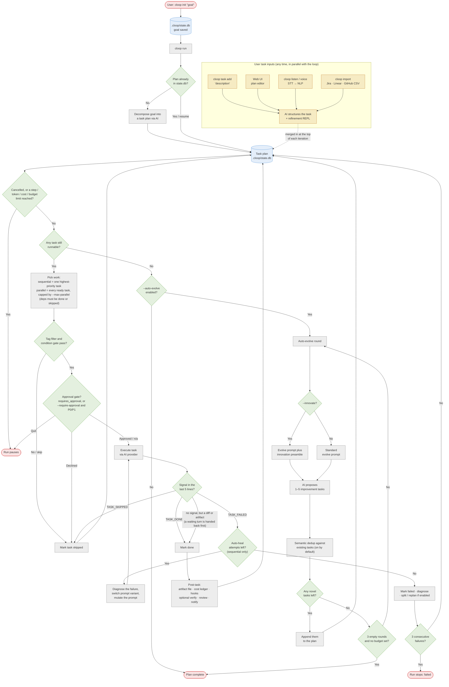

# How cloop works

You have run `cloop init` and `cloop run` once: cloop turned your goal into a
numbered list of tasks and worked through it. This page explains the rules
behind that loop, so that when a run stops, skips a task or adds work you
didn't ask for, you know why.

cloop is a Software Factory: you give it a goal, a task list or a
specification, and it turns that into a plan of tasks that coding agents carry
out one at a time while cloop checks each result. Every piece of work cloop
does is a task in that plan, and every plan is stored in the project's
database.

- [The loop at a glance](#the-loop-at-a-glance)
- [The goal and the plan](#the-goal-and-the-plan)
- [A task](#a-task)
- [The execution loop](#the-execution-loop)
- [When a task fails](#when-a-task-fails)
- [Auto-evolve](#auto-evolve)
- [Parallel execution](#parallel-execution)
- [Where execution happens](#where-execution-happens)

---

## The loop at a glance



---

## The goal and the plan

`cloop init "…"` records the goal and does nothing else. The first `cloop run`
sends the goal to the provider and asks for a JSON list of concrete tasks that
can each be done on their own, usually 5 to 15 of them. Each task has a
priority, an optional role, an optional `depends_on` list and a time estimate
(the prompt is built by `pm.DecomposePrompt`). If you are in a terminal and
haven't passed `--skip-clarify`, cloop first asks you a few questions about the
goal and adds your answers to that prompt.

The result is saved straight away as a `Plan`: the goal, the tasks and a
version number. A second `cloop run` doesn't plan again. It finds the saved
plan and carries on with it. To throw the plan away and plan again, use
`--replan`.

Everything is stored in **`.cloop/state.db`**, a SQLite database (`pkg/state`,
`pkg/statedb`). It holds the goal, the plan, the step history, token and cost
counters, the activity queue and the event journal. If cloop finds a
`.cloop/state.json` written by an older version, it moves the contents into the
database the first time it opens the project, and doesn't write the file again.
Each attempt at a task also leaves a Markdown file under `.cloop/tasks/` with
the provider's full response, and plan snapshots go to `.cloop/plan-history/`.

cloop reads the plan from disk at the start of every iteration, so changes made
elsewhere are picked up during a run. `cloop task add`, the dashboard's plan
editor, `cloop listen` and `cloop import` all write to the same plan.

---

## A task

A task (`pm.Task` in `pkg/pm/pm.go`) has many optional fields, but the loop
itself reads only these:

| Field | Meaning |
| --- | --- |
| `id` | a number, unique within the plan; a new task whose number is taken is renumbered |
| `title`, `description` | what the agent is told to do |
| `priority` | **1 is the highest**. Priorities are compared as numbers, so P1 runs before P2 |
| `status` | see below |
| `depends_on` | the IDs of tasks that must be `done` or `skipped` first |
| `tags` | labels of your choice; `--tags` limits a run to the tasks that have them |
| `role` | one of `backend`, `frontend`, `testing`, `security`, `devops`, `data`, `docs`, `review`. It adds a specialist system prompt, and can send the task to a different provider |
| `condition` | a check made before the task runs: `$cmd` runs a shell command, anything else is a yes/no question for the model |
| `deadline` | a task past its deadline is raised to P1 at the start of each iteration |
| `on_success`, `on_failure` | the tasks to start, or skip, depending on how this task ends |

The loop fills in the rest as it goes: `result`, `started_at`, `completed_at`,
`actual_minutes`, `artifact_path`, `fail_count`, `heal_attempts`,
`failure_diagnosis`, and `annotations`, a timestamped log of every decision
cloop made about the task. There are also optional fields for approval,
recurring tasks, per-task time limits, story points and links.

A task has one of **six** statuses: `pending`, `in_progress`, `done`,
`skipped`, `failed`, and `timed_out` for a task that ran past its time limit.

`in_progress` can also mean that the run working on the task died, so a new run
first sorts out every task left `in_progress`. It goes by what cloop itself
decided about the task, which is written to `.cloop/artifacts/<id>_verdict.json`
before the outcome is stored. A task that the review gate or a verification
step rejected therefore stays rejected, even if the agent printed `TASK_DONE`.
Without such a record, cloop uses the final signal in the agent's live output.
If there is none of that either, the task runs again.

`skipped` and `failed` decide what happens to the tasks that depend on a task.
A `skipped` dependency counts as **satisfied**, because a task that turned out
not to be needed shouldn't hold up the work after it. A `failed` or `timed_out`
dependency blocks the tasks that depend on it for good, so the loop marks them
`skipped`, with the reason, instead of leaving them waiting forever.

---

## The execution loop

At the start of each iteration, before it calls the provider, the loop checks
whether it should stop: whether you pressed Ctrl-C, or whether the run has
reached `--steps`, `--token-budget`, the project's `max_steps`,
`--cost-limit`, the daily `budget` setting or, with the `claudecode` provider,
the project's share of the Anthropic subscription. If any of these applies, the
run is set to `paused` and stops, and `cloop run` resumes it. If you cancel
while a task is running, that task is interrupted and goes back to `pending`
instead of being marked `failed`. Resuming starts it again, and the tasks that
depend on it are not skipped.

Next the loop **reads the plan from disk again**, adding tasks that were added
elsewhere and resetting recurring tasks whose cron schedule is due. Then it
applies **deadlines**: overdue tasks are raised to P1, and with
`--auto-promote`, tasks that are close to their deadline are raised too.

**Choosing the next task** is the job of `Plan.NextTask()`: it picks the pending
task with the lowest `priority` number whose dependencies are all `done` or
`skipped`. When priorities are equal, the task that comes first in the plan
wins. Pinning a task changes how lists are displayed, not what runs next. The
chosen task then passes the checks shown in the diagram (tag filter,
condition, optional risk check, optional approval) and runs: cloop builds a
prompt with `pm.ExecuteTaskPrompt` and calls the provider. The prompt contains
the goal and your constraints, this task, the completed tasks with short
summaries of their results, the upcoming tasks marked *do not work on these*,
matching snippets from your code, relevant knowledge-base entries and, if this
task failed before, the diagnosis from last time.

### The signal protocol

cloop doesn't use a structured output format. It asks the agent to end its
answer with one of three words on a line of its own, and then looks for it:

```
TASK_DONE      the task is complete
TASK_SKIPPED   the task is not applicable, or was already done
TASK_FAILED    the task could not be completed
```

`pm.CheckTaskSignal` trims the output, splits it into lines and looks at
**only the last 5 lines**. A line counts only if, after trimming spaces, it is
the word and nothing else: `TASK_DONE.` and `Result: TASK_DONE` don't count.
The first match in those five lines wins.

**A missing signal needs evidence.** If the agent doesn't print a signal, cloop
still marks the task `done`, with a note that it was completed implicitly, so
an agent that ends with a summary paragraph isn't penalized. But it does this
only if there is something to show for the run: a change in the repository, or
a non-empty artifact. The agent's process exiting is not enough, because
otherwise every refusal from a provider would count as a finished task
(`pkg/orchestrator/abort.go`).

If the output has no signal and is a recognisable refusal (a usage limit, a
used-up quota, a rejected credential, a harness that wouldn't start), cloop
treats it as an **abort**, not a failure. A failure says something about the
work; an abort means there was no work to judge. The task goes back to
`pending`, the event is logged under its own type, and the run waits for the
limit to reset or pauses for you, instead of running the rest of the plan into
the same limit.

If the output has no signal and is a *question*, cloop asks the agent, at most
twice, to decide for itself. If that doesn't settle it, the task fails; cloop
doesn't count it as done. In parallel mode there is no second prompt and the
task fails right away.

If the output has no signal and says the agent is **waiting** for something
("the suite is still running; I'll commit once it reports", "my monitor is
armed"), cloop hands the turn back, up to twice, in both modes. The agent is
behaving as it would in an interactive session, where the harness wakes it up
when the job finishes. In a cloop run nothing wakes it: the harness stops
whatever it left running, and nothing reports back. With the `claudecode`
provider the turn continues in the same conversation (`--resume`), so the agent
still knows what it was waiting for; other providers get their previous answer
back in a new prompt. If the turn still ends with the agent waiting, the task
is aborted as `unfinished_turn` and goes back to `pending`, not `done`, because
the work it describes never finished and was often never committed
(`pkg/orchestrator/unfinished.go`).

Matching phrases will always miss some new wording, so a project can also use
the working tree itself as the signal. With
**[done means committed](../guides/done-means-committed.md)** switched on
(`cloop require-committed`, or the *Done = Committed* badge on the Overview), a
turn that ends with changes from this attempt still uncommitted is handed back
with a list of them, whether it ended with `TASK_DONE` or without a signal.
With *pushed* also set, the same happens when its commits are not on the
branch's upstream. The same limit of two applies. If the turn still ends that
way, the task is aborted as `uncommitted_work`: it goes back to `pending`, the
work stays in the tree untouched, and the next attempt is held to the same rule
(`pkg/orchestrator/committed.go`).

One rule overrides even an explicit `TASK_DONE`. If the agent left processes
running, such as a build, a test suite or a training job, cloop waits for them.
If they never finish, the task is **not** accepted as complete, whatever the
agent printed, because its output describes work that hadn't finished
(`pkg/orchestrator/background.go`).

With `--verify`, a task marked `done` gets a second pass from the model, which
looks at the actual files and answers `VERIFY_PASS` or `VERIFY_FAIL`, read with
the same last-5-lines rule. A failure sets the task back to `pending`, up to
`--max-verify-retries` times (2 by default), and then fails it.

---

## When a task fails

`TASK_FAILED` doesn't mark the task failed straight away. In sequential mode,
**auto-heal** runs first. Each attempt asks the provider to diagnose what went
wrong, saves the diagnosis on the task as `failure_diagnosis` and as a
`[HEAL n/m]` annotation, switches to a better prompt variant if the A/B
statistics suggest one, and runs the task again with the diagnosis added to the
prompt. By default there are **2 attempts** (`--heal-retries`; `0` means the
default), and `--no-heal` turns auto-heal off. If the provider returns an error
or an empty response during a heal attempt, cloop treats it as a temporary
problem: the task stays failed and the next attempt runs.

When the heal attempts run out, the task is marked `failed` and its
`fail_count` goes up. Then the optional recovery features get their turn:
`--diagnose` saves a fresh analysis of the cause for the next retry,
`--auto-split` asks the model to split a task that has now failed twice into
2–5 smaller tasks that replace it, and `--adaptive-replan` rethinks all the
remaining pending work in light of the failure. A successful split or replan
resets the failure count, because the plan is now different.

**Stopping after repeated failures.** The loop counts failures in a row. Any
success or skip resets the count to zero. When it reaches the limit, **3** by
default (`--max-failures`), the run's status is set to `failed` and cloop exits
with an error. Because only failures in a row count, a plan can get through
many failures as long as tasks keep succeeding in between. Every kind of
failure counts: failure signals, failed verifications (by the model or by a
script), tasks that run out of time, and provider errors. A task that runs out
of time counts towards the same limit but gets a status of its own, and a
marker artifact with whatever output it had produced. There is no time limit by
default; you can set one per task (`max_minutes`), per project or per process.

---

## Auto-evolve

When no task can run and the plan is complete, the run normally ends with the
status `complete`. With `--auto-evolve` it doesn't: an empty queue starts a new
round of work instead.

Before either happens, the loop looks through the plan for tasks marked done
whose saved summary is a refusal and not a description of work
(`pkg/orchestrator/abort_sweep.go`). Refusals are recognised as they happen,
but tasks recorded before cloop could recognise them may still be marked
`done`, and a plan that relies on them isn't really finished. Each one it finds
is set back to `pending`, and the reason is saved on the task, so it survives a
reload and the dashboard can show it.

A refusal summary shows that *that run* produced nothing, but the work may
still exist because a later task did it. So you can also **clear** a finding,
with a note saying where the work actually is. A cleared entry stays visible as
a bad record but no longer stops the plan from completing. You can do either
from the Tasks tab, or with `cloop task audit-ledger --reopen|--clear`.

An evolve round calls the provider with `pm.EvolveDiscoverPrompt`. The prompt
lists the completed tasks with their result summaries and asks for
**1 to 5 new improvement tasks** covering features, tests, documentation,
performance, security, UX and refactoring. `--innovate` keeps that list but
adds a short instruction to think creatively about new capabilities.

If the project has approved [requirements](../guides/requirements.md), the
round takes them into account. The model sees where each requirement stands,
every task it adds is linked to the requirements it addresses, and open
**must** requirements come before anything new: the tasks that close them run
first, and if the model leaves a must requirement open, cloop adds a task for
it. See
[Planning from the requirements](../guides/requirements.md#auto-evolve-and-the-suggestions-panel).

The suggested tasks are then filtered. Semantic deduplication is **on by
default**: a second call to the provider compares the suggestions with the
existing plan and drops anything the plan already covers, even if it is worded
differently. A suggestion linked only to requirements that an open task already
implements is dropped before the provider is asked. If the provider call fails,
all suggestions are kept, so new work isn't lost by mistake; `--no-dedup` skips
the step. The remaining tasks are renumbered so their IDs don't clash, and
added to the plan. From then on they are ordinary tasks: they show up in
`cloop status`, you can edit them and make other tasks depend on them, and the
same loop runs them. Everything auto-evolve adds is visible in the plan.

Two things limit auto-evolve. Every round increases `evolve_step` and is
written to the activity log, even when it finds nothing. And if
**three rounds in a row find no new tasks** while no `--token-budget` or
`--steps` limit is set, the run stops by itself. When a budget *is* set, the
budget decides when to stop, and evolving continues until it runs out.

---

## Parallel execution

`--parallel` (or `--max-parallel N` / `-j N`, which also turn it on) changes
how tasks are chosen, from `Plan.NextTask()` to `Plan.ReadyTasks()`: every
pending task whose dependencies are met starts at once, up to the current
`max_parallel` value. cloop reads that limit again every round, so a change you
make in the dashboard applies to the next batch. If you switch parallel mode on
or off during a run, the loop switches over without restarting the process.
Each result is handled as soon as its task finishes, without waiting for the
rest of the batch, and a crash inside a provider fails only that one task.

By default all tasks share one working directory. That works when they touch
different files, and goes wrong when they don't. If the project is a git
repository, `--worktree-parallel` solves this:

- Each task gets its own worktree at `.cloop/worktrees/task-<id>/`, on a branch
  named `cloop/task-<id>-<slug>` (`pkg/worktree`), and the provider works in
  that directory, so tasks can't overwrite each other's changes.
- When a task is `done`, its worktree is committed and its branch goes into a
  **merge queue** (`pkg/mergequeue`). The queue merges one branch at a time, in
  order, so each merge starts from the previous one. The loop waits for its
  merge before starting the next round. If there is a conflict, an AI resolver
  gets the first try. If it gives up, resolves too few files or leaves conflict
  markers behind, the merge is aborted and the branch is left for you to
  resolve, with the reason noted on the task.
- When a task is `failed` or `skipped`, nothing is merged. In every case the
  worktree directory is removed but **the branch is kept**, so you can still
  look at the work.

If the project isn't a git repository, or its base branch can't be found, cloop
prints a notice and uses the shared directory instead of failing.

Parallel mode leaves a lot out. Auto-heal, verification by the model or by a
script, failure diagnosis, auto-split, adaptive replanning, the approval gate,
interactive review, coaching, risk checks and the multi-agent pipeline all work
in **sequential mode only**. In parallel mode a `TASK_FAILED` fails the task on
the first attempt. Use parallel mode when the tasks really are independent and
you want them done sooner; use sequential mode when you want cloop to recover
from failures.

---

## Where execution happens

Everything above is about what the orchestrator decides. Where the agent
actually runs is a separate question. When you type `cloop run` in your own
terminal, the orchestrator runs in your shell and calls the provider from
there. A run started from the hub or the web dashboard is different, because
the hub never starts the harness next to itself. Instead, `cloop run` itself
becomes the workload. It is handed to whichever **executor** the project is
bound to (a local process, a container, a Kata VM, an enrolled edge device or a
short-lived Kubernetes Pod), together with instructions for getting the source
code there and a short-lived lease holding any credentials the task needs. When
the sandbox doesn't share the hub's filesystem, a completed task records
`write_back_branch` and `write_back_commit` so that you can find the work.

[The executor architecture](../architecture/executors.md) describes all of
this: the `Executor` interface, the four backends, how an executor is chosen,
how the code gets into the sandbox, health checks and failover.

---

## See also

- [Your first project](first-project.md): from an empty directory to a finished
  plan
- [Providers](providers.md): which backend handles the prompts, and how the
  model is chosen
- [Command reference](../reference/commands.md): every flag mentioned on this
  page
- [Executor architecture](../architecture/executors.md): where a task actually
  runs
