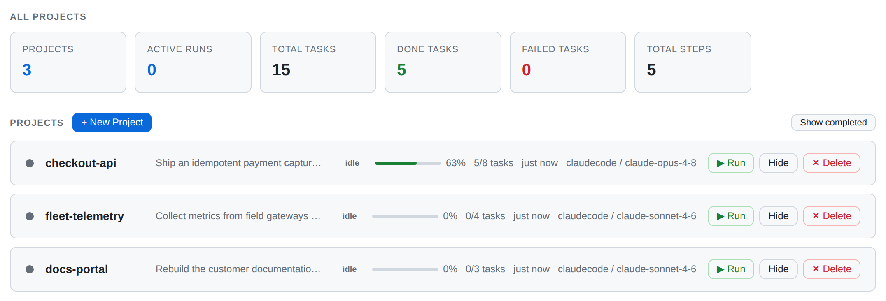
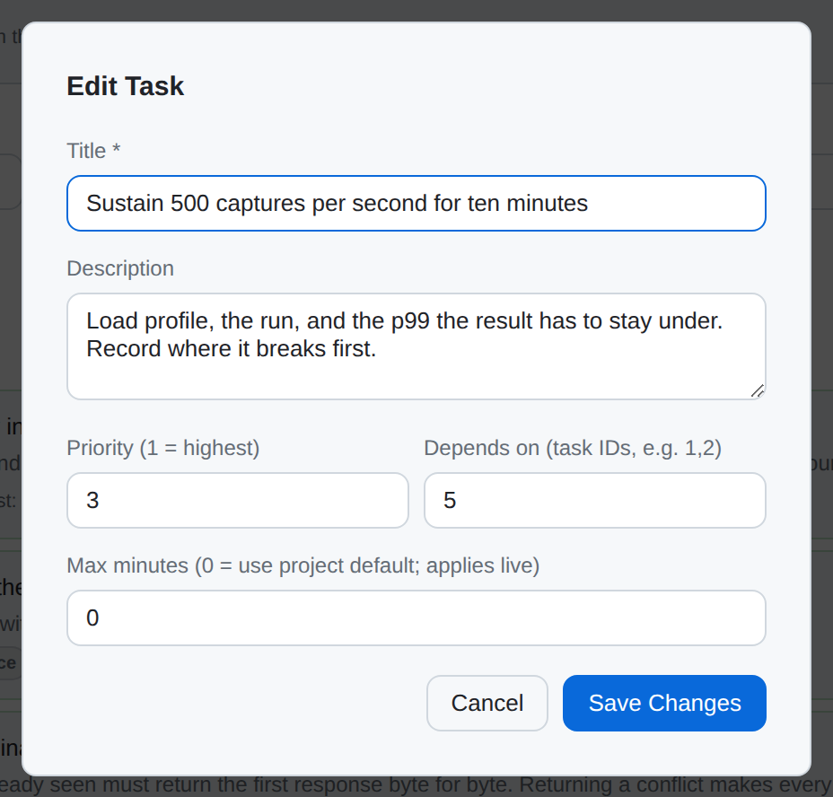
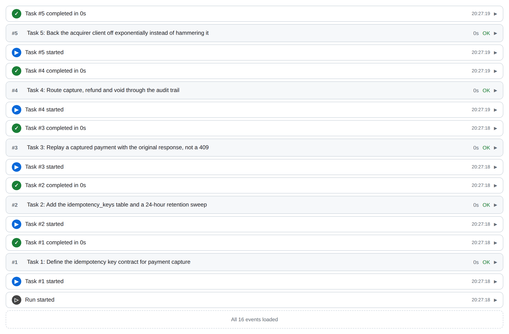

# A walkthrough of the dashboard

[Your first project](first-project.md) goes through a first run from the
terminal. This page does the same from the browser, in three steps: you decide
where work is allowed to run, create a project that runs there, and then add
tasks and start it.

Do these in that order. Executors (the places where work runs) belong to the
whole hub, and each project points at one. If you create a project before there
is a suitable executor, it runs wherever the hub accepts it, and on a default
install that is a child process of the dashboard itself.

- [Before you start](#before-you-start)
- [1. The fleet view](#1-the-fleet-view)
- [2. Decide where work runs](#2-decide-where-work-runs)
- [3. Add a device](#3-add-a-device)
- [4. Create a project](#4-create-a-project)
- [5. The project's control panel](#5-the-projects-control-panel)
- [6. The plan](#6-the-plan)
- [7. Run it, and watch](#7-run-it-and-watch)
- [8. Settings](#8-settings)
- [Where to go next](#where-to-go-next)

The screenshots come from a real, throwaway hub with three invented projects,
which `scripts/screenshots/capture.sh` builds from scratch.

---

## Before you start

```bash
cd ~/Projects/checkout-api
cloop ui
```

The dashboard starts on port 8080 and opens in your browser. With no token and
no SSO configured, it doesn't ask anyone to sign in, so it only listens on
`127.0.0.1`. That is the right default for a laptop. Before you put the
dashboard on a network, read
[what it authenticates by default](web-ui.md#what-it-authenticates-by-default).
To reach it from other machines, set up [OIDC](../security/model.md) first. The
hub then listens on every interface.

---

## 1. The fleet view



**Projects** is the hub's front page, and the only tab that shows the whole hub
at once. Counters run across the top. Below them is one row per registered
project, with its goal, a status pill, a progress bar, `done/total` tasks, when
it last did anything, and the provider and model it will use on its next run.

Click a row to open that project in the **Project** tabs, to the left of the
divider in the tab bar. The tabs to the right of the divider (Projects, Budget,
Executors, Settings) are hub-wide. The two groups are labelled because a setting
you change on a Global tab changes it for every project on the hub.

---

## 2. Decide where work runs


An **executor** is where a harness runs. The Executors tab lists all of the
hub's executors. To decide whether a project should use one, look at two things
on its card: what it isolates, and whether it is reachable right now.

| Kind | What runs where | What a task can reach |
| --- | --- | --- |
| `localprocess` | a child process of the dashboard | this server's user, filesystem and network, with no isolation |
| `container` | a Docker/Podman sandbox on this server | only what the sandbox spec and the egress rules allow |
| `remote` | an enrolled device that dialled out to the hub | that device, under the sandbox mode set on its card |
| `kubernetes` | a Pod in a cluster | its namespace, under a per-Pod NetworkPolicy |

Read the two amber banners at the top of the tab. The first says that host execution is enabled
(`executors.allow_host_process: true`). That is the default, and most of this
documentation recommends turning it off once you have a better place to run
work. The second says that the container executor is on network `none`, so
sandboxed work has no network access at all. A project that needs to reach a package
registry needs [egress configured](../reference/configuration.md#ip-layer-egress-filtering)
or a grant from the egress broker.

You manage an executor with the buttons on its card:

- **History** shows in-flight work, recent completions, and whether anything ran
  on the host.
- **Sandbox** (enrolled devices only) sets whether work runs on the device's
  host or in a container on it, and under which runtime. For a driver the hub
  builds itself, this is already set in `config.yaml`, so its card has no
  Sandbox button.
- **Limits** sets the most CPU, memory, disk and processes that any one workload
  on this executor may get.
- **Access** sets which users and groups may place work on this executor.
- **Cordon** stops new work from being placed here without disturbing what is
  running. On an enrolled device it also takes back the credentials the device
  holds. **Drain** retires the executor and waits for in-flight work to finish.
- **Upgrade** and **Revoke** are for enrolled devices only.

Use Cordon or Drain before you do anything destructive to an executor. A
cordoned executor keeps its running work and takes no new work. `cloop executor
cordon` and `drain` do the same from a terminal, and report which hub member
took the device's credentials back.

---

## 3. Add a device


**+ Enroll device** creates a single-use token and shows the command to run on
the machine you are adding:

```bash
cloop executor agent --server wss://hub.example.com/api/executors/connect \
                     --token <the token it printed>
```

The device connects out to the hub, so a laptop, a build box or a machine on a
factory network behind NAT can join without an inbound firewall rule or a
forwarded port. The hub never connects to the device.

The token works once and expires after 15 minutes by default, and the dialog
shows it only once. A lost token can't be recovered, but creating another takes
one click. Once the agent connects, the device appears as a `remote` card that
shows its build, its CPU and memory, the container runtimes it found and the
harnesses it has installed.
Set its **Sandbox** mode and **Limits** before you point a project at it.

[Edge-device onboarding](../architecture/executors.md) has the full details,
including the hardened systemd unit and certificate pinning.

---

## 4. Create a project


**+ New Project** on the Projects tab needs a directory and a goal. Everything
else in the dialog is optional.

cloop turns the goal into the plan, so a goal that names an outcome and its
constraints produces a better plan than one that only names a technology.
*"Ship an idempotent payment capture API with end-to-end audit coverage"* gives
the planner something to work with. *"payments"* doesn't.

Open the **Access** section. It is collapsed by default because an ordinary
single-user project needs neither of its two settings, but it is the part of
this dialog that this walkthrough is about:

- **Executor** pins where this project's harness runs. If you leave it on
  *Default (hub decides)*, the hub chooses, and on a default install that means
  the host.
- **Grants** lease stored secrets to the project: a GitHub repository, a
  personal access token, a kubeconfig, or an allowance on the hub's own Internet
  connection. Each row scopes one credential to this project.

Both are applied when the project is created. If the executor or any grant is
refused, the whole project is rolled back, so a mistyped secret name doesn't
leave a half-created project behind.

A device doesn't get your Claude login. Signing in to Claude Code from Settings
only authenticates harnesses that run on the hub itself. A harness in a
container, in a Pod or on an enrolled device gets credentials only through a
grant ([why](../security/claude-code-identity.md#isolating-executors-do-not-get-a-directory)).
So a `claudecode` project bound to one of these also needs a Claude credential
granted to it: `CLAUDE_CODE_OAUTH_TOKEN` (from `claude setup-token`) or
`ANTHROPIC_API_KEY`.

The hub checks for one before it starts anything. If there is none, or the
sandbox would lose it within ten minutes, Run is refused with
`harness_credential_missing` (or `_expiring`) and the name of the executor, and
no sandbox starts. The project's Overview shows a red **Claude credential** card
beside the Executor card. The refused Run and the card both open a dialog that,
in one step, either grants an `env` secret you already have, or takes a token
pasted from `claude setup-token` and stores it as your own secret. The grant
lasts 30 days unless you choose otherwise, and the card turns amber three days
before it ends. On a hub with single sign-on, that personal token is only used
for runs you start. Other people on the project need their own token or a shared
one ([details](../guides/secrets.md#the-claude-credential-of-a-sandboxed-run)).

Repositories work the same way, with one default to watch. The project's
**Repositories** panel assigns *Read only* unless you pick *Read and write*, and
read-only access is enough to clone but not to push. You can limit *Read and
write* to particular branches, for example `cloop/*` to keep the agent off
`main`. The hub's git proxy enforces that limit. On a hub without the proxy, a
GitHub App assignment with branches is delivered read-only instead
([why](../guides/secrets.md#limiting-pushes-to-particular-branches)). The
harness is told which repositories it has, whether it may push and to which
branches, and it clones them itself.

When the Grants list is empty, it says *"No grants — the project starts able to
reach nothing."* Nothing in this dialog defaults to allowing everything. An
empty allowlist is rejected as a mistake instead of being read as
"unrestricted" (see [secrets and egress](../guides/secrets.md)).

---

## 5. The project's control panel


Click a project to open its **Overview**. From top to bottom it shows the goal,
instructions, stats, options, controls, live output and event history.

Four of the stat cards are also buttons. **Claude credential** opens the grant
dialog described in the previous section, and **Review gate** sets up a
[reviewer model](../guides/review-gate.md) that checks each task's changes
before they are pushed or merged. **Provider** opens a provider and model
picker. Your choice is saved on the project and used by every run until you
change it. **Executor** opens the dialog this walkthrough is about:


The Executor card reads **pinned** or **default**. That tells you whether
someone chose where this project runs, or whether the hub decides. A change
here takes effect on the next run. Work already in flight stays on the executor
that started it, because a running task can't be moved safely between machines.

**Active Options** holds the run flags. Click a badge to turn a flag on or off;
the Run button has no options dialog. The flags are stored on the project, so
the dashboard and the CLI use the same ones: a badge you turn on here is a flag
that `cloop run` will use. `Max Parallel`, `Step Timeout` and `Task Timeout` are
in the same card. A new Task Timeout also applies to tasks that are already
running, within a few seconds, and not only to the next one.

---

## 6. The plan


The **Tasks** tab shows the plan. Each row is a task with an ID, a status and,
once it has run, a stored result. Because results are stored per task, progress
survives a restart, and a failure shows which task it belongs to.

To add a task, fill in the inline form: a title, an optional description, a
priority (`1` is highest) and a comma-separated list of the task IDs it depends
on. **Add Task** adds it straight away, whether or not a run is going. The
description is the brief the agent works from, so its box takes several lines:
Enter starts a new line, and Ctrl+Enter (⌘+Enter on a Mac) adds the task.
**Decompose**, next to it, takes the same fields but asks the AI to break the
task into several smaller ones. They are proposed below the form, each with the
priority and dependencies you typed, and you can add them one by one or all at
once.

The list is also the run queue. Tasks run from top to bottom, and dragging a
row changes the priorities the scheduler reads. This works during a run too,
because the orchestrator reads the order again on every iteration. Three rules
apply:

- **Dependencies come first.** A task dragged to the top still waits for the
  tasks it depends on. The order only decides between tasks that are ready to
  run.
- **Only pending tasks have a position.** Completed and running rows have no
  drag handle, because both have already left the queue.
- **Pinned tasks stay at the top.** A drag across the divider below them is
  refused, and nothing changes.

The screenshot above has **Show completed** turned on. By default finished
tasks are hidden, and the header says how many. Each done task shows the
summary the run produced, so the list still makes sense weeks later.



**Edit** opens the same fields plus a per-task **Max minutes** budget, where `0`
means the project default. The other buttons on a row set its status directly,
and which ones a row has depends on its current status. A pending task has
**Done**, **Skip**, **Fail**, **Split**, **Edit** and **Remove**. A finished
task has **Reset** in place of Done and Split, since there is nothing left to
mark done or split. After a failure, use **Reset** to put the task back in the
queue. Setting the status of a task that is running also aborts the task.

The same plan is also shown as **Kanban** (four draggable columns), **Timeline**
(a Gantt chart), **Dependencies** (a graph) and **Activity** (every execution,
heal retry and evolve cycle for each task).

---

## 7. Run it, and watch

**Start run** is at the top of the Tasks tab, so you can start the plan from the
page where you edited it. The same button is on the Overview and on every row of
the Projects tab, and they all do the same thing. Next to it you see the
project's status, worded as on the Overview (a paused project says why), and an
**Evolve Mode** chip when that option is on.



**Event History** on the Overview records what happened, in one stream: steps,
and also task starts, completions, failures, skips, heal retries, evolve cycles
and manual status changes. **Live Output** above it shows the running step's
output as it arrives. The hub pushes both over a WebSocket, so they stay current
without a refresh. Behind a proxy that blocks the WebSocket upgrade, the page
falls back to server-sent events and keeps working.

A run on an enrolled device reports back when it ends. The plan on the
dashboard belongs to the hub, and a run on a device works on a copy that is sent
with it. While the run is going, Live Output streams from the device, but the
task list doesn't change. When the run ends, the device sends back what changed
(the tasks it finished or added, its steps, events and spend), and Event History
gets a *project_result* row that says what came back. If you changed a task on
the hub while the run was away, your change is kept, and the row says so too. If
the agent is too old to report back, the row says that it needs an upgrade.
**Upgrade** on the device's card fixes that.

When every task is done, the run stops. With **Evolve Mode** on, the agent
proposes new work instead, and the new work is added as tasks that you can
review and reject. [How cloop works](concepts.md#auto-evolve) explains what it
looks at when deciding. While it decides, the project shows **Evolving** and the
run is still live. **Pause / Stop** ends the round, and the next start picks it
up again.

---

## 8. Settings


**Settings** is global, not per-project. The **Configuration** section edits the
same provider keys that `cloop config set` writes: the default provider, and for
each backend a model, a base URL and an API key. Each card saves on its own. API
keys are write-only: leave the field blank to keep the existing key. A *no key*
badge marks a backend that has none. For help picking a backend, see
[Choosing and configuring a provider](providers.md).

Further down the same tab are **Display glasses** (a personal, expiring link for
Meta Ray-Ban Display glasses), **Hidden Projects**, and a **Danger Zone**, whose
*Reset Project State* clears the step history but keeps the goal and
configuration.

Hiding a project removes it from your dashboard only. It keeps running, and
other users still see it. **Hidden Projects** shows only how many projects you
have hidden. Their names appear in a dialog when you ask for them, so they don't
show up on screen when you open this tab for something else.


The last panel turns a single-user hub into a shared one. **Single sign-on
(OIDC)** signs dashboard users in through your identity provider instead of with
a shared token. With it on, every browser request needs a provider session,
each project is owned by the user who created it, and roles come from the claims
your IdP releases.

Two settings here matter most. The client secret is optional. If you leave it
blank, the hub signs in as a public client using PKCE, so there is no secret to
leak. The default role decides whether a role policy applies at all. **none**
denies everything that a mapping doesn't grant. If you leave it unset and add no
mapping, RBAC stays off, and everyone who can sign in through your provider gets
full access. The panel asks you to confirm before saving that, and keeps warning
you, next to an **Enforce deny-by-default** button, until a policy is in place.
SSO can only be turned on once there is at least one admin email or a claim
mapping that grants `admin`, because a hub without an administrator can't be
administered. [The security model](../security/model.md#when-rbac-is-in-force)
has the full details.

---

## Where to go next

- **[How cloop works](concepts.md)**: the loop behind the Tasks tab, including
  how a task is picked, how cloop knows it is finished, and what happens when it
  fails.
- **[The web dashboard](web-ui.md)**: a reference for the same UI, with every
  tab, every run option and the glasses view.
- **[Executors](../architecture/executors.md)**: how a task gets from the
  orchestrator to a sandbox and back, and what enrolling a device sets up.
- **[Secrets and egress](../guides/secrets.md)**: what a grant is, when a lease
  expires, and how a sandbox gets a credential without being able to keep it.
- **[Enterprise hosts](../guides/enterprise-hosts.md)**: per-project
  repositories, firewall rules, gVisor and Kata runtimes, and passing hardware
  into a sandbox.

---

↩ [getting started](README.md) · [documentation map](../README.md)
